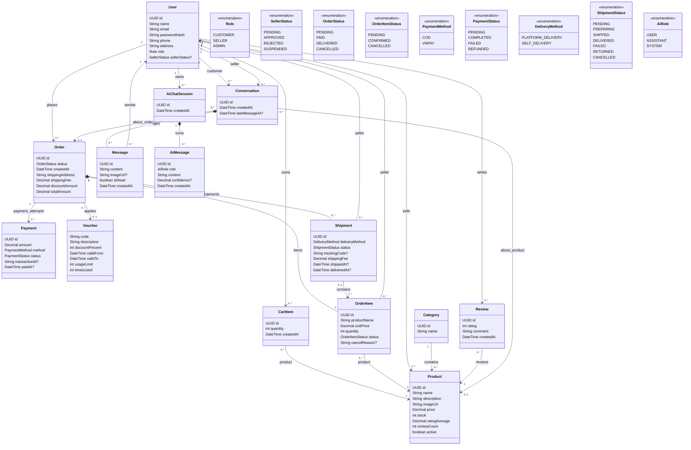

# Domain Class Diagram

## 1. Full Mermaid view

This diagram is the Mermaid documentation view of
[`ECommerce_Marketplace_Class_Diagram.puml`](https://github.com/anhhoang19122005/E-Commercial-Market-Place/blob/main/ECommerce_Marketplace_Class_Diagram.puml). The
PlantUML file remains the source reference for the complete class model.

## 2. Important interpretation rules

- `sellerStatus` applies only when `User.role = SELLER`.
- `OrderItemStatus` describes seller processing; `ShipmentStatus` describes delivery progress.
- `OrderStatus` is an order-level aggregate; seller-specific `FAILED` and `RETURNED` outcomes belong
  to `ShipmentStatus`.
- `OrderItem.productName` and `OrderItem.unitPrice` preserve checkout history.
- A shipment contains order items from exactly one seller.
- A shipment contains order items from exactly one order; `Shipment.order == OrderItem.order` for
  every mapped item. In the MVP, mappings use whole order-item lines and one `OrderItem` belongs to at
  most one `Shipment`.
- `FAILED` does not restore stock. `RETURNED` means the package reached the seller warehouse and is
  the only shipment transition that restores its shipped quantity.
- Prepayment orders expire 24 hours after creation when payment is incomplete; COD is collected only
  when all required non-cancelled shipments are delivered. Mixed `FAILED`/`RETURNED` outcomes have no
  partial COD settlement in the MVP.
- Mixed terminal outcomes remain seller-scoped on `ShipmentStatus`; the model does not invent an
  order-level failure enum.
- Direct item cancellation is allowed before shipment assignment; assigned unshipped lines use the
  atomic shipment-cancellation path, while `SHIPPED` or later lines cannot be cancelled.
- Before payment completion, cancellation recalculates the current order payable total and pending
  payment amount from remaining line snapshots; all-cancelled orders become `CANCELLED`.
- Guest AI product search is stateless/public; persisted `AiChatSession` data belongs to `CUSTOMER`.
- One order may have multiple payment attempts so failed VNPAY attempts can be retried.
- Human chat and AI chat are separate concepts.
- AI is read-only for Order, Payment, and Shipment in the initial design.

## 3. Feature-level diagrams

Use the focused diagrams for implementation work:

- [`features/auth/README.md`](features/auth/README.md)
- [`features/user/README.md`](features/user/README.md)
- [`features/catalog/README.md`](features/catalog/README.md)
- [`features/cart/README.md`](features/cart/README.md)
- [`features/order/README.md`](features/order/README.md)
- [`features/payment/README.md`](features/payment/README.md)
- [`features/shipment/README.md`](features/shipment/README.md)
- [`features/voucher/README.md`](features/voucher/README.md)
- [`features/review/README.md`](features/review/README.md)
- [`features/chat/README.md`](features/chat/README.md)
- [`features/ai/README.md`](features/ai/README.md)
- [`features/common/README.md`](features/common/README.md)
