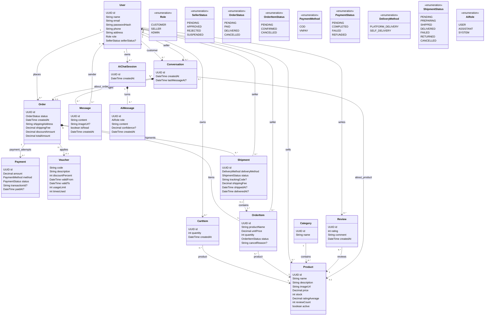

# Sơ đồ class miền

## 1. Khung nhìn Mermaid đầy đủ

Sơ đồ này là Mermaid documentation view của
[`ECommerce_Marketplace_Class_Diagram.puml`](https://github.com/anhhoang19122005/E-Commercial-Market-Place/blob/main/ECommerce_Marketplace_Class_Diagram.puml). File
PlantUML vẫn là source reference cho complete class model.

## 2. Quy tắc diễn giải quan trọng

- `sellerStatus` chỉ áp dụng khi `User.role = SELLER`.
- `OrderItemStatus` mô tả seller processing; `ShipmentStatus` mô tả delivery progress.
- `OrderStatus` là order-level aggregate; các `FAILED` và `RETURNED` outcomes seller-specific thuộc
  về `ShipmentStatus`.
- `OrderItem.productName` và `OrderItem.unitPrice` bảo lưu checkout history.
- Một shipment chứa order items từ đúng một seller.
- Một shipment chứa order items từ đúng một order; `Shipment.order == OrderItem.order` cho
  mọi mapped item. Trong MVP, mappings dùng whole order-item lines và một `OrderItem` thuộc về tối
  đa một `Shipment`.
- `FAILED` không khôi phục stock. `RETURNED` nghĩa là package đã tới seller warehouse và là
  shipment transition duy nhất khôi phục shipped quantity của nó.
- Prepayment orders hết hạn 24 giờ sau khi tạo khi payment chưa complete; COD chỉ được collected
  khi mọi required non-cancelled shipments đã delivered. Mixed `FAILED`/`RETURNED` outcomes không có
  partial COD settlement trong MVP.
- Mixed terminal outcomes vẫn seller-scoped trên `ShipmentStatus`; model không invent
  order-level failure enum.
- Direct item cancellation được phép trước shipment assignment; các assigned unshipped lines dùng
  atomic shipment-cancellation path, trong khi các lines `SHIPPED` hoặc sau đó không thể cancelled.
- Trước payment completion, cancellation tính lại current order payable total và pending
  payment amount từ remaining line snapshots; các all-cancelled orders trở thành `CANCELLED`.
- Guest AI product search stateless/public; persisted `AiChatSession` data thuộc về `CUSTOMER`.
- Một order có thể có nhiều payment attempts để failed VNPAY attempts có thể retried.
- Human chat và AI chat là các khái niệm tách biệt.
- AI read-only đối với Order, Payment và Shipment trong thiết kế ban đầu.

## 3. Sơ đồ cấp feature

Dùng các focused diagrams cho công việc implementation:

- [`features/auth/README.vi.md`](features/auth/README.vi.md)
- [`features/user/README.vi.md`](features/user/README.vi.md)
- [`features/catalog/README.vi.md`](features/catalog/README.vi.md)
- [`features/cart/README.vi.md`](features/cart/README.vi.md)
- [`features/order/README.vi.md`](features/order/README.vi.md)
- [`features/payment/README.vi.md`](features/payment/README.vi.md)
- [`features/shipment/README.vi.md`](features/shipment/README.vi.md)
- [`features/voucher/README.vi.md`](features/voucher/README.vi.md)
- [`features/review/README.vi.md`](features/review/README.vi.md)
- [`features/chat/README.vi.md`](features/chat/README.vi.md)
- [`features/ai/README.vi.md`](features/ai/README.vi.md)
- [`features/common/README.vi.md`](features/common/README.vi.md)
