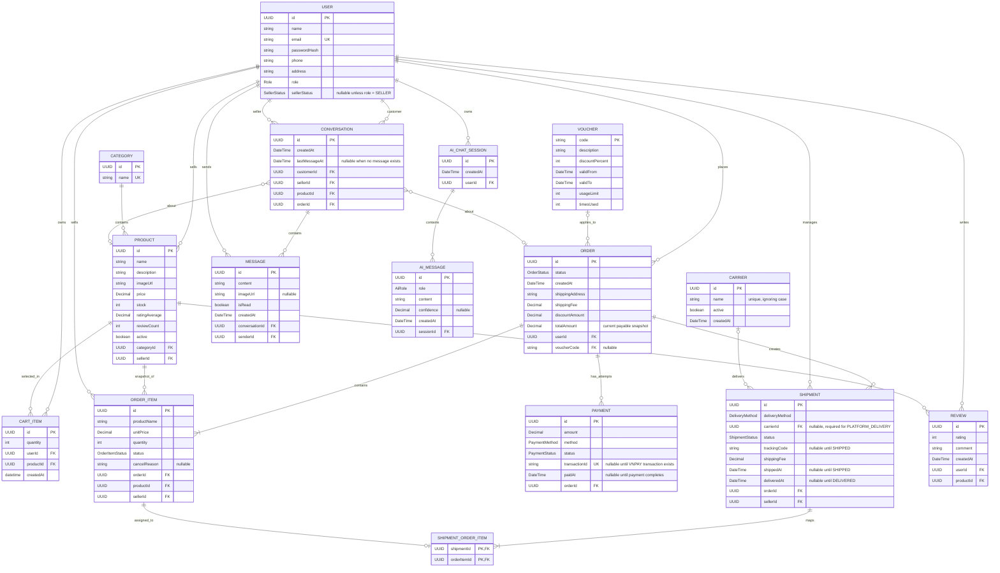

# Entity Relationship Diagram (ERD)

## 1. Logical data model

This is a logical ERD derived from the class diagram and database plan. It describes domain
relationships, not a final SQL migration. The planned shipment-to-order-item mapping may be persisted
through `shipment_order_items` as described in [`PLAN.md`](https://github.com/anhhoang19122005/E-Commercial-Market-Place/blob/main/PLAN.md).



## 2. Data constraints

- `USER.email` is unique.
- `CATEGORY.name` is unique.
- A published `PRODUCT` has an `imageUrl`; the MVP uses one product image.
- `PRODUCT.ratingAverage` and `PRODUCT.reviewCount` are catalog read values derived from eligible reviews.
- `PRODUCT.ratingAverage` is between `0` and `5`, and `PRODUCT.reviewCount` is not negative.
- The MVP does not model `PRODUCT` variants; color/size inventory belongs to a later `ProductVariant` design.
- `(CART_ITEM.userId, CART_ITEM.productId)` is unique and quantity is at least 1.
- `(REVIEW.userId, REVIEW.productId)` is unique and rating is in `[1..5]`.
- `PRODUCT.price > 0`, `PRODUCT.stock >= 0`, and `active = false` means soft-deleted/unlisted.
- `ORDER_ITEM.productName` and `ORDER_ITEM.unitPrice` are checkout snapshots.
- `SHIPMENT` items must belong to one seller, and `Shipment.seller == OrderItem.seller`.
- `SHIPMENT.orderId == ORDER_ITEM.orderId` for every `SHIPMENT_ORDER_ITEM` row.
- In the MVP, `(shipmentId, orderItemId)` is unique and each `orderItemId` appears in at most one
  shipment. The mapping uses the complete order-item line; no mapping quantity is stored.
- An MVP order has at most one shipment per seller; split and replacement shipments are deferred.
- VNPAY transaction/reference identifiers are unique where applicable.
- `trackingCode` and `shippedAt` are required when shipment status is `SHIPPED`.
- `deliveredAt` is required when shipment status is `DELIVERED`.
- `FAILED` is a seller-scoped shipment result and does not restore stock.
- `RETURNED` is valid only after the package reaches the seller warehouse; only that transition may
  restore the quantities from the shipment.
- A prepayment order is cancelled 24 hours after `ORDER.createdAt` when payment is incomplete;
  checkout stock is restored exactly once. COD follows the delivery collection rule.
- COD remains `PENDING` until all required non-cancelled shipments are `DELIVERED`; partial COD
  settlement for mixed `FAILED`/`RETURNED` outcomes is deferred.
- Mixed terminal outcomes remain on seller-scoped `SHIPMENT.status`; no order-level failure status is
  inferred.
- Direct order-item cancellation is allowed before shipment assignment. An assigned `PENDING`/
  `PREPARING` shipment is cancelled atomically by marking its mapped lines `CANCELLED` and releasing
  unshipped stock exactly once; cancellation after `SHIPPED` is rejected. This release is distinct
  from stock restoration after `RETURNED`.
- Before payment completion, that cancellation recalculates `ORDER.totalAmount` and pending
  `PAYMENT.amount` from the remaining line snapshots. If all lines are cancelled, the order becomes
  `CANCELLED`; if delivered non-cancelled lines are all that remain, aggregate completion is reevaluated
  in the same transaction.
- Money is stored and transported as `VND`; the MVP shipping fee is fixed at `0.00`.
- One order uses at most one voucher.
- One order may have multiple payment attempts.
- `USER.sellerStatus` is nullable for non-sellers. `ORDER.voucherCode`, `ORDER_ITEM.cancelReason`,
  payment timestamps/transaction IDs, shipment timestamps/tracking code, optional chat fields, and
  AI confidence are nullable as described in the diagram.

## 3. Migration order

```text
V1  users
V2-V11 historical placeholders (do not edit after Flyway records them)
V12 refresh_tokens
V13 domain tables: categories, products, cart_items, orders/items, vouchers, payments,
    shipments/mapping, reviews, conversations/messages, ai_chat_sessions/messages
V14 password_reset_codes (Phase 1 addition)
V15 cart_items.created_at (Phase 3 cart ordering)
V16+ pgvector extension and AI document/vector tables (deferred until the RAG schema is finalized)
```
