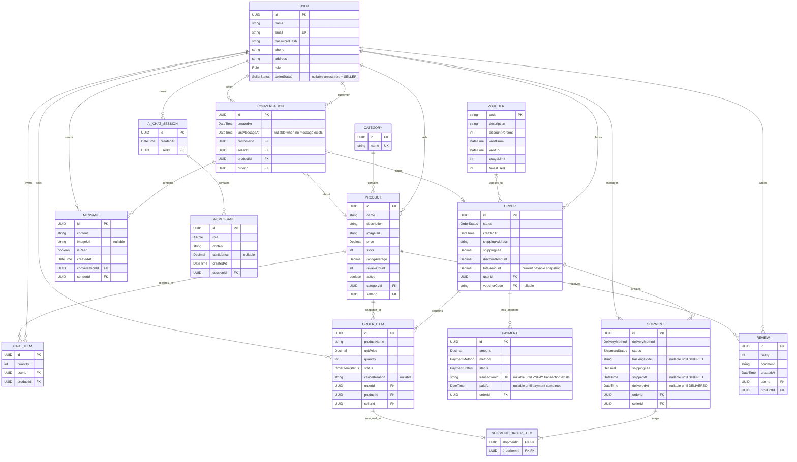

# Sơ đồ quan hệ thực thể (ERD)

## 1. Mô hình dữ liệu logic

Đây là logical ERD dẫn xuất từ class diagram và database plan. Nó mô tả domain
relationships, không phải SQL migration cuối cùng. Planned shipment-to-order-item mapping có thể được persisted
qua `shipment_order_items` như mô tả trong [`PLAN.md`](https://github.com/anhhoang19122005/E-Commercial-Market-Place/blob/main/PLAN.md).



## 2. Ràng buộc dữ liệu

- `USER.email` là unique.
- `CATEGORY.name` là unique.
- Một `PRODUCT` đã published có `imageUrl`; MVP dùng một product image.
- `PRODUCT.ratingAverage` và `PRODUCT.reviewCount` là catalog read values dẫn xuất từ eligible reviews.
- `PRODUCT.ratingAverage` nằm giữa `0` và `5`, và `PRODUCT.reviewCount` không âm.
- MVP không mô hình hóa `PRODUCT` variants; color/size inventory thuộc về thiết kế `ProductVariant` sau này.
- `(CART_ITEM.userId, CART_ITEM.productId)` là unique và quantity tối thiểu 1.
- `(REVIEW.userId, REVIEW.productId)` là unique và rating nằm trong `[1..5]`.
- `PRODUCT.price > 0`, `PRODUCT.stock >= 0`, và `active = false` nghĩa là soft-deleted/unlisted.
- `ORDER_ITEM.productName` và `ORDER_ITEM.unitPrice` là checkout snapshots.
- Các `SHIPMENT` items phải thuộc về một seller, và `Shipment.seller == OrderItem.seller`.
- `SHIPMENT.orderId == ORDER_ITEM.orderId` cho mọi dòng `SHIPMENT_ORDER_ITEM`.
- Trong MVP, `(shipmentId, orderItemId)` là unique và mỗi `orderItemId` xuất hiện trong tối đa một
  shipment. Ánh xạ dùng complete order-item line; không lưu mapping quantity.
- Một MVP order có tối đa một shipment cho mỗi seller; split và replacement shipments được hoãn lại.
- VNPAY transaction/reference identifiers là unique ở những nơi áp dụng.
- `trackingCode` và `shippedAt` bắt buộc khi shipment status là `SHIPPED`.
- `deliveredAt` bắt buộc khi shipment status là `DELIVERED`.
- `FAILED` là seller-scoped shipment result và không khôi phục stock.
- `RETURNED` chỉ hợp lệ sau khi package tới seller warehouse; chỉ transition đó mới được
  restore quantities từ shipment.
- Một prepayment order bị cancelled 24 giờ sau `ORDER.createdAt` khi payment chưa complete;
  checkout stock được khôi phục đúng một lần. COD tuân theo delivery collection rule.
- COD vẫn `PENDING` cho đến khi mọi required non-cancelled shipments đều `DELIVERED`; partial COD
  settlement cho mixed `FAILED`/`RETURNED` outcomes được hoãn lại.
- Mixed terminal outcomes vẫn nằm trên seller-scoped `SHIPMENT.status`; không suy diễn order-level failure status.
- Direct order-item cancellation được phép trước shipment assignment. Một assigned `PENDING`/
  `PREPARING` shipment được cancelled atomically bằng cách marking các mapped lines của nó thành `CANCELLED` và releasing
  unshipped stock đúng một lần; cancellation sau `SHIPPED` bị rejected. Lần release này khác biệt
  với stock restoration sau `RETURNED`.
- Trước payment completion, cancellation đó tính lại `ORDER.totalAmount` và pending
  `PAYMENT.amount` từ các remaining line snapshots. Nếu mọi lines đều cancelled, order trở thành
  `CANCELLED`; nếu chỉ còn lại delivered non-cancelled lines, aggregate completion được reevaluated
  trong cùng transaction.
- Money được lưu và truyền tải dưới dạng `VND`; MVP shipping fee cố định ở `0.00`.
- Một order dùng tối đa một voucher.
- Một order có thể có nhiều payment attempts.
- `USER.sellerStatus` nullable đối với non-sellers. `ORDER.voucherCode`, `ORDER_ITEM.cancelReason`,
  payment timestamps/transaction IDs, shipment timestamps/tracking code, optional chat fields và
  AI confidence nullable như mô tả trong sơ đồ.

## 3. Thứ tự migration

```text
V1  users
V2-V11 placeholder lịch sử (không sửa sau khi Flyway đã ghi nhận)
V12 refresh_tokens
V13 các bảng domain: categories, products, cart_items, orders/items, vouchers, payments,
    shipments/mapping, reviews, conversations/messages, ai_chat_sessions/messages
V14 password_reset_codes (bổ sung Phase 1)
V15+ pgvector extension và AI document/vector tables (hoãn đến khi hoàn tất thiết kế RAG schema)
```
