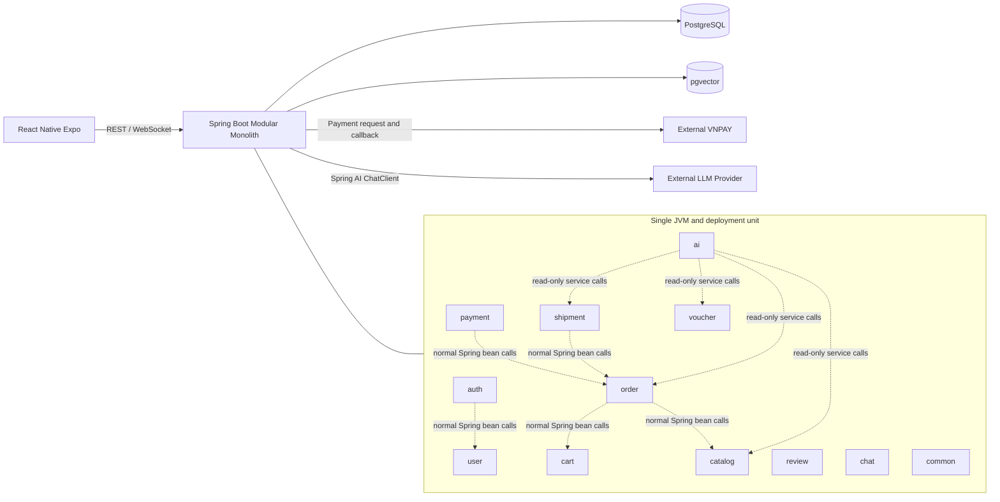
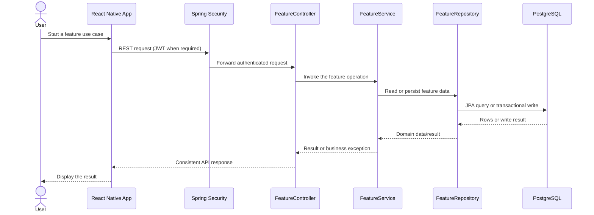
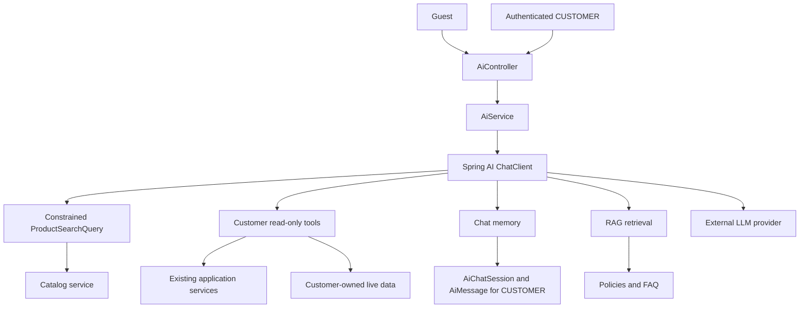

# System Overview

## 1. Runtime architecture

## 2. Architectural decisions

- The backend is one Spring Boot application, one JVM process, one deployment unit, and one primary
  PostgreSQL database.
- Top-level organization is package-by-layer (`controller`, `service`, `repository`, `entity`, `dto`, ...).
- Features communicate through normal Spring bean method calls inside the same JVM.
- Controllers remain thin; services/domain logic own business rules.
- Checkout, stock updates, voucher consumption, and payment callbacks use PostgreSQL transactions.
- Prepayment orders expire 24 hours after creation; checkout stock is restored exactly once. COD
  remains pending until all required non-cancelled seller shipments are delivered in the MVP.
- The first MVP uses `VND` and a fixed `0.00` shipping fee. Partial COD settlement for mixed
  `FAILED`/`RETURNED` seller outcomes is deferred.
- `FAILED` and `RETURNED` are seller-scoped shipment outcomes. `FAILED` does not restore stock;
  `RETURNED` restores that shipment's quantity after warehouse receipt.
- A shipment belongs to one order and one seller. MVP mapping uses whole order-item lines, with each
  order item assigned to at most one shipment; `shipment.orderId` must equal `orderItem.orderId`.
- Spring AI is an internal feature, not a separate service.
- The LLM is an OpenAI-compatible provider configured by `AI_BASE_URL`, `AI_API_KEY` and `AI_MODEL`, called through Spring AI on the backend.
- AI starts with read-only tools and must not bypass normal authorization.
- React Native never calls the LLM provider directly. When the provider is not configured, failing or
  over its per-minute budget, AI answers with rule-based search and canned answers (`answeredBy = RULES`), unless
  `APP_AI_RULES_ENABLED=false`, which returns an error instead.

## 3. Client-to-backend flow

This is the target synchronous path, not evidence that every layer is already implemented. External
provider calls are feature-specific and are shown in the corresponding sequence diagrams; they are
not a step that happens after every API response.

## 4. AI flow

RAG is for semi-static policy knowledge. Catalog/application services are the source for live data.
Guest requests are limited to public product search; seller and admin AI access is out of scope.

## 5. Feature boundaries

| Boundary | Owns | Must not bypass |
|---|---|---|
| `auth` | Registration, login, refresh, JWT, security | Spring Security and authenticated principal |
| `catalog` | Categories, products, stock, catalog browsing | Seller ownership and product activity rules |
| `cart` | Customer cart items and cart validation | Active product and stock validation |
| `order` | Checkout, order, order items, seller processing | Transaction, snapshot, and ownership rules |
| `payment` | COD and VNPAY attempts/callbacks | Signature validation and idempotency |
| `shipment` | Seller shipments and delivery state | Same-seller shipment rule and status invariants |
| `voucher` | Voucher validation and usage | Expiry, exhaustion, and concurrency rules |
| `review` | Eligibility and reviews | Purchase/delivery eligibility and uniqueness |
| `chat` | Human conversations and messages | Participant ownership and message consistency |
| `ai` | ChatClient, product-query mapping, tools, memory, RAG | Guest public search and CUSTOMER-only protected data |
| `common` | Shared response, exception, config, utility | Feature-specific business decisions |

## 6. External integrations

- PostgreSQL stores primary marketplace data.
- pgvector stores embeddings for the RAG phase.
- VNPAY handles online payment interaction.
- The LLM (an OpenAI-compatible provider configured by `AI_BASE_URL`, `AI_API_KEY` and `AI_MODEL`) supplies model responses through Spring AI.
- Provider secrets remain on the backend.
- Production error responses use safe `INTERNAL_ERROR` messages without framework binding details.
