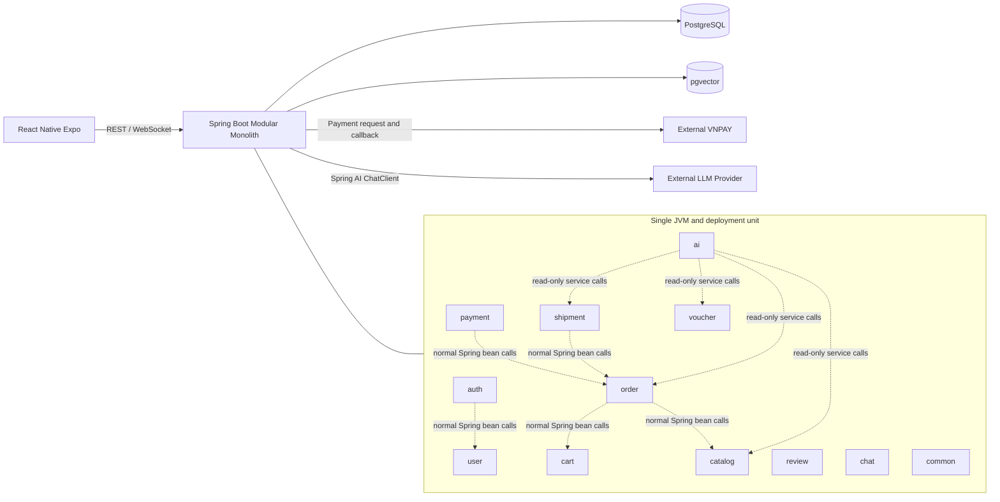
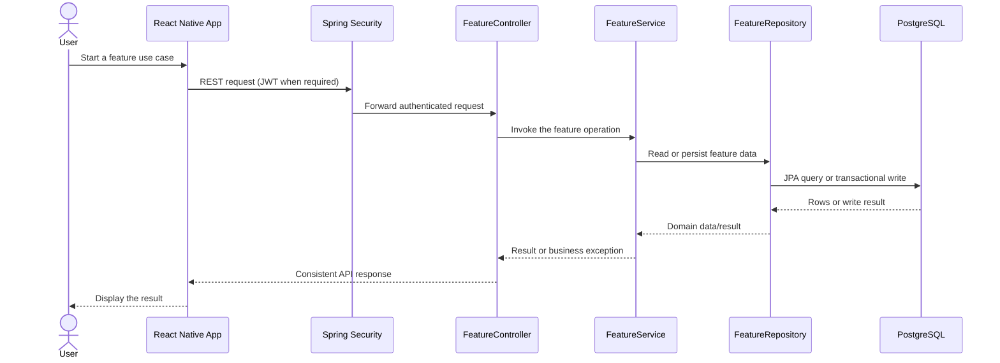
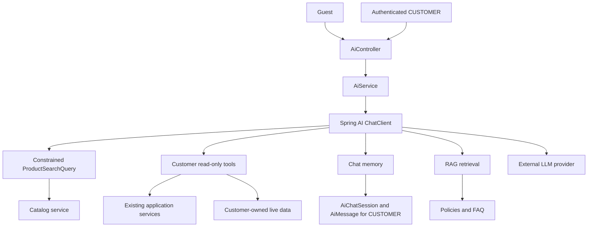

# Tổng quan hệ thống

## 1. Kiến trúc runtime

## 2. Quyết định kiến trúc

- Backend là một ứng dụng Spring Boot, một JVM process, một deployment unit và một primary
  PostgreSQL database.
- Tổ chức top-level là package-by-layer (`controller`, `service`, `repository`, `entity`, `dto`, ...).
- Các feature giao tiếp qua normal Spring bean method calls trong cùng JVM.
- Controllers giữ thin; services/domain logic sở hữu business rules.
- Checkout, stock updates, voucher consumption và payment callbacks dùng PostgreSQL transactions.
- Prepayment orders hết hạn 24 giờ sau khi tạo; checkout stock được khôi phục đúng một lần. COD
  vẫn pending cho đến khi mọi seller shipments required còn non-cancelled đều delivered trong MVP.
- MVP đầu tiên dùng `VND` và fixed `0.00` shipping fee. Partial COD settlement cho các
  `FAILED`/`RETURNED` seller outcomes hỗn hợp được hoãn lại.
- `FAILED` và `RETURNED` là seller-scoped shipment outcomes. `FAILED` không khôi phục stock;
  `RETURNED` khôi phục quantity của shipment đó sau khi warehouse receipt.
- Một shipment thuộc về một order và một seller. Ánh xạ MVP dùng whole order-item lines, với mỗi
  order item được gán cho tối đa một shipment; `shipment.orderId` phải bằng `orderItem.orderId`.
- Spring AI là internal feature, không phải service riêng biệt.
- LLM provider được chọn là DeepSeek, gọi qua Spring AI trên backend.
- AI bắt đầu với read-only tools và không được bypass authorization thông thường.
- React Native không bao giờ gọi trực tiếp LLM provider. AI phải degrade gracefully với
  `AI_UNAVAILABLE` khi provider chưa được cấu hình hoặc lỗi.

## 3. Luồng client-backend

Đây là luồng đồng bộ theo kiến trúc mục tiêu, không phải bằng chứng mọi layer đã được implement.
External provider calls chỉ thuộc feature tương ứng và được thể hiện trong sequence diagram riêng;
chúng không diễn ra sau mọi API response.

## 4. Luồng AI

RAG dùng cho semi-static policy knowledge. Catalog/application services là source cho live data.
Guest requests bị giới hạn ở public product search; seller và admin AI access ngoài scope.

## 5. Ranh giới feature

| Boundary | Owns | Must not bypass |
|---|---|---|
| `auth` | Registration, login, refresh, JWT, security | Spring Security và authenticated principal |
| `catalog` | Categories, products, stock, catalog browsing | Seller ownership và product activity rules |
| `cart` | Customer cart items và cart validation | Active product và stock validation |
| `order` | Checkout, order, order items, seller processing | Transaction, snapshot và ownership rules |
| `payment` | COD và VNPAY attempts/callbacks | Signature validation và idempotency |
| `shipment` | Seller shipments và delivery state | Same-seller shipment rule và status invariants |
| `voucher` | Voucher validation và usage | Expiry, exhaustion và concurrency rules |
| `review` | Eligibility và reviews | Purchase/delivery eligibility và uniqueness |
| `chat` | Human conversations và messages | Participant ownership và message consistency |
| `ai` | ChatClient, product-query mapping, tools, memory, RAG | Guest public search và CUSTOMER-only protected data |
| `common` | Shared response, exception, config, utility | Feature-specific business decisions |

## 6. Tích hợp bên ngoài

- PostgreSQL lưu primary marketplace data.
- pgvector lưu embeddings cho RAG phase.
- VNPAY xử lý online payment interaction.
- DeepSeek provider được chọn (API tương thích OpenAI) cung cấp model responses qua Spring AI.
- Provider secrets giữ trên backend.
- Production error responses dùng safe `INTERNAL_ERROR` messages không kèm framework binding details.
