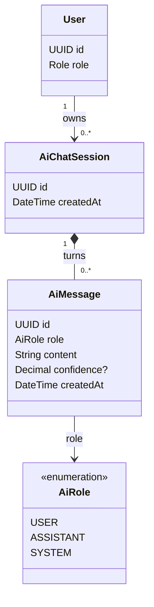
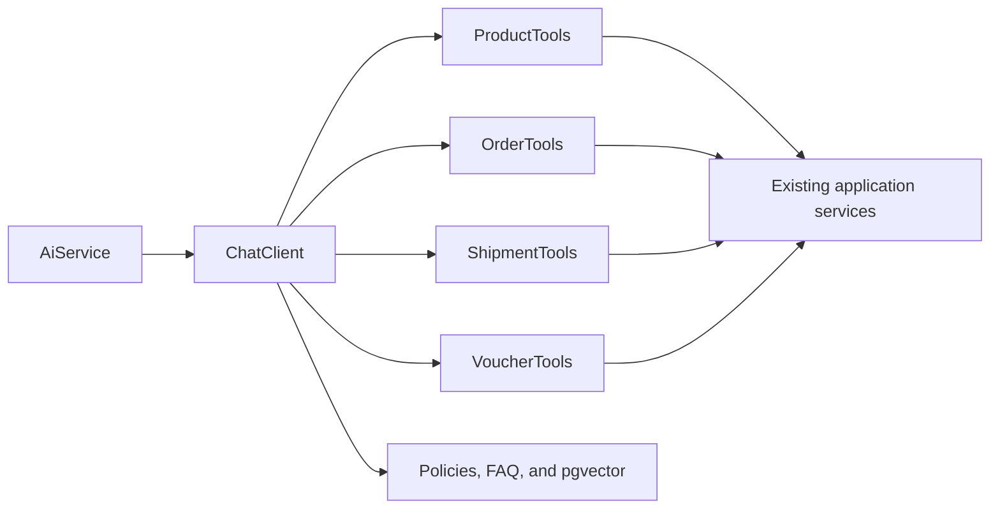
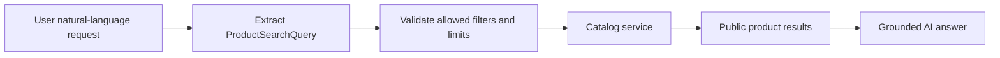

# AI Feature

## Purpose

Owns the Spring AI assistant, natural-language product-search mapping, read-only tool calling, chat
memory, RAG, and AI chat persistence inside the same Spring Boot monolith.

## MVP boundary

The first AI slice answers marketplace questions without requiring login: it maps a guest or
authenticated customer's natural-language request to a constrained public product search (via Tool
Calling on the catalog service) or to RAG-grounded policy/FAQ knowledge. Guest requests are stateless.

Current slice: `ChatClient`, the read-only `listCategories` and `searchProducts` tools, persisted customer sessions with chat
memory (last 10 messages), and the rule-based fallback. Deferred: RAG, order/shipment/voucher tools,
and seller revenue analysis.

The LLM is an OpenAI-compatible provider configured by `AI_BASE_URL`, `AI_API_KEY` and `AI_MODEL` (Spring AI OpenAI client); OpenAI, DeepSeek, Groq or OpenRouter work by
changing those variables only. Provider secrets never leave the backend. The AI feature must never
crash the app: when the provider is not configured, the call fails, or the caller is over 20
questions in the current minute, the backend answers without the LLM and marks the response
`answeredBy = RULES`. More than 60 questions in a minute return `429 RATE_LIMITED`.

## Responsibilities

- Provide `POST /api/v1/ai/ask` as a public endpoint (no login required for public data).
- Configure `ChatClient` from environment configuration (`AI_BASE_URL`, `AI_API_KEY`, `AI_MODEL`).
- Answer with the rule-based fallback when the provider is missing, failing or over budget.
- Persist `AiChatSession` and `AiMessage` history for authenticated customers.
- Expose public product-search tools first; add customer-owned order, shipment, tracking, and voucher
  tools later.
- Resolve the authenticated customer from Spring Security context for protected data; guests only
  receive public data and must never pass a user ID.
- Use RAG for policies/FAQ and tools for live transactional data.
- Add semantic product search/review summary later without enabling irreversible actions.
- Keep seller revenue analysis as planning only.

## Planned API

```text
POST /api/v1/ai/ask                         # public for catalog search; customer scope when authenticated
GET  /api/v1/ai/sessions                    # CUSTOMER only
GET  /api/v1/ai/sessions/{id}/messages      # CUSTOMER and own session only
```

## Permissions

| Actor | Allowed operation | Constraint |
|---|---|---|
| Unauthenticated client | Ask about public products, FAQ, and policies | No login required. No order, shipment, voucher, or account data. Requests may be stateless and are rate-limited. |
| CUSTOMER | Search products; later ask about their own orders, shipments, and vouchers | Protected data is resolved from the authenticated principal. |
| SELLER/ADMIN | No AI access in the current scope | Seller revenue analysis is planning only. |
| AI model/client | Call read-only tools | Must not provide arbitrary `userId` access or direct repository bypass. |

## Focused class diagram



## Tool and RAG boundary



Use tools for current order status, shipment status, stock, voucher availability, and live price.
Use RAG for return policy, shipping policy, payment guide, voucher policy, seller rules, and FAQ.

Product-search flow:



The AI must not invent product availability, price, or stock outside the catalog-service result.

## Forbidden initial actions

The initial AI feature must not expose `cancelOrder`, `refundPayment`, `changePrice`, `updateStock`,
`markDelivered`, or `deleteReview`.

## Data model

The persisted AI model stores customer conversations only. Guest product-search requests are public
and stateless, so they should not create a customer-owned session.

### Table relationships

- `users (1) -> ai_chat_sessions (many)`: an authenticated customer owns their saved AI sessions.
- `ai_chat_sessions (1) -> ai_messages (many)`: a session contains ordered user, assistant, or system turns.
- `ai_chat_sessions.userId -> users.id` is the ownership boundary; never accept the owner ID from the request body.

### Field meanings

| Table | Field | Meaning |
|---|---|---|
| `ai_chat_sessions` | `id` | Stable identifier for one persisted customer conversation. |
| `ai_chat_sessions` | `createdAt` | Time at which the session was created. |
| `ai_chat_sessions` | `userId` | Authenticated customer who owns the session. |
| `ai_messages` | `id` | Stable identifier for one conversation turn. |
| `ai_messages` | `role` | `USER`, `ASSISTANT`, or `SYSTEM`; controls how the turn is interpreted. |
| `ai_messages` | `content` | User input or the grounded assistant/system message. |
| `ai_messages` | `confidence` | Optional confidence metadata for the mapped answer; it is not an authorization decision. |
| `ai_messages` | `createdAt` | Time at which the turn was persisted. |
| `ai_messages` | `sessionId` | Parent `ai_chat_sessions` record. |

### Chat memory

`AiChatMemory` implements Spring AI `ChatMemory` on top of `ai_messages`, with the session id as the
conversation id. It only appends rows (full history stays for `GET /ai/sessions/{id}/messages`) and
gives the model the last 10 `USER`/`ASSISTANT` messages (kept short to save provider tokens). Guests get no memory.

AI session/message fields are created by V13. V11 remains a historical placeholder; pgvector and AI
document/vector tables are deferred until the RAG schema is finalized.
