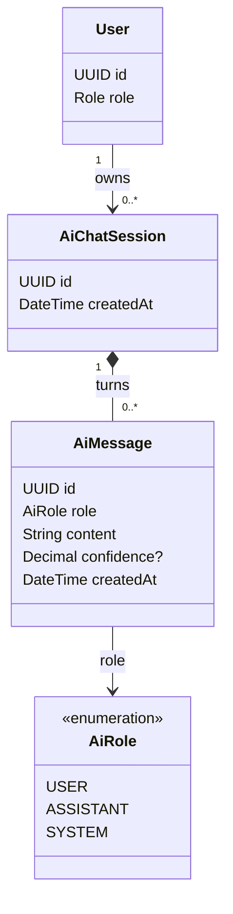
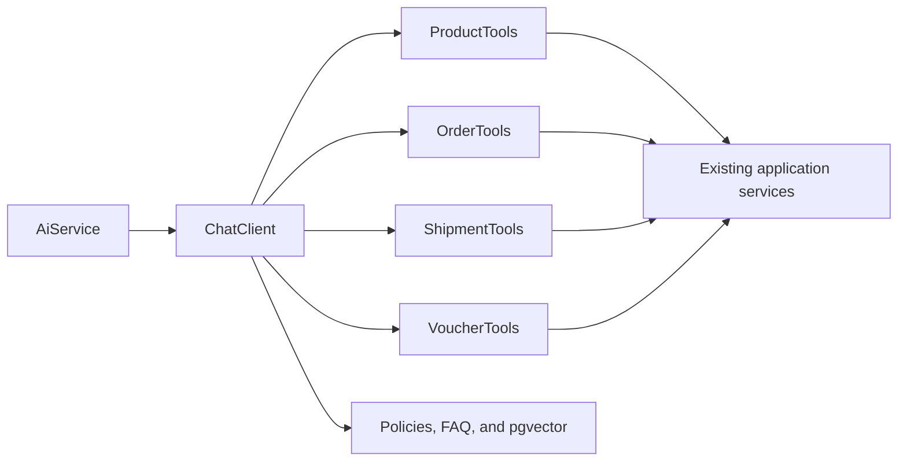
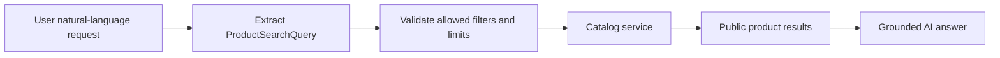

# Tính năng AI

## Mục đích

Sở hữu trợ lý Spring AI, ánh xạ tìm kiếm sản phẩm bằng ngôn ngữ tự nhiên, gọi tool chỉ đọc, bộ nhớ hội thoại, RAG và lưu trữ hội thoại AI chat trong cùng một Spring Boot monolith.

## Phạm vi MVP

Lát cắt AI đầu tiên trả lời câu hỏi về marketplace mà không yêu cầu đăng nhập: ánh xạ yêu cầu ngôn
ngữ tự nhiên của khách (guest hoặc khách hàng đã xác thực) thành tìm kiếm sản phẩm công khai có giới
hạn (qua Tool Calling tới catalog service) hoặc kiến thức chính sách/FAQ qua RAG. Yêu cầu của guest
phi trạng thái (stateless).

Đợt hiện tại: `ChatClient`, hai tool chỉ đọc `listCategories` và `searchProducts`, phiên lưu trữ của khách hàng kèm chat memory
(10 tin gần nhất), RAG điều khoản khách hàng (pgvector) và bộ trả lời bằng luật. Hoãn lại: tool đơn
hàng/vận chuyển/voucher và phân tích
doanh thu cho seller.

LLM là provider tương thích OpenAI, cấu hình bằng `AI_BASE_URL`, `AI_API_KEY` và `AI_MODEL` (client OpenAI của Spring AI); dùng OpenAI, DeepSeek, Groq hay OpenRouter chỉ cần
đổi các biến đó. Secret của provider không bao giờ rời backend. Tính năng AI không bao giờ được làm crash
app: khi provider chưa cấu hình, gọi lỗi, hoặc người gọi đã hỏi quá 20 câu trong phút hiện tại, backend
trả lời không cần LLM và đánh dấu `answeredBy = RULES`. Hỏi quá 60 câu trong một phút thì trả
`429 RATE_LIMITED`.

## Trách nhiệm

- Cung cấp `POST /api/v1/ai/ask` dưới dạng endpoint public (không yêu cầu đăng nhập cho dữ liệu công khai).
- Cấu hình `ChatClient` từ cấu hình môi trường (`AI_BASE_URL`, `AI_API_KEY`, `AI_MODEL`).
- Trả lời bằng luật khi provider thiếu, lỗi hoặc vượt hạn mức.
- Lưu trữ lịch sử `AiChatSession` và `AiMessage` cho khách hàng đã xác thực.
- Trước hết công khai các tool tìm kiếm sản phẩm công khai; sau đó bổ sung các tool đơn hàng, vận chuyển, theo dõi và voucher thuộc sở hữu của khách hàng.
- Phân giải khách hàng đã xác thực từ Spring Security context cho dữ liệu được bảo vệ; guest chỉ
  nhận dữ liệu công khai và không bao giờ được truyền user ID.
- Dùng RAG cho chính sách/FAQ và tool cho dữ liệu giao dịch trực tiếp.
- Sau này bổ sung tìm kiếm sản phẩm theo ngữ nghĩa/tóm tắt đánh giá mà không cho phép các hành động không thể đảo ngược.
- Giữ phân tích doanh thu cho seller ở mức lập kế hoạch.

## API dự kiến

```text
POST /api/v1/ai/ask                         # public for catalog search; customer scope when authenticated
GET  /api/v1/ai/sessions                    # CUSTOMER only
GET  /api/v1/ai/sessions/{id}/messages      # CUSTOMER and own session only
```

## Phân quyền

| Tác nhân | Thao tác cho phép | Ràng buộc |
|---|---|---|
| Client chưa xác thực | Hỏi về sản phẩm công khai, FAQ và chính sách | Không yêu cầu đăng nhập. Không có dữ liệu đơn hàng, vận chuyển, voucher hay tài khoản. Yêu cầu có thể phi trạng thái và bị giới hạn mức sử dụng. |
| CUSTOMER | Tìm kiếm sản phẩm; sau này hỏi về đơn hàng, vận chuyển và voucher của chính họ | Dữ liệu được bảo vệ được phân giải từ principal đã xác thực. |
| SELLER/ADMIN | Không có quyền truy cập AI trong phạm vi hiện tại | Phân tích doanh thu cho seller chỉ ở mức lập kế hoạch. |
| AI model/client | Gọi các tool chỉ đọc | Không được cung cấp quyền truy cập `userId` tùy ý hay bỏ qua repository trực tiếp. |

## Sơ đồ lớp trọng tâm



## Ranh giới Tool và RAG



Dùng tool cho trạng thái đơn hàng hiện tại, trạng thái vận chuyển, tồn kho, tình trạng voucher và giá trực tiếp. Dùng RAG cho chính sách đổi trả, chính sách vận chuyển, hướng dẫn thanh toán, chính sách voucher, quy định cho seller và FAQ.

Luồng tìm kiếm sản phẩm:



AI không được bịa đặt tình trạng còn hàng, giá hay tồn kho của sản phẩm ngoài kết quả từ catalog-service.

## Các hành động bị cấm ban đầu

Tính năng AI ban đầu không được công khai `cancelOrder`, `refundPayment`, `changePrice`, `updateStock`, `markDelivered` hay `deleteReview`.

## Mô hình dữ liệu

Mô hình AI lưu trữ chỉ lưu hội thoại của khách hàng. Yêu cầu tìm kiếm sản phẩm công khai của guest là công khai và phi trạng thái, vì vậy không nên tạo session thuộc sở hữu của khách hàng.

### Quan hệ bảng

- `users (1) -> ai_chat_sessions (many)`: khách hàng đã xác thực sở hữu các phiên AI đã lưu của mình.
- `ai_chat_sessions (1) -> ai_messages (many)`: một session chứa các lượt hội thoại user, assistant hoặc system theo thứ tự.
- `ai_chat_sessions.userId -> users.id` là ranh giới sở hữu; không bao giờ nhận ID chủ sở hữu từ request body.

### Ý nghĩa trường

| Bảng | Trường | Ý nghĩa |
|---|---|---|
| `ai_chat_sessions` | `id` | Định danh ổn định cho một hội thoại khách hàng được lưu trữ. |
| `ai_chat_sessions` | `createdAt` | Thời điểm session được tạo. |
| `ai_chat_sessions` | `userId` | Khách hàng đã xác thực sở hữu session. |
| `ai_messages` | `id` | Định danh ổn định cho một lượt hội thoại. |
| `ai_messages` | `role` | `USER`, `ASSISTANT` hoặc `SYSTEM`; quyết định cách diễn giải lượt hội thoại. |
| `ai_messages` | `content` | Đầu vào của người dùng hoặc thông điệp assistant/system đã được grounded. |
| `ai_messages` | `confidence` | Metadata confidence tùy chọn cho câu trả lời đã ánh xạ; không phải quyết định ủy quyền. |
| `ai_messages` | `createdAt` | Thời điểm lượt hội thoại được lưu trữ. |
| `ai_messages` | `sessionId` | Bản ghi `ai_chat_sessions` cha. |

### Chat memory

`AiChatMemory` cài interface `ChatMemory` của Spring AI trên bảng `ai_messages`, dùng id session làm
conversation id. Nó chỉ thêm dòng (toàn bộ lịch sử vẫn còn cho `GET /ai/sessions/{id}/messages`) và đưa
cho model 10 tin `USER`/`ASSISTANT` gần nhất (ít để đỡ tốn token của provider). Guest không có memory.

### RAG điều khoản

Điều khoản dành cho khách hàng nằm trong `backend/src/main/resources/rag/marketplace-terms.vi.md`. Mỗi mục
`##` là một chunk độc lập, có dòng `Chủ đề:`. File chỉ chứa chính sách dành cho khách hàng: không có chi
tiết bảo mật, quy định seller, giá, tồn kho hay mã voucher.

- Embedding lấy từ Google Gemini qua endpoint tương thích OpenAI
  (`https://generativelanguage.googleapis.com/v1beta/openai`, đường dẫn `/embeddings`), model
  `gemini-embedding-001` (3072 chiều). `AI_EMBEDDING_BASE_URL`, `AI_EMBEDDING_PATH` và `AI_EMBEDDING_MODEL`
  mặc định là các giá trị này; `AI_EMBEDDING_API_KEY` là key của Google AI Studio. Provider khác dùng được
  nếu model trả vector 3072 chiều. Các biến
  này tách riêng khỏi biến chat vì một số provider chat (DeepSeek, Groq) không có API embedding.
  `AI_EMBEDDING_API_KEY` rỗng thì tắt RAG; trợ lý vẫn chạy như trước.
- Khi ứng dụng khởi động, backend đọc file, embedding từng chunk và thay toàn bộ dòng của bảng
  `policy_chunks` (V18, pgvector). Muốn đổi điều khoản thì sửa file rồi khởi động lại.
- Với mỗi câu hỏi được LLM trả lời, backend embedding câu hỏi, lấy 3 chunk gần nhất (khoảng cách cosine)
  và thêm vào system prompt dưới dạng trích đoạn chính sách. Model chỉ được trả lời câu hỏi chính sách dựa
  trên các trích đoạn này. Câu trả lời bằng luật không dùng RAG.
- Gọi embedding lỗi không làm `/ai/ask` lỗi: câu hỏi vẫn được trả lời, chỉ là không có trích đoạn.

| Bảng | Trường | Ý nghĩa |
|---|---|---|
| `policy_chunks` | `id` | Định danh dòng. |
| `policy_chunks` | `topic` | Giá trị của dòng `Chủ đề:`. |
| `policy_chunks` | `title` | Tiêu đề `##`. |
| `policy_chunks` | `content` | Toàn bộ nội dung chunk đưa cho model. |
| `policy_chunks` | `embedding` | `vector(3072)` của nội dung. |

Các trường AI session/message được tạo trong V13. V11 vẫn là placeholder lịch sử; extension pgvector và
bảng `policy_chunks` được tạo trong V18.
