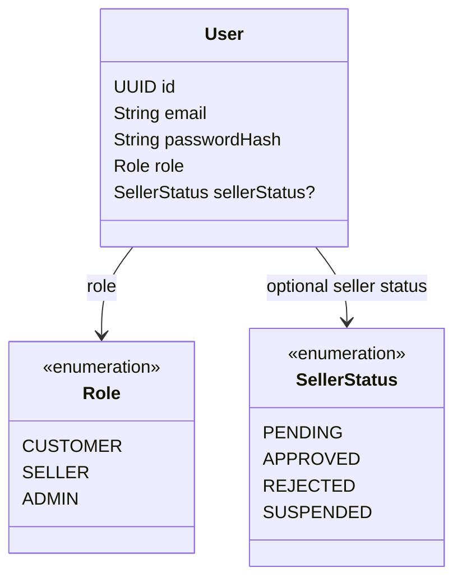

# Auth Feature

## Purpose

Owns authentication entry points and the security boundary for the marketplace.

## MVP boundary

The first mobile MVP uses customer register/login/refresh before server-backed cart checkout. Seller
approval and Admin authorization remain backend capabilities without mobile screens in this milestone.

## Responsibilities

- Register users.
- Authenticate users and issue JWT access/refresh tokens.
- Refresh access tokens.
- Hash passwords with Spring Security `PasswordEncoder`.
- Resolve the authenticated principal for downstream ownership checks.
- Apply role and seller approval rules when seller approval is part of the MVP.

## Planned API

```text
POST /api/auth/register
POST /api/auth/login
POST /api/auth/refresh
```

## Permissions

| Actor | Allowed operation | Constraint |
|---|---|---|
| Unauthenticated client | Register, login, refresh | Auth endpoints are public; guest access is separately limited to public catalog search and the public AI product-search flow. |
| CUSTOMER | Use customer-authorized features after login | Identity comes from the authenticated token. |
| SELLER | Use seller-authorized features after login | Seller ownership and approval are checked separately. |
| ADMIN | Use admin-authorized features after login | Role comes from the authenticated principal, not request data. |
| Any client | Send a user ID or role in a request | Must not be trusted for authorization. |

## Focused class diagram



## Implementation boundary

Auth establishes identity. Feature services must still enforce resource ownership; a `SELLER` role by
itself does not authorize access to another seller's product, order item, or shipment.

## Data model

Auth owns the identity boundary around the `users` table. It does not own product, order, payment, or
shipment rows; those tables reference `users` for ownership and actor checks.

### Table relationships

- `users.id` is referenced by `products.sellerId`, `orders.userId`, and seller/customer participant fields in other features.
- `users.sellerStatus` is an enum value, not a foreign-key relationship to another table.
- Ownership must be resolved from the authenticated principal before a feature service reads a related row.

### Field meanings

| Table | Field | Meaning |
|---|---|---|
| `users` | `id` | Primary identity used by ownership and audit relationships. |
| `users` | `email` | Unique login identifier. |
| `users` | `passwordHash` | One-way password hash; never store or return the raw password. |
| `users` | `name` | Logical display/full name of the account. The current V1 SQL column is `full_name`. |
| `users` | `role` | Authorization role: `CUSTOMER`, `SELLER`, or `ADMIN`. |
| `users` | `sellerStatus` | Seller onboarding/operation state; nullable for non-sellers. |
| `users` | `enabled` | Whether the account may authenticate; current V1 persistence field. |
| `users` | `createdAt` / `updatedAt` | Account creation and last-update timestamps. |

`phone` and `address` are logical profile fields in the current ERD/class model but are not present in
the V1 migration yet. Do not assume they are persisted until a migration adds them.
