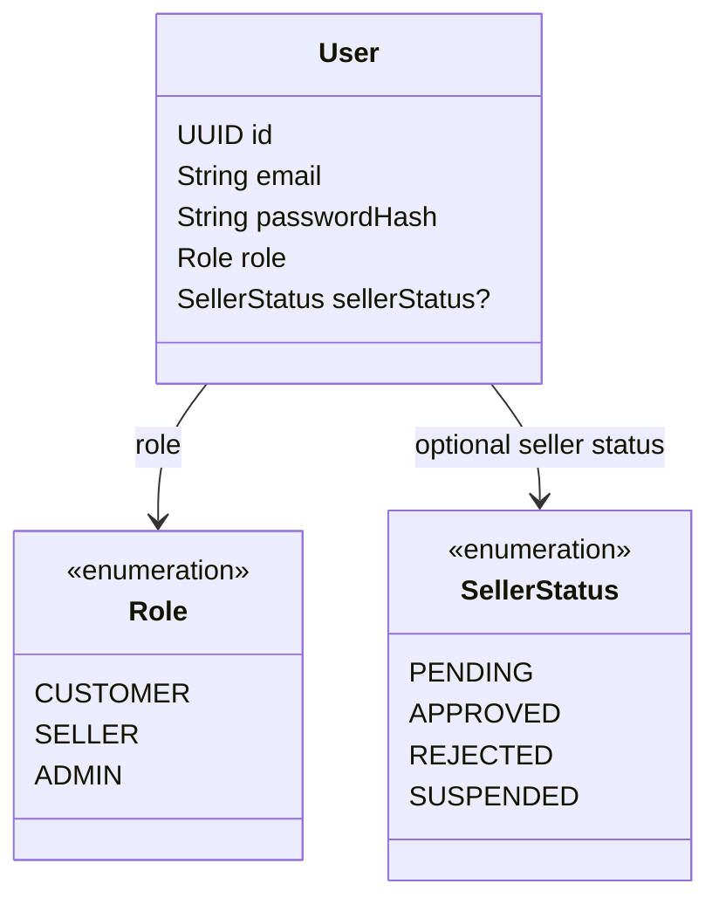

# Tính năng Auth

## Mục đích

Sở hữu các điểm vào xác thực và ranh giới bảo mật cho marketplace.

## Phạm vi MVP

MVP mobile đầu tiên dùng đăng ký/đăng nhập/refresh của customer trước khi checkout bằng giỏ hàng có backend. Phê duyệt seller và ủy quyền Admin vẫn là khả năng của backend, chưa có màn hình mobile trong mốc này.

Đăng ký public mặc định tạo `CUSTOMER`; đơn đăng ký seller (được cung cấp trên màn hình tạo tài khoản) tạo `SELLER` với trạng thái `PENDING`. Đăng ký public không bao giờ được tạo tài khoản `ADMIN`. Khi chưa có admin, admin đầu tiên được bootstrap từ cấu hình môi trường (không bao giờ hard-code credentials).

## Trách nhiệm

- Đăng ký người dùng.
- Xác thực người dùng và cấp JWT access/refresh token.
- Refresh access token kèm xoay vòng: refresh thành công trả về cặp mới và thu hồi refresh token đã dùng.
- Thu hồi refresh token trước khi hết hạn (logout/thao tác admin); token bị thu hồi bị từ chối với 401.
- Hết hạn access và refresh token theo cấu hình backend.
- Băm mật khẩu bằng Spring Security `PasswordEncoder`.
- Phân giải principal đã xác thực cho các kiểm tra sở hữu ở downstream.
- Áp dụng quy tắc role và phê duyệt seller khi phê duyệt seller thuộc MVP.
- Gửi email thông báo khi seller đăng ký và khi được duyệt theo kiểu best-effort: gửi email thất bại
  không được rollback đăng ký/duyệt (MVP không dùng message broker; retry bằng outbox lưu DB hoặc
  admin gửi lại khi cần).

## API dự kiến

```text
POST /api/v1/auth/register
POST /api/v1/auth/login
POST /api/v1/auth/refresh
POST /api/v1/auth/logout
```

## Phân quyền

| Tác nhân | Thao tác cho phép | Ràng buộc |
|---|---|---|
| Client chưa xác thực | Đăng ký, đăng nhập, refresh | Các endpoint auth là công khai; quyền truy cập guest được giới hạn riêng ở tìm kiếm catalog công khai và luồng AI tìm kiếm sản phẩm công khai. Đăng ký chỉ chấp nhận `CUSTOMER` hoặc `SELLER`; `ADMIN` chỉ đến từ bootstrap. |
| User đã xác thực | Logout (thu hồi refresh token của chính mình) | Yêu cầu access token; refresh token bị thu hồi dùng lại sẽ bị từ chối. |
| CUSTOMER | Dùng các tính năng dành cho customer sau khi đăng nhập | Định danh lấy từ token đã xác thực. |
| SELLER | Dùng các tính năng dành cho seller sau khi đăng nhập | Quyền sở hữu và phê duyệt seller được kiểm tra riêng. |
| ADMIN | Dùng các tính năng dành cho admin sau khi đăng nhập | Role lấy từ principal đã xác thực, không lấy từ dữ liệu request. |
| Mọi client | Gửi user ID hoặc role trong request | Không được tin cậy để ủy quyền. |

## Sơ đồ lớp trọng tâm



## Ranh giới triển khai

Auth thiết lập định danh. Các service tính năng vẫn phải thực thi quyền sở hữu tài nguyên; riêng role `SELLER` không ủy quyền truy cập sản phẩm, order item hay shipment của seller khác.

## Mô hình dữ liệu

Auth sở hữu ranh giới định danh quanh bảng `users`. Auth không sở hữu các hàng product, order, payment hay shipment; các bảng đó tham chiếu `users` cho kiểm tra sở hữu và tác nhân.

### Quan hệ bảng

- `users.id` được tham chiếu bởi `products.sellerId`, `orders.userId` và các trường participant của seller/customer trong các tính năng khác.
- `users.sellerStatus` là giá trị enum, không phải quan hệ khóa ngoại tới bảng khác.
- `refresh_tokens.userId -> users.id` lưu một hàng cho mỗi refresh token đã cấp (chỉ lưu SHA-256 hash,
  migration `V12`); xoay vòng thu hồi hàng đã dùng, logout/thao tác admin đặt `revokedAt`.
- Quyền sở hữu phải được phân giải từ principal đã xác thực trước khi service tính năng đọc hàng liên quan.

### Ý nghĩa trường

| Bảng | Trường | Ý nghĩa |
|---|---|---|
| `users` | `id` | Định danh chính dùng cho các quan hệ sở hữu và audit. |
| `users` | `email` | Định danh đăng nhập duy nhất. |
| `users` | `passwordHash` | Hash mật khẩu một chiều; không bao giờ lưu hay trả về mật khẩu thô. |
| `users` | `name` | Tên hiển thị/tên đầy đủ logic của tài khoản. Cột SQL V1 hiện tại là `full_name`. |
| `users` | `role` | Role ủy quyền: `CUSTOMER`, `SELLER` hoặc `ADMIN`. |
| `users` | `sellerStatus` | Trạng thái onboarding/vận hành của seller; nullable với non-seller. |
| `users` | `enabled` | Tài khoản có được phép xác thực hay không; trường persistence V1 hiện tại. |
| `users` | `createdAt` / `updatedAt` | Thời điểm tạo tài khoản và cập nhật lần cuối. |

`phone` và `address` là các trường profile tùy chọn được bổ sung vào bảng `users` trong migration V13; chúng không thuộc migration V1.
