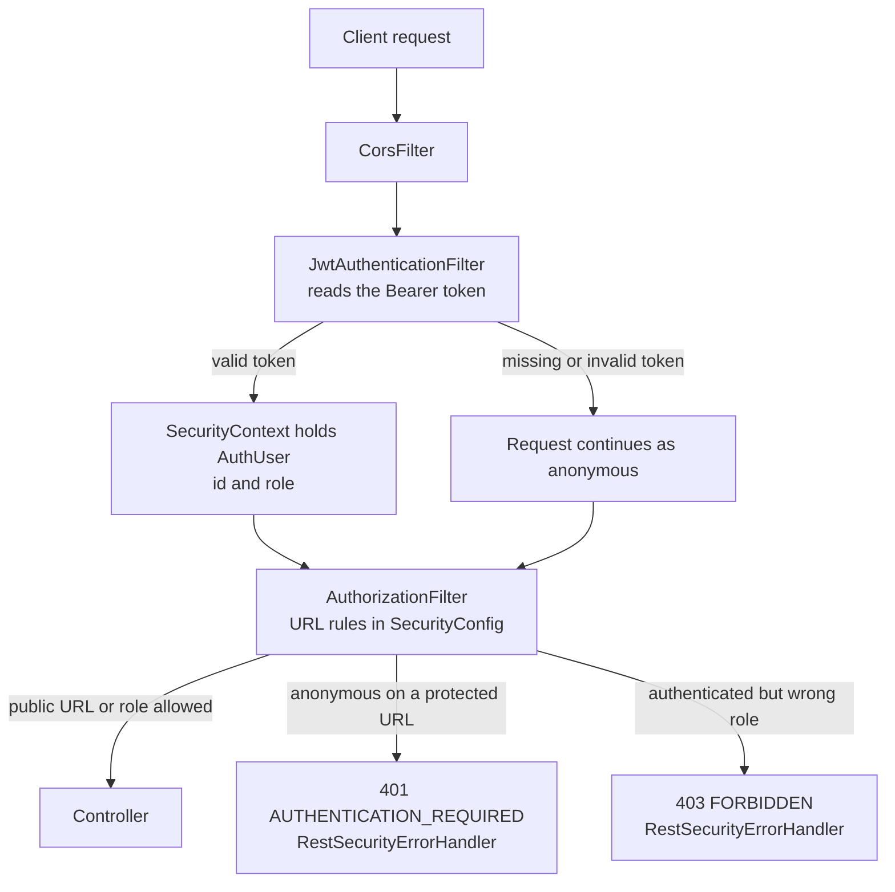
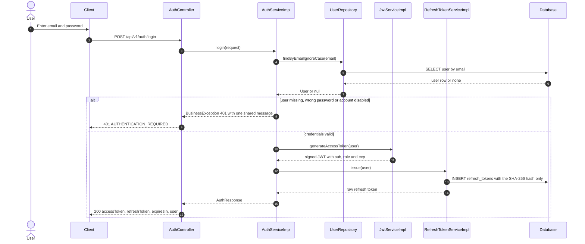
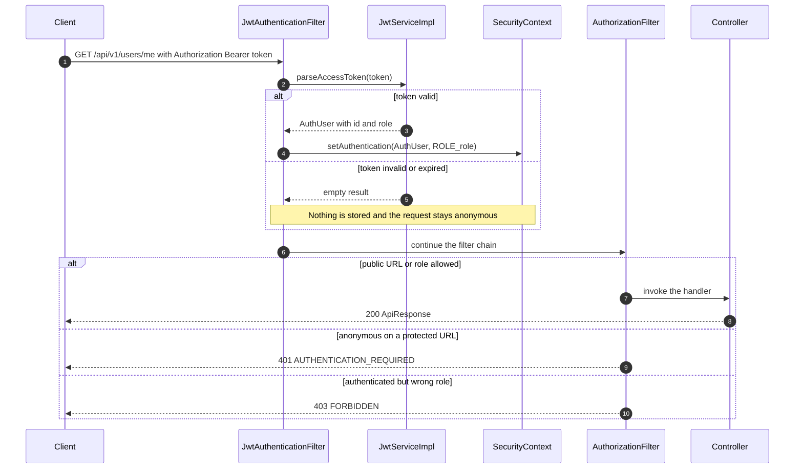
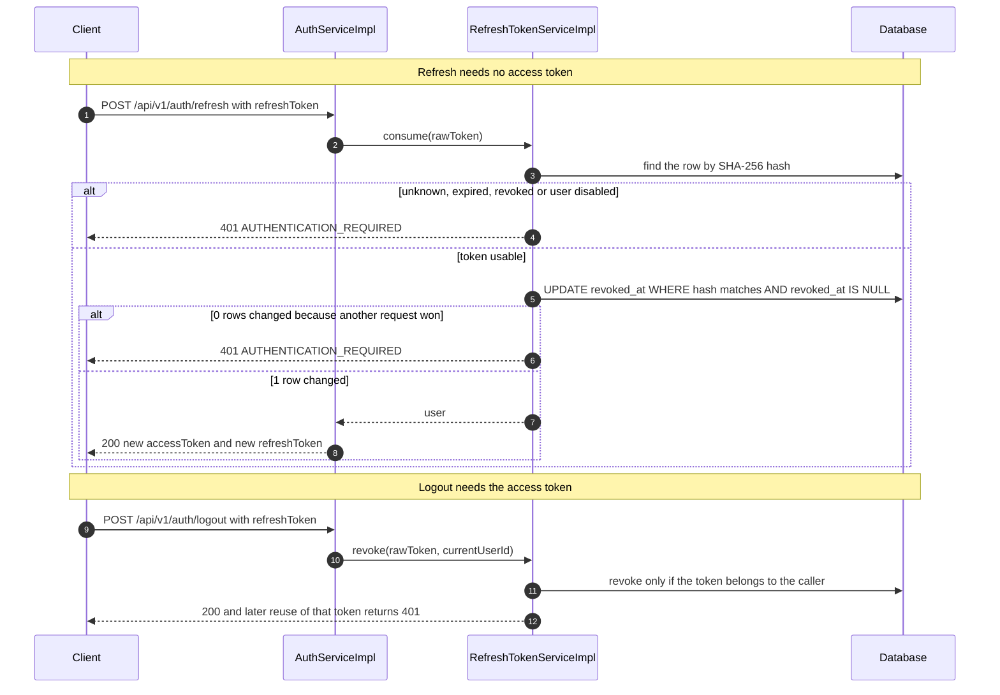

# Auth Security Flow

Status: **Implemented in the Phase 1 backend.** This document describes how the running backend authenticates and authorizes requests. Class names refer to the `backend` repository (layered packages under `com.marketplace`). Related documents: [README.md](README.md) for responsibilities and permissions, [API_CONTRACT.md](API_CONTRACT.md) for request and response shapes.

## 1. The big picture

Security does three jobs. Every diagram below is a closer look at one of them.

| Job | Everyday analogy | Implemented by |
|---|---|---|
| Issue a token | Exchange a password for an entry card | `AuthController` → `AuthServiceImpl` (register, login, refresh, logout) |
| Check the token | A guard at the gate inspects the card | `JwtAuthenticationFilter` → `JwtServiceImpl` |
| Apply the rules | A sign says which floor each person may enter | URL rules in `SecurityConfig`, plus `RestSecurityErrorHandler` |

The next diagram shows the path of one request. The gate check happens first and never rejects the request by itself: a bad token only means the caller stays anonymous. The URL rules decide whether anonymous is acceptable for that URL.

How to read it:

- `SecurityContext` is where Spring remembers who is calling for the current request. Each request has its own, so users never mix.
- `AuthUser` holds only the user id and the role, both read from the token. No database query happens while checking a token.
- 401 means no identity (nobody is logged in). 403 means the identity is known but the role is not allowed.

## 2. The two tokens

| | Access token | Refresh token |
|---|---|---|
| What it is | Signed JWT with `sub` (user id), `role`, `iat`, `exp` | Random 32-byte string (Base64Url) |
| Lifetime | 15 minutes (`expiresIn: 900`) | 7 days |
| Sent how | `Authorization: Bearer <accessToken>` on every protected request | Request body of `POST /api/v1/auth/refresh` and `/logout` |
| Stored on the server | No | Only its SHA-256 hash, in table `refresh_tokens` |
| Can be revoked | No, it simply expires | Yes: on refresh (single use) and on logout |

Why store only the hash: if the database leaks, an attacker cannot reuse the tokens, because a hash cannot be turned back into the original token.

## 3. URL authorization rules

The rules in `SecurityConfig` are checked from top to bottom and the first match wins, which is why the catch-all rule is last.

| Method and URL | Rule |
|---|---|
| `GET /actuator/health`, `/actuator/info`, `/v3/api-docs/**`, `/swagger-ui/**` | Public |
| `POST /api/v1/auth/register`, `POST /api/v1/auth/login` | Public |
| `POST /api/v1/auth/refresh` | Public (it authenticates with the refresh token) |
| `POST /api/v1/auth/google` | Public (it authenticates with the Google ID token; planned) |
| `POST /api/v1/auth/logout` | Authenticated (needs the caller's access token) |
| `GET /api/v1/products`, `/products/*`, `/products/*/reviews`, `/categories`, `/sellers/*` | Public |
| `POST /api/v1/ai/ask` | Public |
| `/api/v1/cart/**` | Role `CUSTOMER` only; the cart owner comes from the token |
| `/api/v1/seller/**` | Role `SELLER` only (seller approval is checked by the service, see below) |
| `/api/v1/admin/**` | Role `ADMIN` only |
| Any other request | Authenticated |

Roles become Spring authorities with the prefix `ROLE_` (for example `ROLE_ADMIN`), so `hasRole("ADMIN")` matches.

## 4. Login

Register behaves the same way and returns `201` instead of `200`. The password is hashed with BCrypt before it is stored.

How to read it:

- The three failure cases (unknown email, wrong password, disabled account) return the same message, so an attacker cannot learn which emails exist.
- The raw refresh token is returned to the client once. The database never holds it.

## 5. A request with a token

This is the sequence behind every protected call, for example `GET /api/v1/users/me`.

How to read it:

- A token fails when its signature is wrong, it has expired, or its content is malformed. In every case the filter ignores it instead of raising an error.
- A public endpoint still works when the client sends an old token, because the request simply stays anonymous.

## 6. Refresh and logout

How to read it:

- Every refresh token works exactly once (rotation). The conditional `UPDATE` is atomic: if two requests send the same token at the same time, only one changes a row and the other gets 401.
- Logout revokes the token only when it belongs to the caller. A token of another user and an unknown token produce the same 401, so nothing is leaked.

## 7. Error responses from security

All errors use the common `ApiResponse` envelope described in [API_CONTRACT.md](../../API_CONTRACT.md).

| Situation | HTTP | Code | Produced by |
|---|---|---|---|
| No identity on a protected URL | 401 | `AUTHENTICATION_REQUIRED` | `RestSecurityErrorHandler` |
| Wrong email or password, disabled account | 401 | `AUTHENTICATION_REQUIRED` | `AuthServiceImpl` |
| Invalid, expired or revoked refresh token | 401 | `AUTHENTICATION_REQUIRED` | `RefreshTokenServiceImpl` |
| Identity known but role not allowed | 403 | `FORBIDDEN` | `RestSecurityErrorHandler` |
| Seller not `APPROVED`, or product owned by another seller | 403 | `FORBIDDEN` | `SellerProductServiceImpl` |
| `@PreAuthorize` rejects the call | 403 | `FORBIDDEN` | `GlobalExceptionHandler` |
| Malformed body or unknown role value | 400 | `VALIDATION_ERROR` | `GlobalExceptionHandler` |

## 8. Code map

| Concern | Class |
|---|---|
| URL rules, filter chain, CORS, password encoder | `SecurityConfig` |
| Reads the Bearer token and stores the user | `JwtAuthenticationFilter` |
| Creates and verifies access tokens | `JwtServiceImpl` |
| Authenticated user (id and role, authorities) | `AuthUser` |
| 401 and 403 JSON bodies | `RestSecurityErrorHandler` (status and default message from `ErrorCode`) |
| Register, login, refresh, logout | `AuthServiceImpl` |
| Seller approval and product ownership checks | `SellerProductServiceImpl` |
| Refresh token issue, rotation, revocation | `RefreshTokenServiceImpl` |
| First admin from environment variables | `AdminBootstrap` |

## 9. Known limits and not yet implemented

- An access token cannot be revoked. A user who is locked keeps working until the access token expires (at most 15 minutes).
- The token carries only the role. Seller approval (`sellerStatus`) and resource ownership are not in the token, so feature services check the database. The seller product endpoints do this in `SellerProductServiceImpl` (Phase 2); future seller features must do the same.
- Not implemented yet: login rate limiting.
- Change password, forgot password, and reset with an emailed code were added to Phase 1 (`AuthServiceImpl.changePassword`, `PasswordResetServiceImpl`; see the auth and user API contracts). Email is sent by `EmailServiceImpl` over SMTP (Gmail App Password during development); with `APP_MAIL_ENABLED=false` the code is only written to the log, which is for local development only.
- Browser calls need CORS. It is off by default and enabled with `APP_CORS_ALLOWED_ORIGIN_PATTERNS`; use `*` only during development.
