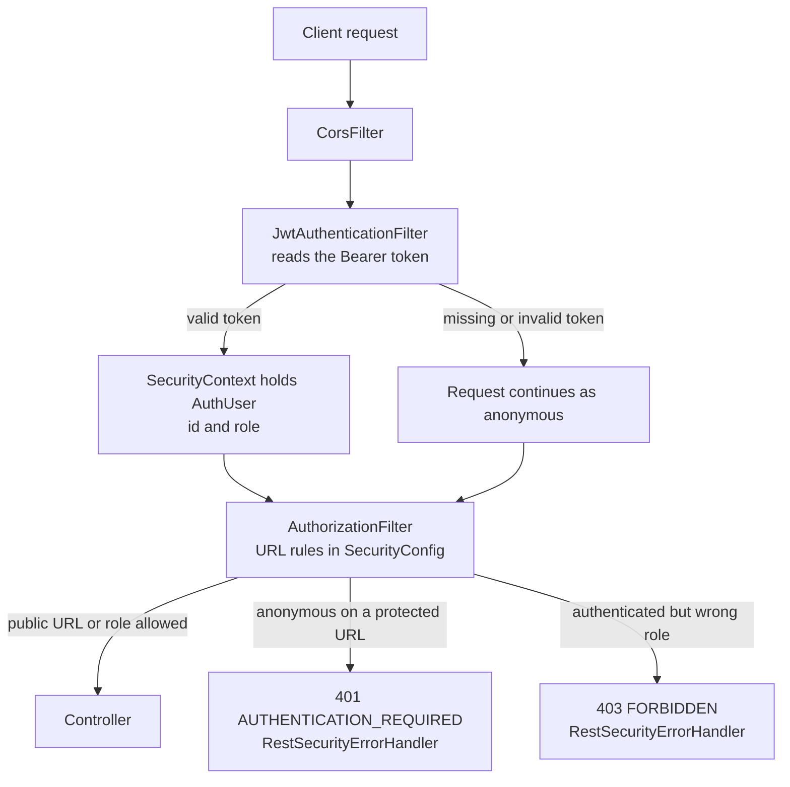
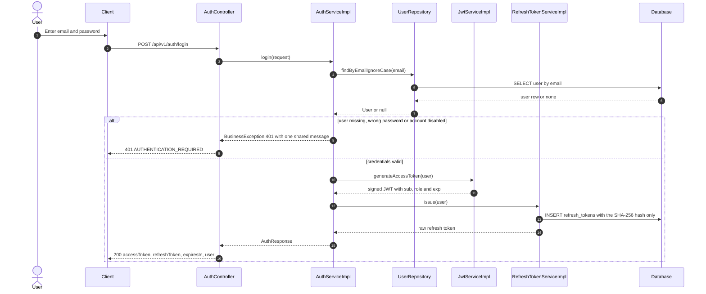
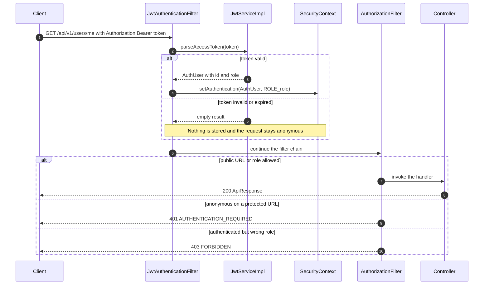
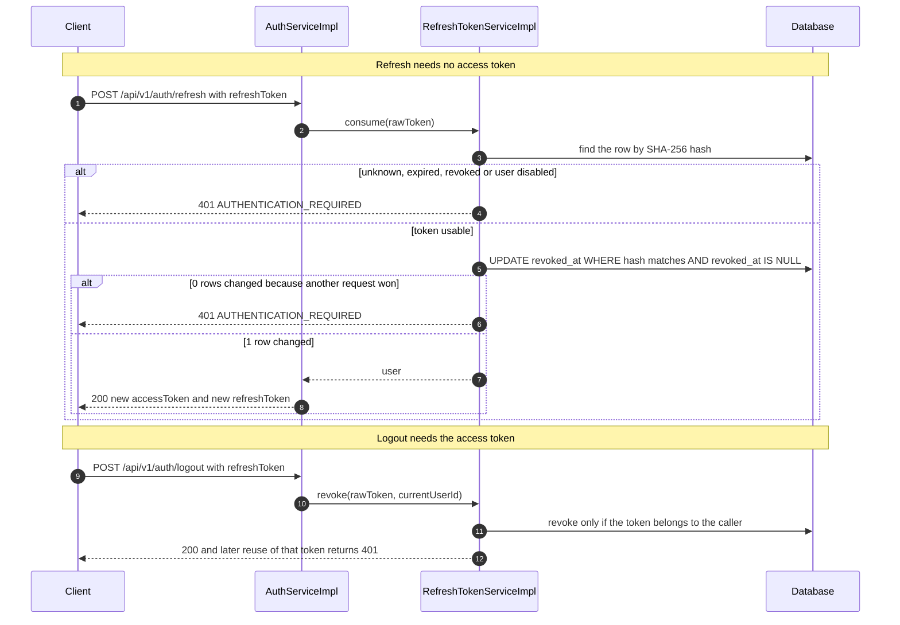

# Luồng bảo mật của Auth

Trạng thái: **Đã triển khai trong backend Phase 1.** Tài liệu này mô tả cách backend đang chạy xác thực và phân quyền cho request. Tên class thuộc repository `backend` (package theo tầng dưới `com.marketplace`). Tài liệu liên quan: [README.vi.md](README.vi.md) cho trách nhiệm và quyền, [API_CONTRACT.md](API_CONTRACT.md) cho hình dạng request và response.

## 1. Bức tranh tổng thể

Bảo mật làm ba việc. Mỗi sơ đồ bên dưới là một góc nhìn kỹ hơn vào một việc.

| Việc | Ví von đời thường | Thực hiện bởi |
|---|---|---|
| Cấp token | Đổi mật khẩu lấy thẻ ra vào | `AuthController` → `AuthServiceImpl` (đăng ký, đăng nhập, refresh, logout) |
| Kiểm tra token | Bảo vệ ở cổng soi thẻ | `JwtAuthenticationFilter` → `JwtServiceImpl` |
| Áp dụng luật | Bảng chỉ dẫn mỗi người được vào tầng nào | Luật URL trong `SecurityConfig`, cùng `RestSecurityErrorHandler` |

Sơ đồ tiếp theo cho thấy đường đi của một request. Bước kiểm tra ở cổng chạy trước và không tự từ chối request: token sai chỉ khiến người gọi vẫn là ẩn danh. Luật URL mới quyết định ẩn danh có được chấp nhận ở URL đó hay không.

Cách đọc:

- `SecurityContext` là nơi Spring ghi nhớ ai đang gọi cho request hiện tại. Mỗi request có một ngăn riêng nên người dùng không bị lẫn.
- `AuthUser` chỉ giữ id người dùng và role, đều đọc từ token. Không có truy vấn database nào khi kiểm tra token.
- 401 nghĩa là không có danh tính (chưa ai đăng nhập). 403 nghĩa là đã biết danh tính nhưng role không được phép.

## 2. Hai loại token

| | Access token | Refresh token |
|---|---|---|
| Là gì | JWT có chữ ký, chứa `sub` (id người dùng), `role`, `iat`, `exp` | Chuỗi ngẫu nhiên 32 byte (Base64Url) |
| Thời hạn | 15 phút (`expiresIn: 900`) | 7 ngày |
| Gửi thế nào | `Authorization: Bearer <accessToken>` ở mỗi request cần bảo vệ | Body của `POST /api/v1/auth/refresh` và `/logout` |
| Lưu trên server | Không | Chỉ lưu SHA-256 hash, trong bảng `refresh_tokens` |
| Thu hồi được | Không, chỉ chờ hết hạn | Có: khi refresh (dùng một lần) và khi logout |

Vì sao chỉ lưu hash: nếu database bị lộ thì kẻ tấn công không dùng lại được token, vì từ hash không suy ngược ra token gốc.

## 3. Luật phân quyền theo URL

Các luật trong `SecurityConfig` được kiểm tra từ trên xuống và luật khớp đầu tiên thắng, nên luật chung chung nằm cuối cùng.

| Method và URL | Luật |
|---|---|
| `GET /actuator/health`, `/actuator/info`, `/v3/api-docs/**`, `/swagger-ui/**` | Công khai |
| `POST /api/v1/auth/register`, `POST /api/v1/auth/login` | Công khai |
| `POST /api/v1/auth/refresh` | Công khai (tự xác thực bằng refresh token) |
| `POST /api/v1/auth/logout` | Phải đăng nhập (cần access token của chính người gọi) |
| `GET /api/v1/products`, `/products/*`, `/products/*/reviews`, `/categories`, `/sellers/*` | Công khai |
| `POST /api/v1/ai/ask` | Công khai |
| `/api/v1/cart/**` | Chỉ role `CUSTOMER`; chủ giỏ lấy từ token |
| `/api/v1/seller/**` | Chỉ role `SELLER` (trạng thái duyệt seller do service kiểm tra, xem bên dưới) |
| `/api/v1/admin/**` | Chỉ role `ADMIN` |
| Mọi request còn lại | Phải đăng nhập |

Role được đổi thành authority của Spring với tiền tố `ROLE_` (ví dụ `ROLE_ADMIN`), nhờ vậy `hasRole("ADMIN")` khớp được.

## 4. Đăng nhập

Đăng ký chạy tương tự và trả `201` thay vì `200`. Mật khẩu được băm bằng BCrypt trước khi lưu.

Cách đọc:

- Ba trường hợp thất bại (email không tồn tại, sai mật khẩu, tài khoản bị khóa) trả cùng một thông báo, nên kẻ tấn công không dò được email nào đã tồn tại.
- Refresh token thô chỉ được trả cho client một lần. Database không bao giờ giữ nó.

## 5. Request có token

Đây là chuỗi bước đằng sau mọi lời gọi cần bảo vệ, ví dụ `GET /api/v1/users/me`.

Cách đọc:

- Token bị coi là sai khi chữ ký không khớp, đã hết hạn, hoặc nội dung hỏng. Trong mọi trường hợp filter bỏ qua token thay vì ném lỗi.
- Endpoint công khai vẫn dùng được khi client gửi token cũ, vì request chỉ đơn giản vẫn là ẩn danh.

## 6. Refresh và logout

Cách đọc:

- Mỗi refresh token chỉ dùng đúng một lần (xoay vòng). Câu `UPDATE` có điều kiện là nguyên tử: nếu hai request gửi cùng một token cùng lúc thì chỉ một request đổi được dòng, request kia nhận 401.
- Logout chỉ thu hồi token khi nó thuộc về người gọi. Token của người khác và token không tồn tại cho cùng một lỗi 401, nên không lộ thông tin gì.

## 7. Phản hồi lỗi từ security

Mọi lỗi dùng khung `ApiResponse` chung, mô tả trong [API_CONTRACT.md](../../API_CONTRACT.md).

| Tình huống | HTTP | Mã | Do |
|---|---|---|---|
| Không có danh tính ở URL cần bảo vệ | 401 | `AUTHENTICATION_REQUIRED` | `RestSecurityErrorHandler` |
| Sai email hoặc mật khẩu, tài khoản bị khóa | 401 | `AUTHENTICATION_REQUIRED` | `AuthServiceImpl` |
| Refresh token sai, hết hạn hoặc đã thu hồi | 401 | `AUTHENTICATION_REQUIRED` | `RefreshTokenServiceImpl` |
| Biết danh tính nhưng role không được phép | 403 | `FORBIDDEN` | `RestSecurityErrorHandler` |
| Seller chưa `APPROVED`, hoặc product thuộc seller khác | 403 | `FORBIDDEN` | `SellerProductServiceImpl` |
| `@PreAuthorize` từ chối lời gọi | 403 | `FORBIDDEN` | `GlobalExceptionHandler` |
| Body sai định dạng hoặc giá trị role không tồn tại | 400 | `VALIDATION_ERROR` | `GlobalExceptionHandler` |

## 8. Bản đồ code

| Mối quan tâm | Class |
|---|---|
| Luật URL, chuỗi filter, CORS, bộ mã hóa mật khẩu | `SecurityConfig` |
| Đọc Bearer token và lưu người dùng | `JwtAuthenticationFilter` |
| Tạo và kiểm tra access token | `JwtServiceImpl` |
| Người dùng đã xác thực (id, role, authorities) | `AuthUser` |
| Body JSON của lỗi 401 và 403 | `RestSecurityErrorHandler` (status và câu mặc định lấy từ `ErrorCode`) |
| Đăng ký, đăng nhập, refresh, logout | `AuthServiceImpl` |
| Kiểm tra seller đã duyệt và quyền sở hữu product | `SellerProductServiceImpl` |
| Cấp, xoay vòng, thu hồi refresh token | `RefreshTokenServiceImpl` |
| Admin đầu tiên từ biến môi trường | `AdminBootstrap` |

## 9. Giới hạn đã biết và phần chưa triển khai

- Access token không thu hồi được. Người dùng bị khóa vẫn gọi được cho đến khi access token hết hạn (tối đa 15 phút).
- Token chỉ chứa role. Trạng thái duyệt seller (`sellerStatus`) và quyền sở hữu tài nguyên không nằm trong token nên service tính năng kiểm tra database. Các endpoint product của seller làm việc này trong `SellerProductServiceImpl` (Phase 2); các tính năng seller sau này phải làm tương tự.
- Chưa triển khai: giới hạn số lần đăng nhập.
- Đổi mật khẩu, quên mật khẩu và đặt lại bằng mã gửi qua email đã được bổ sung vào Phase 1 (`AuthServiceImpl.changePassword`, `PasswordResetServiceImpl`; xem API contract của auth và user). Email được gửi bởi `EmailServiceImpl` qua SMTP (Gmail App Password khi phát triển); khi `APP_MAIL_ENABLED=false` thì mã chỉ được ghi ra log, chỉ dùng khi phát triển local.
- Trình duyệt gọi API cần CORS. Mặc định tắt và bật bằng `APP_CORS_ALLOWED_ORIGIN_PATTERNS`; chỉ dùng `*` khi phát triển.
