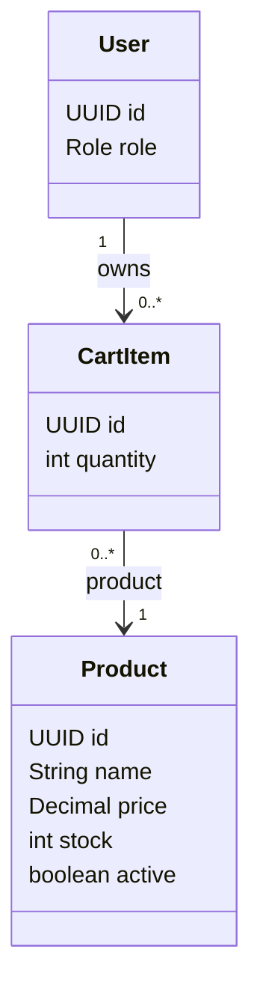

# Cart Feature

## Purpose

Owns the customer's current shopping cart before checkout.

## Responsibilities

- Add, update, and remove cart items.
- Keep one cart row per customer/product pair.
- Validate active products and requested stock.
- Provide cart data to checkout.
- Leave server-side price recalculation to the checkout/order flow.

## Planned API

```text
GET    /api/cart
POST   /api/cart/items
PATCH  /api/cart/items/{id}
DELETE /api/cart/items/{id}
```

## Permissions

| Actor | Allowed operation | Constraint |
|---|---|---|
| CUSTOMER | View and modify their own cart | A customer cannot read or change another customer's cart. |
| SELLER | No direct cart management | Seller sees product/order effects through their own features. |
| ADMIN | No normal customer-cart operation | Administrative access does not replace customer ownership. |

## Focused class diagram



## Important rules

- `(user, product)` is unique.
- `quantity >= 1`.
- Inactive products and insufficient stock cannot proceed to checkout.
- Checkout must recalculate prices on the backend.

## Data model

`cart_items` is the join table between one customer and the products currently selected for checkout.

### Table relationships

- `users (1) -> cart_items (many)`: each cart item belongs to one customer.
- `products (1) -> cart_items (many)`: a product may appear in many customers' carts.
- `cart_items.userId -> users.id` and `cart_items.productId -> products.id` are both required.
- A unique constraint on `(userId, productId)` prevents duplicate rows for the same customer/product pair.

### Field meanings

| Table | Field | Meaning |
|---|---|---|
| `cart_items` | `id` | Identifier for the cart row. |
| `cart_items` | `quantity` | Requested quantity; must be at least `1` and is rechecked against current stock at checkout. |
| `cart_items` | `userId` | Customer who owns the cart row. |
| `cart_items` | `productId` | Product selected by the customer. |

Cart items do not own a price snapshot. The order flow must read the current valid product price and
create an immutable `OrderItem` snapshot during checkout.

The historical V3 migration is a placeholder. The `cart_items` table, foreign keys, and unique
`(userId, productId)` constraint are created by V13 to preserve previously recorded Flyway checksums.
