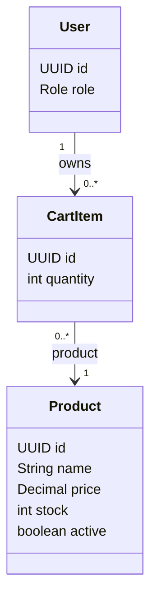

# Tính năng Cart

## Mục đích

Sở hữu giỏ hàng hiện tại của khách hàng trước khi checkout.

## Trách nhiệm

- Thêm, cập nhật và xóa cart item.
- Giữ một hàng cart cho mỗi cặp customer/product.
- Kiểm tra sản phẩm đang hoạt động và tồn kho được yêu cầu.
- Cung cấp dữ liệu giỏ hàng cho checkout.
- Để việc tính lại giá phía server cho luồng checkout/order.

## API dự kiến

```text
GET    /api/cart
POST   /api/cart/items
PATCH  /api/cart/items/{id}
DELETE /api/cart/items/{id}
```

## Phân quyền

| Tác nhân | Thao tác cho phép | Ràng buộc |
|---|---|---|
| CUSTOMER | Xem và sửa giỏ hàng của chính mình | Customer không được đọc hay thay đổi giỏ hàng của customer khác. |
| SELLER | Không quản lý giỏ hàng trực tiếp | Seller thấy tác động sản phẩm/đơn hàng qua các tính năng của mình. |
| ADMIN | Không thao tác giỏ hàng customer thông thường | Quyền truy cập quản trị không thay thế quyền sở hữu của customer. |

## Sơ đồ lớp trọng tâm



## Quy tắc quan trọng

- `(user, product)` là duy nhất.
- `quantity >= 1`.
- Sản phẩm không hoạt động và tồn kho không đủ không thể tiến tới checkout.
- Checkout phải tính lại giá trên backend.

## Mô hình dữ liệu

`cart_items` là bảng nối giữa một customer và các sản phẩm hiện được chọn để checkout.

### Quan hệ bảng

- `users (1) -> cart_items (many)`: mỗi cart item thuộc về một customer.
- `products (1) -> cart_items (many)`: một sản phẩm có thể xuất hiện trong giỏ hàng của nhiều customer.
- `cart_items.userId -> users.id` và `cart_items.productId -> products.id` đều bắt buộc.
- Ràng buộc duy nhất trên `(userId, productId)` ngăn các hàng trùng lặp cho cùng một cặp customer/product.

### Ý nghĩa trường

| Bảng | Trường | Ý nghĩa |
|---|---|---|
| `cart_items` | `id` | Định danh cho hàng giỏ hàng. |
| `cart_items` | `quantity` | Số lượng được yêu cầu; phải ít nhất là `1` và được kiểm tra lại với tồn kho hiện tại tại lúc checkout. |
| `cart_items` | `userId` | Customer sở hữu hàng giỏ hàng. |
| `cart_items` | `productId` | Sản phẩm được customer chọn. |

Cart item không sở hữu snapshot giá. Luồng order phải đọc giá sản phẩm hợp lệ hiện tại và tạo snapshot `OrderItem` bất biến trong lúc checkout.

Migration V3 lịch sử là placeholder. Bảng `cart_items`, các khóa ngoại và ràng buộc duy nhất `(userId, productId)` được tạo trong V13 để giữ nguyên checksum Flyway đã ghi nhận.
