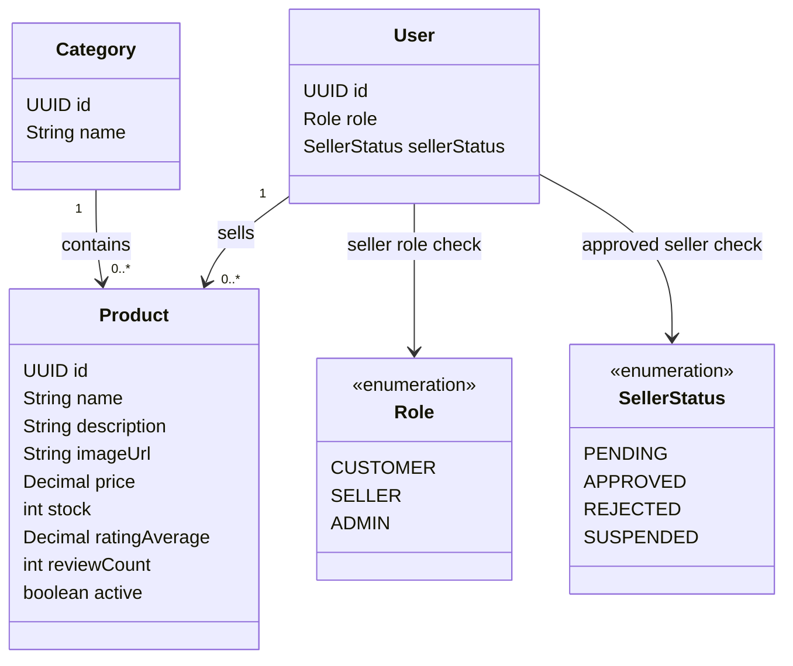

# Catalog Feature

## Purpose

Owns categories, products, product visibility, stock, and customer catalog browsing.

## Responsibilities

- Category management for Admin.
- Seller product create, update, delete/soft-delete, and stock management.
- Customer product browse, search, filter, and pagination.
- Customer view of a seller's shop (the shop name is the seller's `name`) and that seller's listed products.
- Seller view of their own products, including unlisted ones.
- Enforce product activity and stock rules used by cart and checkout.
- Keep each product associated with exactly one category and one seller.

## Planned API

All endpoints listed here are implemented as of Phase 2.

```text
GET    /api/v1/products
GET    /api/v1/products/{id}
GET    /api/v1/categories
GET    /api/v1/sellers/{id}
GET    /api/v1/seller/products
GET    /api/v1/seller/products/{id}
POST   /api/v1/seller/products
PATCH  /api/v1/seller/products/{id}
DELETE /api/v1/seller/products/{id}
PATCH  /api/v1/seller/products/{id}/stock
POST   /api/v1/admin/categories
PATCH  /api/v1/admin/categories/{id}
DELETE /api/v1/admin/categories/{id}
```

## Permissions

| Actor | Allowed operation | Constraint |
|---|---|---|
| CUSTOMER | Browse products, categories, search, filter, paginate | Only active/visible catalog data is exposed. |
| SELLER | Manage products and stock | Only products owned by the authenticated seller; seller approval applies. |
| ADMIN | Manage categories and monitor catalog | Admin authorization is required. |

## Focused class diagram



## Important rules

- `price > 0` and `stock >= 0`.
- `ratingAverage` is between `0` and `5`, and `reviewCount >= 0`.
- `active = false` means soft-deleted or unlisted.
- A seller cannot modify another seller's product.
- Money values use `BigDecimal` in the implementation.
- Catalog list defaults to relevance when a search term exists and `rating_desc` otherwise. Supported
  sorts are `relevance`, `price_asc`, `price_desc`, and `rating_desc`; `popular` is deferred until a
  popularity metric exists. Results use deterministic `id ASC` tie-breaking.
- Text search ignores case and Vietnamese accents and looks in the product name, the category name and the
  description; `relevance` ranks them in that order.
- Semantic fallback: when the text search finds nothing, `GET /products` returns the products closest in
  meaning (see `API_CONTRACT.md`). `ProductIndexer` keeps `product_embeddings` (V20, pgvector, one
  `vector(3072)` of name + category + description per product, plus an md5 `content_hash`) in sync:
  every 10 minutes it embeds only the listed products whose text changed. It reuses the Gemini embedding
  settings of the AI feature (`AI_EMBEDDING_*`); an empty key turns it off.

## Data model

Catalog owns categories and products. Product ownership is represented by the seller relationship;
cart, order, review, and chat rows reference products but do not own catalog data.

### Table relationships

- `categories (1) -> products (many)`: every product belongs to one category.
- `users (1) -> products (many)`: a seller may own many products; `products.sellerId` is the ownership boundary.
- `products.id` is referenced by `cart_items.productId`, `order_items.productId`, `reviews.productId`, and optional `conversations.productId`.
- `active = false` hides a product without deleting historical order or review references.

### Field meanings

| Table | Field | Meaning |
|---|---|---|
| `categories` | `id` | Category identifier. |
| `categories` | `name` | Unique category label shown to clients. |
| `products` | `id` | Product identifier used by cart, order, review, and chat references. |
| `products` | `name` | Customer-facing product name. |
| `products` | `description` | Product detail text used by catalog and public AI search. |
| `products` | `imageUrl` | Primary product image used by the MVP catalog and product detail. |
| `products` | `price` | Current selling price in `VND`; must be greater than zero and represented as `BigDecimal`. |
| `products` | `stock` | Current available quantity; must not be negative. |
| `products` | `ratingAverage` | Read-oriented average rating derived from eligible reviews. |
| `products` | `reviewCount` | Number of eligible reviews represented in the catalog summary. |
| `products` | `active` | Visibility flag; false means unlisted or soft-deleted. |
| `products` | `categoryId` | Required category relationship. |
| `products` | `sellerId` | Seller owner; used for authorization and seller-scoped stock updates. |

The first mobile MVP uses one image per product and does not model color/size variants. A later
variant model must not silently change the meaning of the product-level `stock` field.

The historical V2 migration is a placeholder. The catalog tables are created by V13 because earlier
placeholder migrations may already be recorded by Flyway.
