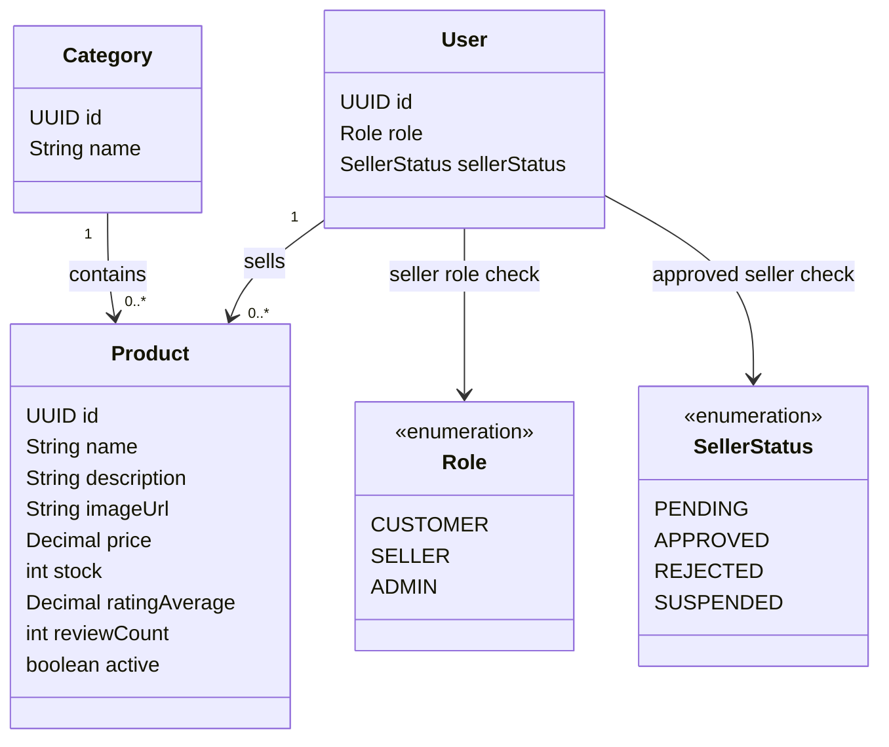

# Tính năng Catalog

## Mục đích

Sở hữu danh mục (category), sản phẩm, khả năng hiển thị sản phẩm, tồn kho và duyệt catalog của khách hàng.

## Trách nhiệm

- Quản lý danh mục cho Admin.
- Seller tạo, cập nhật, xóa/xóa mềm sản phẩm và quản lý tồn kho.
- Khách hàng duyệt, tìm kiếm, lọc và phân trang sản phẩm.
- Thực thi quy tắc hoạt động sản phẩm và tồn kho dùng bởi giỏ hàng và checkout.
- Giữ mỗi sản phẩm thuộc đúng một danh mục và một seller.

## API dự kiến

```text
GET    /api/products
GET    /api/products/{id}
GET    /api/categories
POST   /api/seller/products
PATCH  /api/seller/products/{id}
DELETE /api/seller/products/{id}
PATCH  /api/seller/products/{id}/stock
```

## Phân quyền

| Tác nhân | Thao tác cho phép | Ràng buộc |
|---|---|---|
| CUSTOMER | Duyệt sản phẩm, danh mục, tìm kiếm, lọc, phân trang | Chỉ dữ liệu catalog đang hoạt động/hiển thị được công khai. |
| SELLER | Quản lý sản phẩm và tồn kho | Chỉ các sản phẩm thuộc sở hữu của seller đã xác thực; áp dụng phê duyệt seller. |
| ADMIN | Quản lý danh mục và giám sát catalog | Yêu cầu ủy quyền admin. |

## Sơ đồ lớp trọng tâm



## Quy tắc quan trọng

- `price > 0` và `stock >= 0`.
- `ratingAverage` nằm trong khoảng `0` đến `5`, và `reviewCount >= 0`.
- `active = false` nghĩa là đã xóa mềm hoặc ẩn khỏi danh mục.
- Seller không được sửa sản phẩm của seller khác.
- Giá trị tiền tệ dùng `BigDecimal` trong implementation.
- Danh sách catalog mặc định sắp xếp theo mức liên quan khi có từ khóa tìm kiếm và `rating_desc` trong các trường hợp còn lại. Các sắp xếp được hỗ trợ là `relevance`, `price_asc`, `price_desc` và `rating_desc`; `popular` được hoãn lại cho đến khi có chỉ số popularity. Kết quả dùng `id ASC` để phá hòa một cách xác định.

## Mô hình dữ liệu

Catalog sở hữu danh mục và sản phẩm. Quyền sở hữu sản phẩm được thể hiện bằng quan hệ seller; các hàng cart, order, review và chat tham chiếu sản phẩm nhưng không sở hữu dữ liệu catalog.

### Quan hệ bảng

- `categories (1) -> products (many)`: mỗi sản phẩm thuộc một danh mục.
- `users (1) -> products (many)`: một seller có thể sở hữu nhiều sản phẩm; `products.sellerId` là ranh giới sở hữu.
- `products.id` được tham chiếu bởi `cart_items.productId`, `order_items.productId`, `reviews.productId` và `conversations.productId` tùy chọn.
- `active = false` ẩn sản phẩm mà không xóa các tham chiếu order hay review lịch sử.

### Ý nghĩa trường

| Bảng | Trường | Ý nghĩa |
|---|---|---|
| `categories` | `id` | Định danh danh mục. |
| `categories` | `name` | Nhãn danh mục duy nhất hiển thị cho client. |
| `products` | `id` | Định danh sản phẩm dùng bởi các tham chiếu cart, order, review và chat. |
| `products` | `name` | Tên sản phẩm hiển thị cho khách hàng. |
| `products` | `description` | Văn bản chi tiết sản phẩm dùng bởi catalog và AI tìm kiếm công khai. |
| `products` | `imageUrl` | Ảnh sản phẩm chính dùng bởi catalog MVP và trang chi tiết sản phẩm. |
| `products` | `price` | Giá bán hiện tại tính bằng `VND`; phải lớn hơn 0 và được biểu diễn bằng `BigDecimal`. |
| `products` | `stock` | Số lượng khả dụng hiện tại; không được âm. |
| `products` | `ratingAverage` | Điểm đánh giá trung bình hướng đọc, suy ra từ các review đủ điều kiện. |
| `products` | `reviewCount` | Số review đủ điều kiện được thể hiện trong tóm tắt catalog. |
| `products` | `active` | Cờ hiển thị; false nghĩa là đã ẩn hoặc xóa mềm. |
| `products` | `categoryId` | Quan hệ danh mục bắt buộc. |
| `products` | `sellerId` | Seller sở hữu; dùng cho ủy quyền và cập nhật tồn kho theo phạm vi seller. |

MVP mobile đầu tiên dùng một ảnh cho mỗi sản phẩm và không mô hình hóa biến thể màu sắc/kích thước. Mô hình biến thể sau này không được âm thầm thay đổi ý nghĩa của trường `stock` cấp sản phẩm.

Migration catalog V2 hiện là placeholder, vì vậy các trường trên mô tả schema logic dự kiến thay vì bảng database đã áp dụng.
