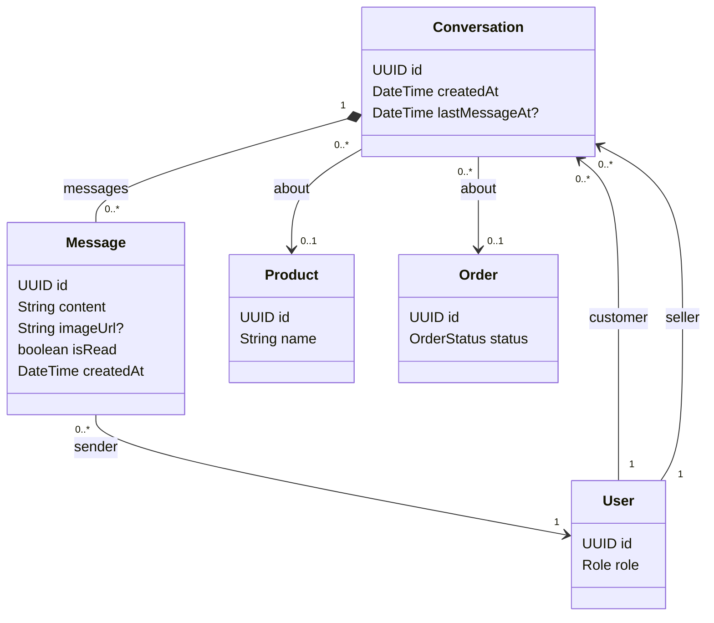

# Human Chat Feature

## Purpose

Owns customer/seller conversations, persisted messages, real-time updates, and message history.

## Responsibilities

- Pair a customer and seller in a conversation.
- Persist text/image messages and read state.
- Provide WebSocket real-time updates.
- Provide offline history loading.
- Apply retry and idempotency handling for messages.
- Allow a conversation to reference a product or order.

## Planned API

```text
WS  /ws/chat
GET /api/conversations
GET /api/conversations/{id}/messages
```

## Permissions

| Actor | Allowed operation | Constraint |
|---|---|---|
| CUSTOMER | Use conversations where they are the customer participant | Must not access another customer's conversation. |
| SELLER | Use conversations where they are the seller participant | Must not access another seller's conversation. |
| ADMIN | Monitor operations according to the administrative workflow | Administrative monitoring is not participant impersonation. |
| AI assistant | No human-chat ownership | AI chat is a separate feature and persistence model. |

## Focused class diagram



## Important rules

- The MVP conversation rule is unique `(customer, seller)`.
- Human chat and AI chat are separate concepts.
- Message retries need an idempotency strategy.

## Data model

Human chat has a participant conversation row and child message rows. It is separate from the AI
session/message model.

### Table relationships

- `users (1) -> conversations (many)` appears twice: once through `customerId` and once through `sellerId`.
- `conversations (1) -> messages (many)`: deleting or archiving a conversation must preserve the chosen message-retention policy.
- `messages.senderId -> users.id` identifies the actual sender and must be checked against conversation membership.
- `conversations.productId` and `conversations.orderId` are optional references used as context.

### Field meanings

| Table | Field | Meaning |
|---|---|---|
| `conversations` | `id` | Conversation identifier. |
| `conversations` | `createdAt` | Time at which the customer/seller conversation was opened. |
| `conversations` | `lastMessageAt` | Optional timestamp used for sorting; empty when no message exists. |
| `conversations` | `customerId` | Customer participant. |
| `conversations` | `sellerId` | Seller participant. |
| `conversations` | `productId` | Optional product context for the conversation. |
| `conversations` | `orderId` | Optional order context for support or after-sales discussion. |
| `messages` | `id` | Message identifier. |
| `messages` | `content` | Text content of the message. |
| `messages` | `imageUrl` | Optional image attachment reference. |
| `messages` | `isRead` | Whether the intended recipient has read the message. |
| `messages` | `createdAt` | Message creation time used for ordering. |
| `messages` | `conversationId` | Parent conversation. |
| `messages` | `senderId` | User who sent the message. |

The historical V9 migration is a placeholder. V13 creates the conversation/message tables; message
idempotency behavior remains to be finalized with the WebSocket persistence implementation.
