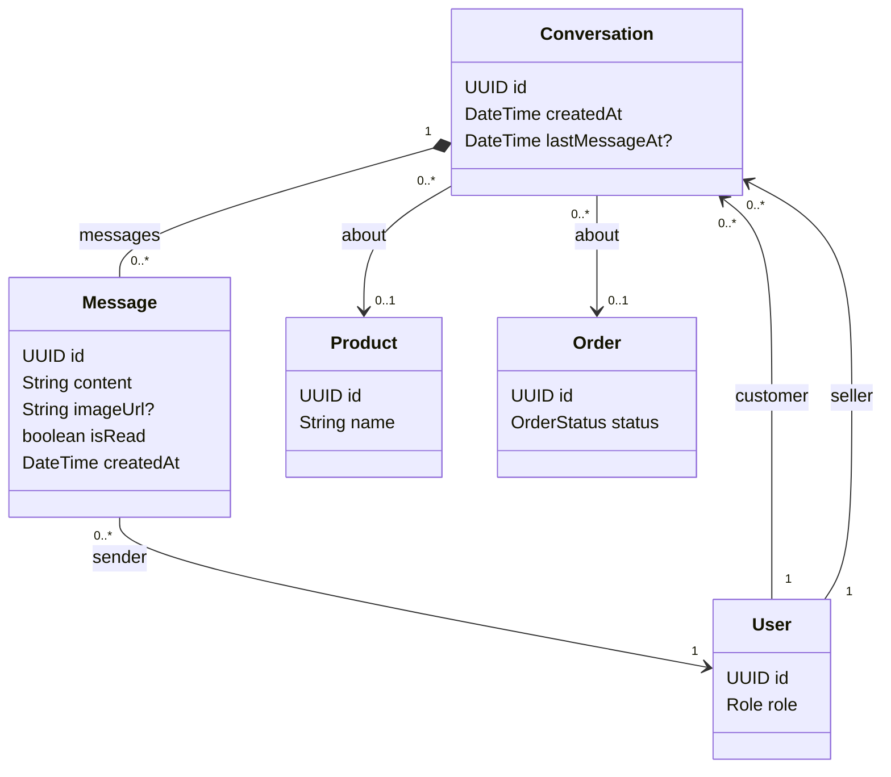

# Tính năng Human Chat

## Mục đích

Sở hữu hội thoại customer/seller, tin nhắn lưu trữ, cập nhật thời gian thực và lịch sử tin nhắn.

## Trách nhiệm

- Ghép cặp customer và seller trong một hội thoại.
- Lưu trữ tin nhắn văn bản/ảnh và trạng thái đã đọc.
- Cung cấp cập nhật thời gian thực qua WebSocket.
- Cung cấp tải lịch sử offline.
- Áp dụng xử lý retry và idempotency cho tin nhắn.
- Cho phép hội thoại tham chiếu sản phẩm hoặc đơn hàng.

## API dự kiến

```text
WS  /ws/chat
GET /api/conversations
GET /api/conversations/{id}/messages
```

## Phân quyền

| Tác nhân | Thao tác cho phép | Ràng buộc |
|---|---|---|
| CUSTOMER | Dùng các hội thoại mà họ là participant customer | Không được truy cập hội thoại của customer khác. |
| SELLER | Dùng các hội thoại mà họ là participant seller | Không được truy cập hội thoại của seller khác. |
| ADMIN | Giám sát vận hành theo quy trình quản trị | Giám sát quản trị không phải mạo danh participant. |
| Trợ lý AI | Không sở hữu human-chat | AI chat là tính năng và mô hình lưu trữ riêng. |

## Sơ đồ lớp trọng tâm



## Quy tắc quan trọng

- Quy tắc hội thoại MVP là `(customer, seller)` duy nhất.
- Human chat và AI chat là hai khái niệm riêng biệt.
- Retry tin nhắn cần chiến lược idempotency.

## Mô hình dữ liệu

Human chat có một hàng hội thoại participant và các hàng tin nhắn con. Mô hình này tách biệt với mô hình session/message của AI.

### Quan hệ bảng

- `users (1) -> conversations (many)` xuất hiện hai lần: một lần qua `customerId` và một lần qua `sellerId`.
- `conversations (1) -> messages (many)`: xóa hay lưu trữ hội thoại phải giữ nguyên chính sách lưu giữ tin nhắn đã chọn.
- `messages.senderId -> users.id` xác định người gửi thực tế và phải được kiểm tra với tư cách thành viên hội thoại.
- `conversations.productId` và `conversations.orderId` là các tham chiếu tùy chọn dùng làm ngữ cảnh.

### Ý nghĩa trường

| Bảng | Trường | Ý nghĩa |
|---|---|---|
| `conversations` | `id` | Định danh hội thoại. |
| `conversations` | `createdAt` | Thời điểm hội thoại customer/seller được mở. |
| `conversations` | `lastMessageAt` | Timestamp tùy chọn dùng để sắp xếp; rỗng khi chưa có tin nhắn. |
| `conversations` | `customerId` | Participant customer. |
| `conversations` | `sellerId` | Participant seller. |
| `conversations` | `productId` | Ngữ cảnh sản phẩm tùy chọn cho hội thoại. |
| `conversations` | `orderId` | Ngữ cảnh đơn hàng tùy chọn cho hỗ trợ hoặc thảo luận sau bán. |
| `messages` | `id` | Định danh tin nhắn. |
| `messages` | `content` | Nội dung văn bản của tin nhắn. |
| `messages` | `imageUrl` | Tham chiếu ảnh đính kèm tùy chọn. |
| `messages` | `isRead` | Người nhận dự kiến đã đọc tin nhắn hay chưa. |
| `messages` | `createdAt` | Thời điểm tạo tin nhắn dùng để sắp xếp. |
| `messages` | `conversationId` | Hội thoại cha. |
| `messages` | `senderId` | Người dùng đã gửi tin nhắn. |

Migration V9 lịch sử là placeholder. V13 tạo bảng conversation/message; hành vi idempotency vẫn cần được chốt khi triển khai lưu trữ WebSocket.
