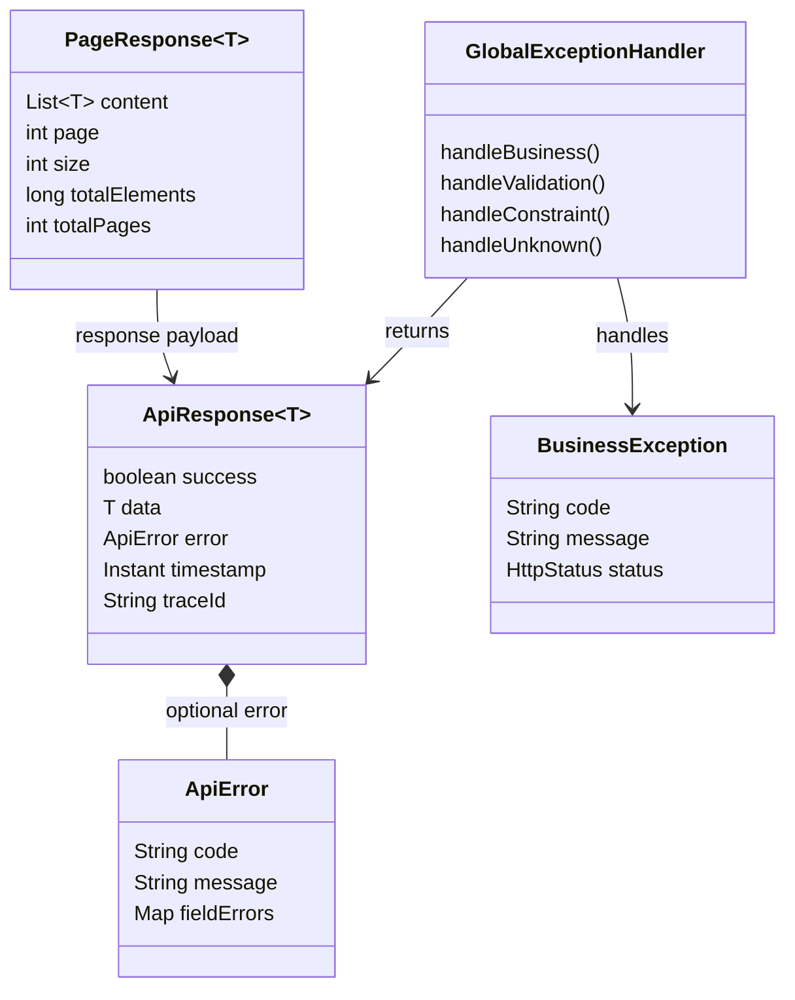

# Common Module

## Purpose

Provides shared technical contracts used by all features. This is a shared module, not a business
feature and not a replacement for feature-specific services.

## Responsibilities

- Define the common API response shape.
- Define consistent error payloads.
- Map business, validation, and unexpected exceptions at the API boundary.
- Provide shared configuration and utilities.
- Keep common code independent of a particular business feature.

The endpoint-specific examples and generic response types are defined in
[`API_CONTRACT.md`](../../API_CONTRACT.md). Every top-level controller response with a body uses
`ApiResponse<T>`; `204 No Content` responses have no body.

## Permissions

| Actor | Allowed operation | Constraint |
|---|---|---|
| Feature controllers | Use common response and exception contracts | Must preserve the feature's business rules. |
| Feature services | Throw business exceptions for expected rule violations | Must not use common errors to hide ownership checks. |
| CUSTOMER/SELLER/ADMIN | Receive consistent API responses | Common response formatting does not grant access. |
| External client | Read error code/message contract | Internal exception details must not be exposed. |

## Focused class diagram

## Response boundary

- Successful responses use `success=true` and `data`.
- Expected errors use `success=false` and an error `code`/`message`.
- The wire envelope also includes `timestamp` and `traceId`; successful responses set `error = null`,
  while error responses set `data = null`.
- Validation errors use `VALIDATION_ERROR`.
- Unexpected errors return a safe `INTERNAL_ERROR` message rather than internal details.
- Production configuration must disable framework message/binding-error inclusion, such as
  `server.error.include-message=never` and `server.error.include-binding-errors=never`.
- Integration tests must verify that malformed requests and unhandled exceptions do not expose stack
  traces, binding details, SQL text, or internal exception messages.
- Pagination uses a zero-based page index following Spring Data conventions.

## Data model

Common owns no business tables and therefore has no foreign-key relationships. It defines transport
objects returned by feature controllers; those objects must not be mistaken for persisted entities.

### Table relationships

None. `ApiResponse`, `ApiError`, `PageResponse`, and exception classes are API/application contracts.

### Field meanings

| Contract | Field | Meaning |
|---|---|---|
| `ApiResponse<T>` | `success` | Whether the request completed successfully. |
| `ApiResponse<T>` | `data` | Typed feature response payload when the request succeeds. |
| `ApiResponse<T>` | `error` | Optional normalized error payload when the request fails. |
| `ApiResponse<T>` | `timestamp` | Time at which the response was generated. |
| `ApiResponse<T>` | `traceId` | Request identifier used to correlate client errors with server logs. |
| `ApiError` | `code` | Stable machine-readable error code. |
| `ApiError` | `message` | Safe client-facing explanation. |
| `ApiError` | `fieldErrors` | Optional validation messages keyed by request field. |
| `PageResponse<T>` | `content` | Page items returned by the feature. |
| `PageResponse<T>` | `page` / `size` | Zero-based page index and requested page size. |
| `PageResponse<T>` | `totalElements` / `totalPages` | Result count and number of available pages. |
