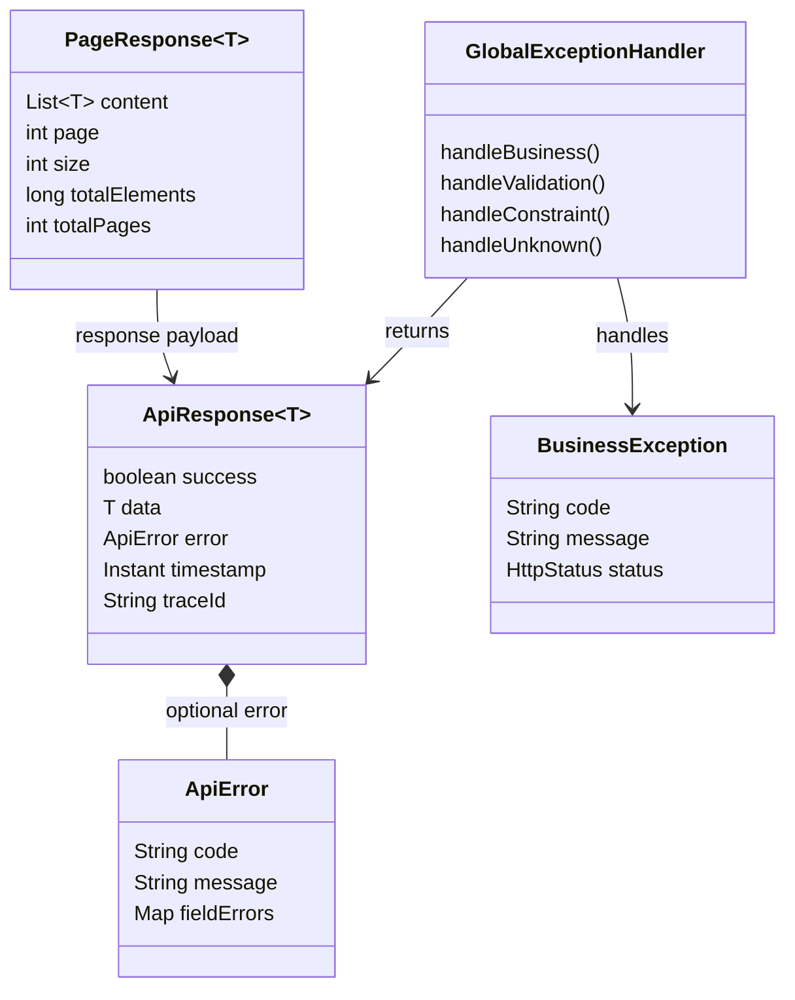

# Module Common

## Mục đích

Cung cấp các hợp đồng kỹ thuật dùng chung cho mọi tính năng. Đây là module dùng chung, không phải tính năng nghiệp vụ và không thay thế service riêng của từng tính năng.

## Trách nhiệm

- Định nghĩa hình dạng response API chung.
- Định nghĩa payload lỗi nhất quán.
- Ánh xạ các exception nghiệp vụ, validation và ngoài dự kiến tại ranh giới API.
- Cung cấp cấu hình và tiện ích dùng chung.
- Giữ code chung độc lập với từng tính năng nghiệp vụ cụ thể.

Các ví dụ endpoint và kiểu response generic được định nghĩa trong
[`API_CONTRACT.vi.md`](../../API_CONTRACT.vi.md). Mọi response top-level của controller có body đều dùng
`ApiResponse<T>`; response `204 No Content` không có body.

## Phân quyền

| Tác nhân | Thao tác cho phép | Ràng buộc |
|---|---|---|
| Feature controller | Dùng hợp đồng response và exception chung | Phải giữ nguyên quy tắc nghiệp vụ của tính năng. |
| Feature service | Ném business exception cho các vi phạm quy tắc dự kiến | Không được dùng lỗi chung để che giấu kiểm tra sở hữu. |
| CUSTOMER/SELLER/ADMIN | Nhận response API nhất quán | Định dạng response chung không cấp quyền truy cập. |
| Client ngoài | Đọc hợp đồng mã lỗi/thông điệp | Không được lộ chi tiết exception nội bộ. |

## Sơ đồ lớp trọng tâm

## Ranh giới response

- Response thành công dùng `success=true` và `data`.
- Lỗi dự kiến dùng `success=false` cùng `code`/`message` lỗi.
- Envelope trên đường truyền còn gồm `timestamp` và `traceId`; response thành công đặt `error = null`, còn response lỗi đặt `data = null`.
- Lỗi validation dùng `VALIDATION_ERROR`.
- Lỗi ngoài dự kiến trả về thông điệp `INTERNAL_ERROR` an toàn thay vì chi tiết nội bộ.
- Cấu hình production phải tắt việc kèm thông điệp/binding-error của framework, ví dụ `server.error.include-message=never` và `server.error.include-binding-errors=never`.
- Test tích hợp phải xác minh rằng request sai định dạng và exception không được xử lý không lộ stack trace, chi tiết binding, câu SQL hay thông điệp exception nội bộ.
- Phân trang dùng chỉ số trang zero-based theo quy ước Spring Data.

## Mô hình dữ liệu

Common không sở hữu bảng nghiệp vụ nào nên không có quan hệ khóa ngoại. Common định nghĩa các đối tượng truyền tải do feature controller trả về; các đối tượng đó không được nhầm với entity lưu trữ.

### Quan hệ bảng

Không có. `ApiResponse`, `ApiError`, `PageResponse` và các class exception là hợp đồng API/application.

### Ý nghĩa trường

| Hợp đồng | Trường | Ý nghĩa |
|---|---|---|
| `ApiResponse<T>` | `success` | Request có hoàn thành thành công hay không. |
| `ApiResponse<T>` | `data` | Payload response có kiểu của tính năng khi request thành công. |
| `ApiResponse<T>` | `error` | Payload lỗi chuẩn hóa tùy chọn khi request thất bại. |
| `ApiResponse<T>` | `timestamp` | Thời điểm response được tạo. |
| `ApiResponse<T>` | `traceId` | Định danh request dùng để đối chiếu lỗi client với log server. |
| `ApiError` | `code` | Mã lỗi ổn định, máy có thể đọc. |
| `ApiError` | `message` | Diễn giải an toàn hướng tới client. |
| `ApiError` | `fieldErrors` | Thông điệp validation tùy chọn, keyed theo trường request. |
| `PageResponse<T>` | `content` | Các phần tử trang do tính năng trả về. |
| `PageResponse<T>` | `page` / `size` | Chỉ số trang zero-based và kích thước trang được yêu cầu. |
| `PageResponse<T>` | `totalElements` / `totalPages` | Tổng số kết quả và số trang khả dụng. |
