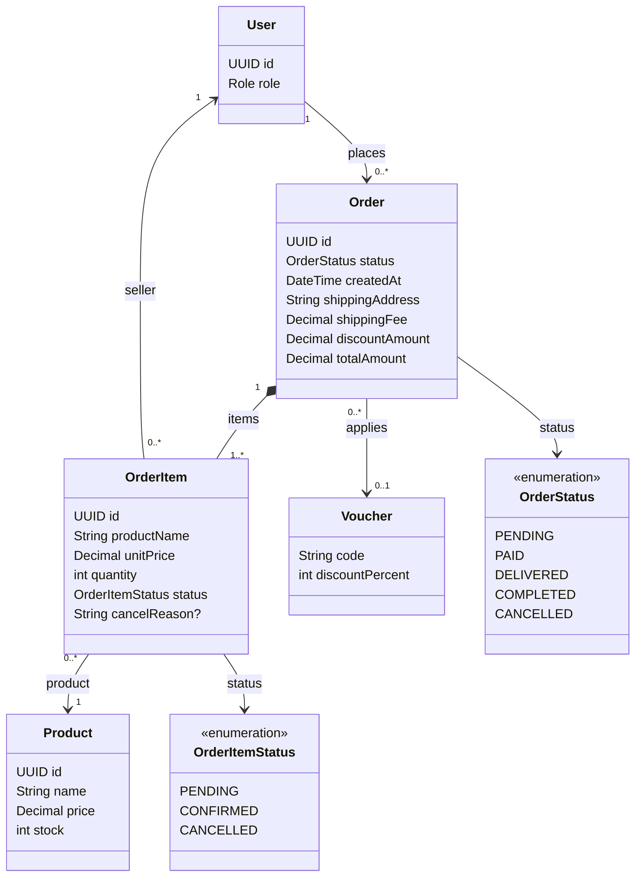

# Order Feature

## Purpose

Owns checkout, order snapshots, order-item seller processing, order status, and multi-seller order
composition.

## MVP boundary

The first mobile MVP includes customer checkout, order creation, and customer-owned order lookup.
Seller order-item processing and multi-seller isolation remain required backend behavior, while Seller
management screens are deferred.

## Responsibilities

- Validate the selected cart products and stock before checkout (voucher validation arrives in Phase 8).
- Create `Order(PENDING)` transactionally.
- Create order items with product name and unit-price snapshots.
- Decrease stock and remove the purchased cart items; unselected cart items stay in the cart.
- Set a 24-hour prepayment deadline from order creation time; COD remains pending until all required
  non-cancelled shipments are delivered.
- Apply discount, shipping, and total snapshots.
- Allow sellers to confirm or cancel only their own order items.
- Allow direct order-item cancellation only before shipment assignment. For an assigned
  `PENDING`/`PREPARING` shipment, shipment cancellation marks the mapped lines `CANCELLED` and
  releases unshipped stock exactly once.
- Expose customer-owned orders and seller-owned order items.

## Planned API

```text
POST  /api/v1/orders
GET   /api/v1/orders
GET   /api/v1/orders/{id}
PATCH /api/v1/orders/{id}/received
GET   /api/v1/seller/order-items
PATCH /api/v1/seller/order-items/{id}/confirm
PATCH /api/v1/seller/order-items/{id}/cancel
```

## Permissions

| Actor | Allowed operation | Constraint |
|---|---|---|
| CUSTOMER | Create and view their own orders | Checkout is server-validated and transactional. |
| SELLER | Query, confirm, or cancel owned order items | Require `orderItem.seller.id == authenticatedSeller.id`. |
| ADMIN | Monitor and perform configured administrative operations | Must not bypass domain invariants. |

## Focused class diagram



## Important rules

- One order must contain at least one order item.
- A multi-seller cart creates one order with seller attribution at `OrderItem` level.
- `OrderItem.productName` and `OrderItem.unitPrice` are historical snapshots.
- `OrderItemStatus` tracks seller processing; shipment progress belongs to `ShipmentStatus`.
- A prepayment order is cancelled after 24 hours and restores checkout stock exactly once; COD is exempt.
- COD payment completion is recorded only after all required non-cancelled shipments are `DELIVERED`;
  partial settlement for mixed `FAILED`/`RETURNED` outcomes is deferred.
- An order item cannot be directly cancelled after assignment. Assigned `PENDING`/`PREPARING` lines
  can be cancelled only through the atomic shipment-cancellation path; `SHIPPED` or later states are
  not cancellable.
- Before payment completion, cancellation recalculates `orders.totalAmount` and every pending
  `payments.amount` from the remaining non-cancelled line snapshots plus the fixed shipping fee. If all
  lines are cancelled, the order becomes `CANCELLED`; if delivered non-cancelled lines are all that
  remain, aggregate completion is reevaluated in the same transaction.
- `OrderStatus` is an order-level aggregate. Seller-specific `FAILED` and `RETURNED` outcomes are
  reported by the related shipments, not by changing the order status.
- For mixed terminal shipment outcomes, the order remains a container and the client reports each
  seller shipment independently; no new order-level success/failure status is inferred.

## Data model

An order is the customer-level checkout aggregate. Seller ownership is deliberately stored on each
`order_items` row so one order can contain products from multiple sellers.

### Table relationships

- `users (1) -> orders (many)`: `orders.userId` identifies the customer who placed the order.
- `orders (1) -> order_items (many)`: an order must contain at least one item.
- `products (1) -> order_items (many)`: the product reference supports fulfillment/history lookup.
- `users (1) -> order_items (many)`: `order_items.sellerId` identifies the seller responsible for that item.
- `vouchers (1) -> orders (many)`: `orders.voucherCode` is optional and at most one voucher applies to an order.
- Shipments reference the same order and selected whole order-item lines; `shipment.orderId` must equal
  `orderItem.orderId`, and an order item is assigned to at most one MVP shipment.
- Shipment outcome must not be collapsed into `OrderStatus`.

### Field meanings

| Table | Field | Meaning |
|---|---|---|
| `orders` | `id` | Customer-facing order identifier. |
| `orders` | `status` | Aggregate order state: `PENDING`, `PAID`, `DELIVERED`, or `CANCELLED`. |
| `orders` | `createdAt` | Start time for the 24-hour prepayment deadline. |
| `orders` | `shippingAddress` | Address snapshot used for this checkout. |
| `orders` | `shippingFee` | Shipping amount included in the order total; fixed at `0.00 VND` in the first MVP. |
| `orders` | `discountAmount` | Total discount applied at checkout. |
| `orders` | `totalAmount` | Current payable amount after item totals, discount, and shipping; it is recalculated after a valid pre-payment cancellation. |
| `orders` | `userId` | Customer owner. |
| `orders` | `voucherCode` | Optional applied voucher code. |
| `order_items` | `id` | Line-item identifier. |
| `order_items` | `productName` | Product-name snapshot captured at checkout. |
| `order_items` | `unitPrice` | Unit-price snapshot captured at checkout. |
| `order_items` | `quantity` | Quantity purchased for this seller/product line. |
| `order_items` | `status` | Seller processing state, separate from shipment delivery state. |
| `order_items` | `cancelReason` | Optional reason when the seller/customer cancellation rule applies. |
| `order_items` | `orderId` / `productId` / `sellerId` | Parent order, source product, and responsible seller references. |

The historical V4 migration is a placeholder. V13 creates the order tables while preserving the
immutable checkout snapshots described above.
