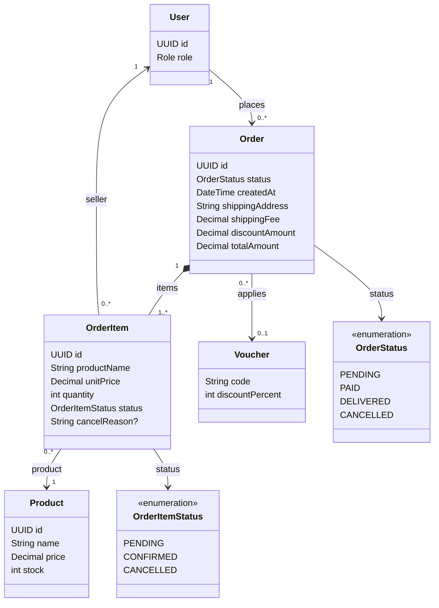

# Tính năng Order

## Mục đích

Sở hữu checkout, snapshot đơn hàng, xử lý order item của seller, trạng thái đơn hàng và cấu thành đơn hàng nhiều seller.

## Phạm vi MVP

MVP mobile đầu tiên gồm checkout của customer, tạo đơn hàng và tra cứu đơn hàng thuộc sở hữu của customer. Xử lý order item của seller và cô lập nhiều seller vẫn là hành vi backend bắt buộc, trong khi các màn hình quản lý của Seller được hoãn lại.

## Trách nhiệm

- Kiểm tra sản phẩm trong giỏ, tồn kho và voucher trước khi checkout.
- Tạo `Order(PENDING)` theo transaction.
- Tạo order item kèm snapshot tên sản phẩm và đơn giá.
- Giữ/giảm tồn kho và xóa các cart item đã mua.
- Đặt hạn thanh toán trước 24 giờ tính từ thời điểm tạo đơn; COD vẫn pending cho đến khi mọi shipment bắt buộc không bị hủy được giao.
- Áp dụng snapshot giảm giá, phí vận chuyển và tổng tiền.
- Cho phép seller xác nhận hoặc hủy chỉ các order item của mình.
- Cho phép hủy order item trực tiếp chỉ trước khi gán shipment. Với shipment `PENDING`/`PREPARING` đã gán, hủy shipment đánh dấu các dòng đã ánh xạ thành `CANCELLED` và giải phóng tồn kho chưa giao đúng một lần.
- Công khai các đơn hàng thuộc sở hữu của customer và order item thuộc sở hữu của seller.

## API dự kiến

```text
POST  /api/orders
GET   /api/orders
GET   /api/orders/{id}
GET   /api/seller/order-items
PATCH /api/seller/order-items/{id}/confirm
PATCH /api/seller/order-items/{id}/cancel
```

## Phân quyền

| Tác nhân | Thao tác cho phép | Ràng buộc |
|---|---|---|
| CUSTOMER | Tạo và xem đơn hàng của chính mình | Checkout được kiểm tra phía server và thực hiện theo transaction. |
| SELLER | Truy vấn, xác nhận hoặc hủy order item thuộc sở hữu | Yêu cầu `orderItem.seller.id == authenticatedSeller.id`. |
| ADMIN | Giám sát và thực hiện các thao tác quản trị đã cấu hình | Không được bỏ qua các bất biến miền. |

## Sơ đồ lớp trọng tâm



## Quy tắc quan trọng

- Một đơn hàng phải chứa ít nhất một order item.
- Giỏ hàng nhiều seller tạo một đơn hàng với định danh seller ở cấp `OrderItem`.
- `OrderItem.productName` và `OrderItem.unitPrice` là snapshot lịch sử.
- `OrderItemStatus` theo dõi xử lý của seller; tiến độ vận chuyển thuộc về `ShipmentStatus`.
- Đơn hàng trả trước bị hủy sau 24 giờ và hoàn tồn kho checkout đúng một lần; COD được miễn.
- Hoàn tất thanh toán COD chỉ được ghi nhận sau khi mọi shipment bắt buộc không bị hủy đều `DELIVERED`; quyết toán từng phần cho các kết quả `FAILED`/`RETURNED` hỗn hợp được hoãn lại.
- Order item không thể bị hủy trực tiếp sau khi gán. Các dòng `PENDING`/`PREPARING` đã gán chỉ có thể bị hủy qua đường hủy shipment nguyên tử; các trạng thái `SHIPPED` trở đi không được hủy.
- Trước khi hoàn tất thanh toán, hủy hợp lệ tính lại `orders.totalAmount` và mọi `payments.amount` đang pending từ các snapshot dòng còn lại không bị hủy cộng phí vận chuyển cố định. Nếu mọi dòng đều bị hủy, đơn hàng trở thành `CANCELLED`; nếu chỉ còn các dòng đã giao không bị hủy, việc hoàn tất gộp được đánh giá lại trong cùng transaction.
- `OrderStatus` là trạng thái gộp cấp đơn hàng. Các kết quả `FAILED` và `RETURNED` riêng của seller do các shipment liên quan báo cáo, không phải bằng cách đổi trạng thái đơn hàng.
- Với các kết quả shipment cuối hỗn hợp, đơn hàng vẫn là container và client báo cáo từng shipment seller độc lập; không suy ra trạng thái thành công/thất bại mới ở cấp đơn hàng.

## Mô hình dữ liệu

Đơn hàng là aggregate checkout cấp customer. Quyền sở hữu của seller được lưu chủ ý trên từng hàng `order_items` để một đơn hàng có thể chứa sản phẩm từ nhiều seller.

### Quan hệ bảng

- `users (1) -> orders (many)`: `orders.userId` xác định customer đặt đơn hàng.
- `orders (1) -> order_items (many)`: một đơn hàng phải chứa ít nhất một item.
- `products (1) -> order_items (many)`: tham chiếu sản phẩm hỗ trợ tra cứu fulfillment/lịch sử.
- `users (1) -> order_items (many)`: `order_items.sellerId` xác định seller chịu trách nhiệm cho item đó.
- `vouchers (1) -> orders (many)`: `orders.voucherCode` là tùy chọn và tối đa một voucher áp dụng cho một đơn hàng.
- Shipment tham chiếu cùng đơn hàng và các dòng order-item nguyên vẹn được chọn; `shipment.orderId` phải bằng `orderItem.orderId`, và một order item được gán cho tối đa một shipment MVP.
- Kết quả shipment không được gộp vào `OrderStatus`.

### Ý nghĩa trường

| Bảng | Trường | Ý nghĩa |
|---|---|---|
| `orders` | `id` | Định danh đơn hàng hiển thị cho customer. |
| `orders` | `status` | Trạng thái đơn hàng gộp: `PENDING`, `PAID`, `DELIVERED` hoặc `CANCELLED`. |
| `orders` | `createdAt` | Thời điểm bắt đầu hạn thanh toán trước 24 giờ. |
| `orders` | `shippingAddress` | Snapshot địa chỉ dùng cho lần checkout này. |
| `orders` | `shippingFee` | Phí vận chuyển tính vào tổng đơn; cố định ở `0.00 VND` trong MVP đầu tiên. |
| `orders` | `discountAmount` | Tổng giảm giá áp dụng tại lúc checkout. |
| `orders` | `totalAmount` | Số tiền phải trả hiện tại sau tổng các item, giảm giá và phí vận chuyển; được tính lại sau hủy hợp lệ trước thanh toán. |
| `orders` | `userId` | Customer sở hữu. |
| `orders` | `voucherCode` | Mã voucher đã áp dụng, tùy chọn. |
| `order_items` | `id` | Định danh dòng item. |
| `order_items` | `productName` | Snapshot tên sản phẩm ghi tại lúc checkout. |
| `order_items` | `unitPrice` | Snapshot đơn giá ghi tại lúc checkout. |
| `order_items` | `quantity` | Số lượng đã mua cho dòng seller/product này. |
| `order_items` | `status` | Trạng thái xử lý của seller, tách biệt với trạng thái giao hàng. |
| `order_items` | `cancelReason` | Lý do tùy chọn khi áp dụng quy tắc hủy của seller/customer. |
| `order_items` | `orderId` / `productId` / `sellerId` | Tham chiếu đơn hàng cha, sản phẩm nguồn và seller chịu trách nhiệm. |

Migration V4 hiện là placeholder; các trường logic trên phải được migrate mà không làm mất snapshot checkout bất biến.
