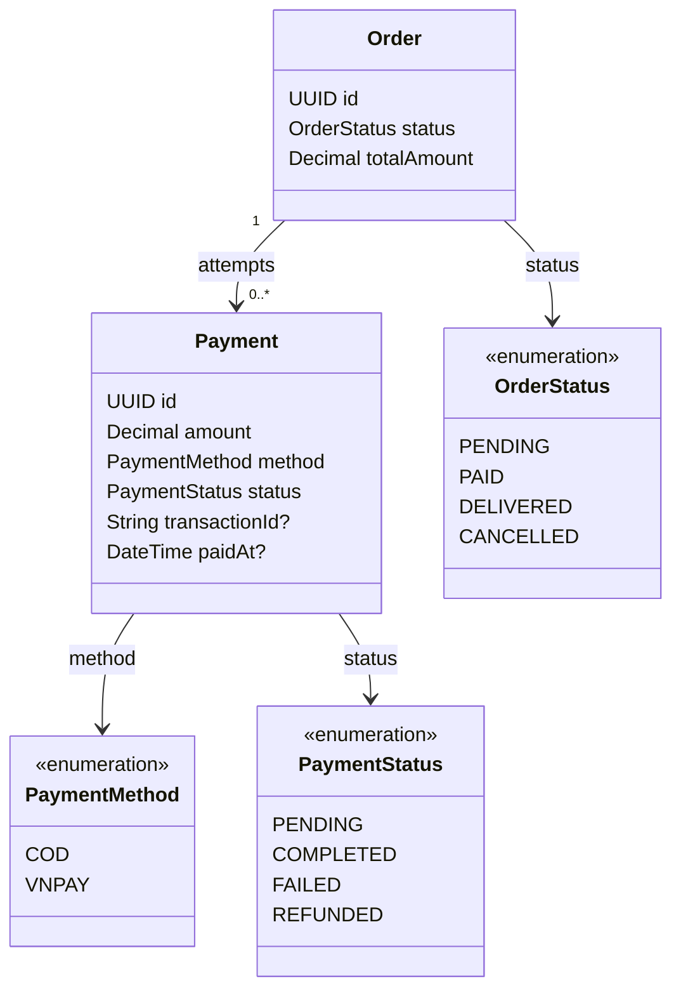

# Payment Feature

## Purpose

Owns payment attempts for orders, COD handling, VNPAY request/callback processing, and payment
idempotency.

## MVP boundary

The first checkout slice implements COD. The `Payment` model and status rules remain compatible with
VNPAY, but VNPAY request creation, callback validation, and retry UI are deferred until the COD flow
is verified end to end.

## Responsibilities

- Create a pending COD payment and complete it only after all required non-cancelled seller shipments
  are delivered in the MVP.
- Create VNPAY payment requests.
- Validate VNPAY callback signatures/checksums.
- Mark attempts completed or failed.
- Keep failed attempts so a retry creates another payment record.
- Use unique transaction/reference identifiers for idempotent callbacks.
- Update order payment state according to payment rules.
- Cancel a prepayment order after 24 hours from order creation and restore checkout stock exactly once;
  COD follows the delivery collection rule.

## Planned API

```text
POST /api/payments/vnpay/create
POST /api/payments/vnpay/callback
```

## Permissions

| Actor | Allowed operation | Constraint |
|---|---|---|
| CUSTOMER | Start payment for their own order and retry a failed attempt | Order ownership and payment state are checked. |
| VNPAY | Send callback data | Signature/checksum and idempotency must be validated. |
| ADMIN | Approve/refund under the administrative workflow | Refund is not an initial AI action. |
| SELLER | No direct payment mutation | Seller processes order items, not payment ownership. |

## Focused class diagram



## Important rules

- COD starts as `PENDING`.
- COD is marked `COMPLETED` by the shipment/payment services in the same transaction as the final
  required non-cancelled shipment transition to `DELIVERED`.
- If any seller shipment becomes `FAILED` or `RETURNED`, the MVP records no COD collection, partial
  settlement, or refund; shipment statuses remain the source of truth for each seller.
- Before payment completion, an allowed item or shipment cancellation updates every pending payment's
  `amount` to the recalculated order payable total. If all lines are cancelled, the order is cancelled
  and the pending COD attempt is not collectible; if delivered non-cancelled lines are all that remain,
  the payment service reevaluates completion in the same transaction.
- VNPAY starts as `PENDING` and ends as `COMPLETED` or `FAILED`.
- A failed attempt does not destroy the order.
- Retry creates another `Payment`; it does not overwrite the failed record.
- The 24-hour prepayment deadline is measured from `Order.createdAt`, not from each payment retry.
- When the deadline expires without a completed prepayment, the order is cancelled and its checkout
  stock is restored exactly once. COD is exempt because it is collected on delivery.

## Data model

Payment stores attempts, not just the current payment state. This allows a failed VNPAY attempt to
remain auditable while a later retry creates another row.

### Table relationships

- `orders (1) -> payments (many)`: one order may have several payment attempts.
- `payments.orderId -> orders.id` is the ownership boundary for customer payment operations.
- `transactionId` is unique when a gateway transaction/reference exists; it is `NULL` before VNPAY returns one.
- Payment status does not replace the aggregate `orders.status`; the order service coordinates both states.

### Field meanings

| Table | Field | Meaning |
|---|---|---|
| `payments` | `id` | Identifier for one payment attempt. |
| `payments` | `amount` | Amount requested or recorded for this attempt. |
| `payments` | `method` | `COD` or `VNPAY`. |
| `payments` | `status` | `PENDING`, `COMPLETED`, `FAILED`, or `REFUNDED`. |
| `payments` | `transactionId` | Nullable unique gateway/reference ID used for callback idempotency; use `NULL` before one exists. |
| `payments` | `paidAt` | Nullable completion timestamp; use `NULL` while not completed. |
| `payments` | `orderId` | Order that owns the attempt. |

The historical V6 migration is a placeholder. V13 creates the payment schema and transaction ID
uniqueness; gateway callback validation and retry behavior remain application-layer work.
