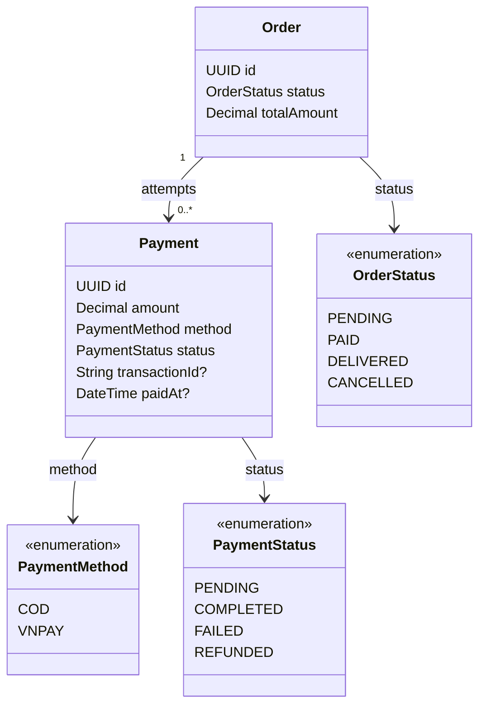

# Tính năng Payment

## Mục đích

Sở hữu các lần thanh toán cho đơn hàng, xử lý COD, xử lý request/callback VNPAY và idempotency thanh toán.

## Phạm vi MVP

COD có từ Phase 4. Phase 6 thêm VNPAY trên VNPAY sandbox: checkout tạo lần thử đầu tiên và trả link thanh toán, kết quả về qua IPN và Return URL, và một endpoint retry cấp lần thử mới. Hoàn tất COD phụ thuộc shipment nên làm ở Phase 7.

## Trách nhiệm

- Tạo thanh toán COD pending và chỉ hoàn tất sau khi mọi shipment seller bắt buộc không bị hủy trong MVP được giao.
- Tạo request thanh toán VNPAY.
- Kiểm tra chữ ký/checksum callback VNPAY.
- Đánh dấu các lần thử đã hoàn tất hoặc thất bại.
- Giữ các lần thử thất bại để retry tạo bản ghi thanh toán khác.
- Dùng định danh transaction/tham chiếu duy nhất cho callback idempotent.
- Cập nhật trạng thái thanh toán của đơn hàng theo quy tắc thanh toán.
- Hủy đơn hàng trả trước sau 24 giờ tính từ lúc tạo đơn và hoàn tồn kho checkout đúng một lần; COD tuân theo quy tắc thu hộ khi giao hàng.

## API dự kiến

```text
POST /api/v1/payments/vnpay/create
GET  /api/v1/payments/vnpay/ipn
GET  /api/v1/payments/vnpay/return
```

## Phân quyền

| Tác nhân | Thao tác cho phép | Ràng buộc |
|---|---|---|
| CUSTOMER | Bắt đầu thanh toán cho đơn hàng của mình và retry lần thử thất bại | Quyền sở hữu đơn hàng và trạng thái thanh toán được kiểm tra. |
| VNPAY | Gửi dữ liệu callback | Chữ ký/checksum và idempotency phải được kiểm tra. |
| ADMIN | Phê duyệt/hoàn tiền theo quy trình quản trị | Hoàn tiền không phải hành động AI ban đầu. |
| SELLER | Không sửa thanh toán trực tiếp | Seller xử lý order item, không sở hữu thanh toán. |

## Sơ đồ lớp trọng tâm



## Quy tắc quan trọng

- COD bắt đầu ở trạng thái `PENDING`.
- COD được đánh dấu `COMPLETED` bởi các service shipment/payment trong cùng transaction với lần chuyển shipment bắt buộc không bị hủy cuối cùng sang `DELIVERED`.
- Nếu shipment của bất kỳ seller nào trở thành `FAILED` hoặc `RETURNED`, MVP không ghi nhận thu hộ COD, quyết toán từng phần hay hoàn tiền; trạng thái shipment vẫn là nguồn sự thật cho từng seller.
- Trước khi hoàn tất thanh toán, hủy item hoặc shipment được phép cập nhật mọi `amount` thanh toán đang pending thành tổng phải trả của đơn được tính lại. Nếu mọi dòng đều bị hủy, đơn hàng bị hủy và lần thử COD pending không thể thu, được đánh dấu `FAILED`; nếu chỉ còn các dòng đã giao không bị hủy, service thanh toán đánh giá lại việc hoàn tất trong cùng transaction.
- VNPAY bắt đầu ở `PENDING` và kết thúc ở `COMPLETED` hoặc `FAILED`.
- Lần thử thất bại không xóa đơn hàng.
- Retry tạo một `Payment` khác; không ghi đè bản ghi thất bại.
- Retry hoặc tổng đơn thay đổi sẽ đánh `FAILED` mọi lần thử VNPAY đang chờ trước, nên link thanh toán cũ không thể hoàn tất đơn nữa.
- Hạn trả trước 24 giờ được đo từ `Order.createdAt`, không đo từ mỗi lần retry thanh toán.
- Khi hạn hết mà không có thanh toán trước nào hoàn tất, đơn hàng bị hủy và tồn kho checkout được hoàn đúng một lần. COD được miễn vì được thu hộ khi giao hàng.

## Mô hình dữ liệu

Payment lưu các lần thử, không chỉ trạng thái thanh toán hiện tại. Điều này cho phép lần thử VNPAY thất bại vẫn có thể audit trong khi lần retry sau tạo một hàng khác.

### Quan hệ bảng

- `orders (1) -> payments (many)`: một đơn hàng có thể có nhiều lần thanh toán.
- `payments.orderId -> orders.id` là ranh giới sở hữu cho các thao tác thanh toán của customer.
- `transactionId` giữ mã tham chiếu gửi đi dưới tên `vnp_TxnRef`; là duy nhất và được gán khi tạo lần thử VNPAY. Lần thử COD giữ `NULL`.
- Trạng thái thanh toán không thay thế `orders.status` gộp; service order điều phối cả hai trạng thái.

### Ý nghĩa trường

| Bảng | Trường | Ý nghĩa |
|---|---|---|
| `payments` | `id` | Định danh cho một lần thanh toán. |
| `payments` | `amount` | Số tiền được yêu cầu hoặc ghi nhận cho lần thử này. |
| `payments` | `method` | `COD` hoặc `VNPAY`. |
| `payments` | `status` | `PENDING`, `COMPLETED`, `FAILED` hoặc `REFUNDED`. |
| `payments` | `transactionId` | ID cổng/tham chiếu duy nhất nullable dùng cho idempotency callback; dùng `NULL` trước khi tồn tại. |
| `payments` | `paidAt` | Timestamp hoàn tất nullable; dùng `NULL` khi chưa hoàn tất. |
| `payments` | `orderId` | Đơn hàng sở hữu lần thử. |

Migration V6 lịch sử là placeholder. V13 tạo schema payment và tính duy nhất transaction ID; kiểm tra callback và hành vi retry vẫn thuộc application layer.
