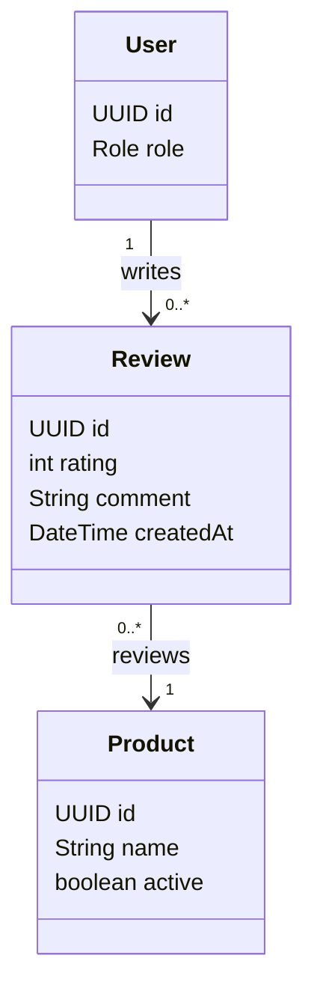

# Review Feature

## Purpose

Owns product reviews, review eligibility, rating validation, and review uniqueness.

## MVP boundary

The first mobile MVP supports one eligible customer review containing a rating and comment. Review
tags and image attachments are deferred.

## Responsibilities

- Confirm that the customer purchased and received the product.
- Create and read product reviews.
- Enforce one review per customer/product.
- Validate rating range `[1..5]`.
- Support administrative moderation rules when implemented.

## Planned API

```text
POST /api/products/{productId}/reviews
GET  /api/products/{productId}/reviews
```

## Permissions

| Actor | Allowed operation | Constraint |
|---|---|---|
| UNAUTHENTICATED USER | Read public product reviews | Only public review fields are exposed. |
| CUSTOMER | Create a review for an eligible product and read reviews | Must have purchased and received the product; one review per product. |
| SELLER | Read public product reviews | Seller does not create a review as the customer. |
| ADMIN | Moderate violations when the moderation workflow is implemented | Must follow the administrative rule. |

## Focused class diagram



## Important rules

- Eligibility requires purchase and receipt/delivery.
- `(user, product)` is unique.
- Rating must be between 1 and 5.

## Data model

Reviews connect a customer to a product after a completed/received purchase. The review row is not
the source of order eligibility; the review service must verify purchase and delivery history first.

### Table relationships

- `users (1) -> reviews (many)`: `reviews.userId` identifies the author.
- `products (1) -> reviews (many)`: `reviews.productId` identifies the reviewed product.
- A unique constraint on `(userId, productId)` allows at most one review by a customer for a product.
- Order and shipment tables are read to verify eligibility, but no direct order FK is modeled in the review table.

### Field meanings

| Table | Field | Meaning |
|---|---|---|
| `reviews` | `id` | Review identifier. |
| `reviews` | `rating` | Integer score from `1` to `5`. |
| `reviews` | `comment` | Customer feedback text. |
| `reviews` | `createdAt` | Time at which the review was submitted. |
| `reviews` | `userId` | Customer author. |
| `reviews` | `productId` | Product being reviewed. |

The V8 migration is currently a placeholder; the final schema must preserve the uniqueness and rating
constraints above.
