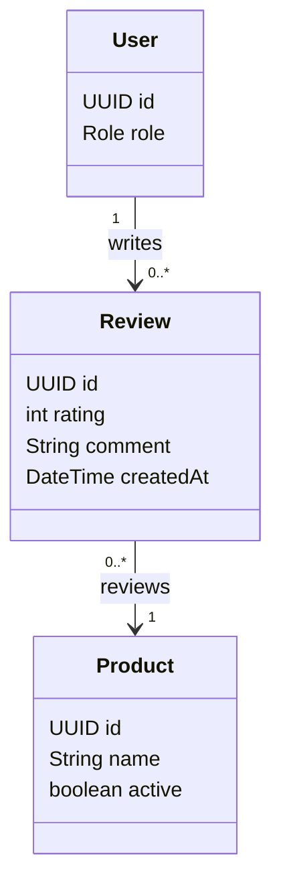

# Tính năng Review

## Mục đích

Sở hữu đánh giá sản phẩm, điều kiện đánh giá, kiểm tra rating và tính duy nhất của đánh giá.

## Phạm vi MVP

MVP mobile đầu tiên hỗ trợ một đánh giá của customer đủ điều kiện gồm rating và bình luận. Tag đánh giá và ảnh đính kèm được hoãn lại.

## Trách nhiệm

- Xác nhận customer đã mua và nhận sản phẩm.
- Tạo và đọc đánh giá sản phẩm.
- Thực thi một đánh giá cho mỗi customer/product.
- Kiểm tra khoảng rating `[1..5]`.
- Hỗ trợ quy tắc kiểm duyệt quản trị khi được triển khai.

## API dự kiến

```text
POST /api/products/{productId}/reviews
GET  /api/products/{productId}/reviews
```

## Phân quyền

| Tác nhân | Thao tác cho phép | Ràng buộc |
|---|---|---|
| UNAUTHENTICATED USER | Đọc đánh giá sản phẩm công khai | Chỉ các trường đánh giá công khai được công khai. |
| CUSTOMER | Tạo đánh giá cho sản phẩm đủ điều kiện và đọc đánh giá | Phải đã mua và nhận sản phẩm; một đánh giá cho mỗi sản phẩm. |
| SELLER | Đọc đánh giá sản phẩm công khai | Seller không tạo đánh giá với tư cách customer. |
| ADMIN | Kiểm duyệt vi phạm khi quy trình kiểm duyệt được triển khai | Phải tuân theo quy tắc quản trị. |

## Sơ đồ lớp trọng tâm



## Quy tắc quan trọng

- Điều kiện yêu cầu đã mua và đã nhận/giao hàng.
- `(user, product)` là duy nhất.
- Rating phải nằm trong khoảng 1 đến 5.

## Mô hình dữ liệu

Đánh giá nối customer với sản phẩm sau lần mua đã hoàn tất/đã nhận. Hàng review không phải nguồn xác định điều kiện đơn hàng; service review phải kiểm tra lịch sử mua hàng và giao hàng trước.

### Quan hệ bảng

- `users (1) -> reviews (many)`: `reviews.userId` xác định tác giả.
- `products (1) -> reviews (many)`: `reviews.productId` xác định sản phẩm được đánh giá.
- Ràng buộc duy nhất trên `(userId, productId)` cho phép tối đa một đánh giá của một customer cho một sản phẩm.
- Các bảng order và shipment được đọc để kiểm tra điều kiện, nhưng không mô hình hóa FK order trực tiếp trong bảng review.

### Ý nghĩa trường

| Bảng | Trường | Ý nghĩa |
|---|---|---|
| `reviews` | `id` | Định danh đánh giá. |
| `reviews` | `rating` | Điểm số nguyên từ `1` đến `5`. |
| `reviews` | `comment` | Văn bản phản hồi của customer. |
| `reviews` | `createdAt` | Thời điểm đánh giá được gửi. |
| `reviews` | `userId` | Customer tác giả. |
| `reviews` | `productId` | Sản phẩm được đánh giá. |

Migration V8 lịch sử là placeholder. V13 tạo bảng review với các ràng buộc duy nhất và rating nêu trên.
