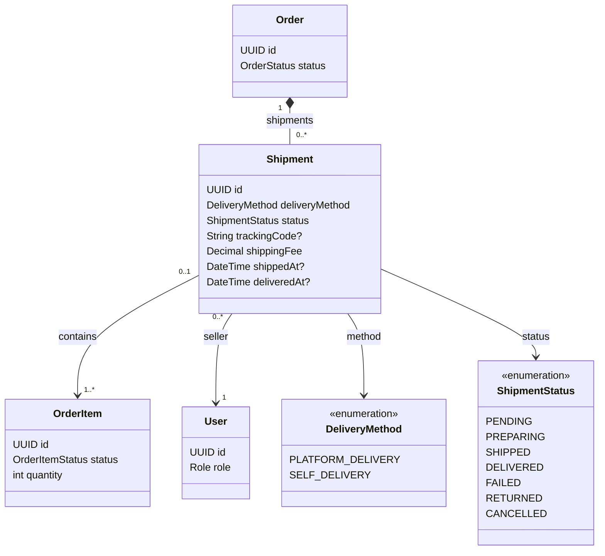

# Shipment Feature

## Purpose

Owns seller shipments, delivery method, tracking data, shipment status, and order delivery completion.

## MVP boundary

Shipment state transitions and stock-restoration rules remain backend requirements for the first order
flow. Customer tracking and Seller shipment-management screens are deferred from the first mobile MVP.

## Responsibilities

- Let sellers choose platform delivery or self delivery.
- Create shipments only from valid confirmed order items.
- Group order items from the same seller.
- Track preparation, shipping, delivery, failure, return-to-warehouse, and cancellation.
- Require tracking data at the correct state transitions.
- Mark an order delivered only after all required shipments are delivered.

## Planned API

```text
POST  /api/v1/seller/shipments
GET   /api/v1/seller/shipments
PATCH /api/v1/seller/shipments/{id}/status
GET   /api/v1/seller/carriers
GET   /api/v1/admin/carriers
POST  /api/v1/admin/carriers
PATCH /api/v1/admin/carriers/{id}
```

## Permissions

| Actor | Allowed operation | Constraint |
|---|---|---|
| SELLER | Create and manage owned shipments | All items must belong to the authenticated seller. |
| CUSTOMER | View shipments for their own order | Must not query another customer's shipment data. |
| ADMIN | Manage carriers (add, rename, activate, deactivate) and monitor operations | Admin is not modeled as the physical shipper. |

## Focused class diagram



## Important rules

- One shipment contains order items from exactly one seller.
- A shipment belongs to exactly one order; every mapped order item must have the same `orderId`.
- In the MVP, one order item belongs to at most one shipment, mapping uses the complete order-item
  line, and one order has at most one shipment per seller. Partial, split, and replacement shipments
  are deferred.
- `SHIPPED` requires `trackingCode` and `shippedAt`.
- `DELIVERED` requires `deliveredAt`.
- `FAILED` means delivery was unsuccessful and does not restore stock.
- `FAILED -> RETURNED` is allowed only after the package reaches the seller warehouse.
- Stock for the shipment is restored only after the `RETURNED` transition succeeds, and only for
  that seller's shipped quantities.
- `PENDING/PREPARING` may be cancelled only before payment completion. Shipment cancellation is an
  atomic operation: it marks all mapped whole order-item lines `CANCELLED` and releases their
  unshipped stock exactly once. If a prepayment is already completed, cancellation is rejected until a
  refund policy exists.
- The cancellation transaction asks the order/payment services to recalculate the payable total and
  pending payment amount. If no non-cancelled lines remain, the order becomes `CANCELLED`; if all
  remaining required shipments are already delivered, aggregate completion is reevaluated immediately.

## Data model

Shipment is seller-scoped even when the customer sees one order. One order can therefore have
multiple independent shipments and outcomes.

### Table relationships

- `orders (1) -> shipments (many)`: each seller may create/manage a separate shipment for the same order.
- `shipments (1) -> order_items (many)` through the planned `shipment_order_items` mapping table.
- `shipment_order_items` has a unique `(shipmentId, orderItemId)` pair and a unique `orderItemId` in
  the MVP; it stores no quantity because the complete order-item line is mapped.
- `shipments.sellerId -> users.id` identifies the seller responsible for the shipment.
- A shipment may contain only order items belonging to its seller.
- `shipments.orderId == order_items.orderId` is mandatory for every mapping.
- `FAILED` and `RETURNED` belong to the shipment; only `RETURNED` triggers stock restoration for its mapped quantities.
- A cancelled shipment does not use the `RETURNED` rule: it releases unshipped stock during the
  cancellation transaction, while `RETURNED` restores only quantities that had already been shipped.

### Field meanings

| Table | Field | Meaning |
|---|---|---|
| `shipments` | `id` | Seller-scoped shipment identifier. |
| `shipments` | `deliveryMethod` | `PLATFORM_DELIVERY` or `SELF_DELIVERY`. |
| `shipments` | `status` | Delivery state, including seller-specific `FAILED` and `RETURNED`. |
| `shipments` | `trackingCode` | Optional until the shipment reaches `SHIPPED`. |
| `shipments` | `shippingFee` | Shipping amount associated with this shipment. |
| `shipments` | `shippedAt` | Required timestamp once status is `SHIPPED`. |
| `shipments` | `deliveredAt` | Required timestamp once status is `DELIVERED`. |
| `shipments` | `orderId` | Parent order. |
| `shipments` | `sellerId` | Seller owner and stock-restoration scope. |
| `shipment_order_items` | `shipmentId` / `orderItemId` | Planned mapping that selects which seller-owned order items are in the shipment. |

The historical V7 migration is a placeholder. V13 creates shipment tables with whole-line mapping;
partial shipment quantity and replacement-shipment fields are intentionally deferred.
