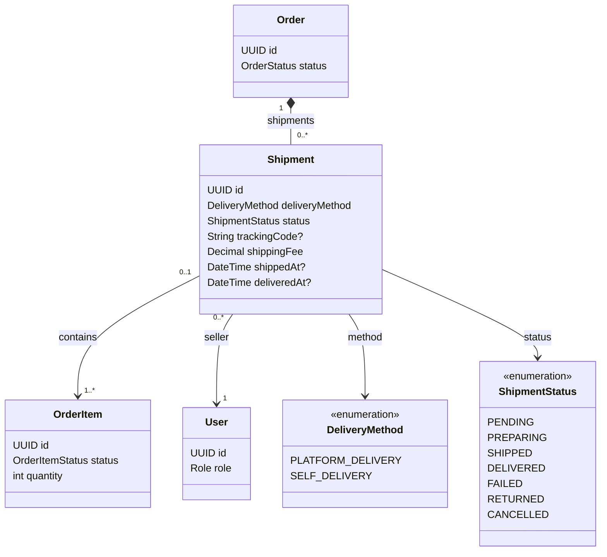

# Tính năng Shipment

## Mục đích

Sở hữu shipment của seller, phương thức giao hàng, dữ liệu theo dõi, trạng thái shipment và hoàn tất giao hàng của đơn hàng.

## Phạm vi MVP

Chuyển trạng thái shipment và quy tắc hoàn tồn kho vẫn là yêu cầu backend cho luồng order đầu tiên. Các màn hình theo dõi của Customer và quản lý shipment của Seller được hoãn khỏi MVP mobile đầu tiên.

## Trách nhiệm

- Cho seller chọn giao hàng nền tảng hoặc tự giao hàng.
- Chỉ tạo shipment từ các order item đã xác nhận hợp lệ.
- Gom các order item cùng một seller.
- Theo dõi chuẩn bị, vận chuyển, giao hàng, thất bại, trả về kho và hủy.
- Yêu cầu dữ liệu theo dõi tại các chuyển trạng thái đúng.
- Đánh dấu đơn hàng đã giao chỉ sau khi mọi shipment bắt buộc được giao.

## API dự kiến

```text
POST  /api/v1/seller/shipments
GET   /api/v1/seller/shipments
PATCH /api/v1/seller/shipments/{id}/status
GET   /api/v1/orders/{orderId}/shipments
```

## Phân quyền

| Tác nhân | Thao tác cho phép | Ràng buộc |
|---|---|---|
| SELLER | Tạo và quản lý shipment thuộc sở hữu | Mọi item phải thuộc về seller đã xác thực. |
| CUSTOMER | Xem shipment cho đơn hàng của mình | Không được truy vấn dữ liệu shipment của customer khác. |
| ADMIN | Cấu hình giao hàng nền tảng và giám sát vận hành | Admin không được mô hình hóa là người giao hàng vật lý. |

## Sơ đồ lớp trọng tâm



## Quy tắc quan trọng

- Một shipment chứa order item của đúng một seller.
- Một shipment thuộc đúng một đơn hàng; mọi order item đã ánh xạ phải có cùng `orderId`.
- Trong MVP, một order item thuộc tối đa một shipment, ánh xạ dùng dòng order-item nguyên vẹn, và một đơn hàng có tối đa một shipment cho mỗi seller. Shipment từng phần, tách và thay thế được hoãn lại.
- `SHIPPED` yêu cầu `trackingCode` và `shippedAt`.
- `DELIVERED` yêu cầu `deliveredAt`.
- `FAILED` nghĩa là giao hàng không thành công và không hoàn tồn kho.
- `FAILED -> RETURNED` chỉ được phép sau khi kiện hàng về tới kho của seller.
- Tồn kho cho shipment chỉ được hoàn sau khi chuyển `RETURNED` thành công, và chỉ cho số lượng đã giao của seller đó.
- `PENDING/PREPARING` chỉ có thể bị hủy trước khi hoàn tất thanh toán. Hủy shipment là thao tác nguyên tử: đánh dấu mọi dòng order-item nguyên vẹn đã ánh xạ thành `CANCELLED` và giải phóng tồn kho chưa giao của chúng đúng một lần. Nếu thanh toán trước đã hoàn tất, hủy bị từ chối cho đến khi có chính sách hoàn tiền.
- Transaction hủy yêu cầu các service order/payment tính lại tổng phải trả và số tiền thanh toán pending. Nếu không còn dòng nào không bị hủy, đơn hàng trở thành `CANCELLED`; nếu mọi shipment bắt buộc còn lại đã được giao, việc hoàn tất gộp được đánh giá lại ngay lập tức.

## Mô hình dữ liệu

Shipment thuộc phạm vi seller ngay cả khi customer thấy một đơn hàng. Do đó một đơn hàng có thể có nhiều shipment và kết quả độc lập.

### Quan hệ bảng

- `orders (1) -> shipments (many)`: mỗi seller có thể tạo/quản lý một shipment riêng cho cùng đơn hàng.
- `shipments (1) -> order_items (many)` qua bảng ánh xạ `shipment_order_items` dự kiến.
- `shipment_order_items` có cặp `(shipmentId, orderItemId)` duy nhất và `orderItemId` duy nhất trong MVP; không lưu số lượng vì dòng order-item nguyên vẹn được ánh xạ.
- `shipments.sellerId -> users.id` xác định seller chịu trách nhiệm cho shipment.
- Một shipment chỉ được chứa các order item thuộc về seller của nó.
- `shipments.orderId == order_items.orderId` là bắt buộc cho mọi ánh xạ.
- `FAILED` và `RETURNED` thuộc về shipment; chỉ `RETURNED` kích hoạt hoàn tồn kho cho các số lượng đã ánh xạ của nó.
- Shipment bị hủy không dùng quy tắc `RETURNED`: nó giải phóng tồn kho chưa giao trong transaction hủy, trong khi `RETURNED` chỉ hoàn các số lượng đã giao trước đó.

### Ý nghĩa trường

| Bảng | Trường | Ý nghĩa |
|---|---|---|
| `shipments` | `id` | Định danh shipment theo phạm vi seller. |
| `shipments` | `deliveryMethod` | `PLATFORM_DELIVERY` hoặc `SELF_DELIVERY`. |
| `shipments` | `status` | Trạng thái giao hàng, gồm `FAILED` và `RETURNED` riêng của seller. |
| `shipments` | `trackingCode` | Tùy chọn cho đến khi shipment đạt `SHIPPED`. |
| `shipments` | `shippingFee` | Phí vận chuyển gắn với shipment này. |
| `shipments` | `shippedAt` | Timestamp bắt buộc khi trạng thái là `SHIPPED`. |
| `shipments` | `deliveredAt` | Timestamp bắt buộc khi trạng thái là `DELIVERED`. |
| `shipments` | `orderId` | Đơn hàng cha. |
| `shipments` | `sellerId` | Seller sở hữu và phạm vi hoàn tồn kho. |
| `shipment_order_items` | `shipmentId` / `orderItemId` | Ánh xạ dự kiến chọn các order item thuộc sở hữu của seller nằm trong shipment. |

Migration V7 lịch sử là placeholder. V13 tạo bảng shipment với ánh xạ cả dòng; shipment từng phần và shipment thay thế được hoãn có chủ ý.
