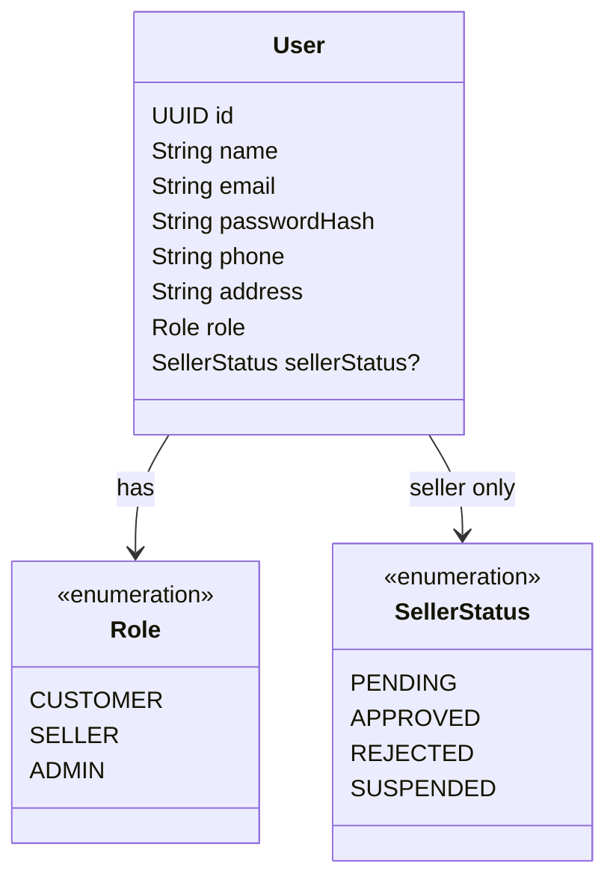

# User Feature

## Purpose

Owns marketplace user data, role classification, and seller approval state.

## Responsibilities

- Persist user identity data.
- Represent `CUSTOMER`, `SELLER`, and `ADMIN` roles.
- Represent seller approval state when seller approval is enabled.
- Support admin user management.
- Provide user ownership information to other feature services.

## Permissions

| Actor | Allowed operation | Constraint |
|---|---|---|
| CUSTOMER | Use and view their own account context | Must not access another user's protected data. |
| SELLER | Use their own seller account context | Selling operations also require seller ownership and approval. |
| ADMIN | Manage users and administrative user state | Admin authorization is required. |
| Other features | Read authenticated user identity | Must use the authenticated principal, not a client-supplied role/user ID. |

## Focused class diagram

## Important rule

`SellerStatus` is required only when `User.role = SELLER`. Role checks and ownership checks are
separate responsibilities.

## Seller onboarding

- Public registration defaults to `CUSTOMER`. A seller application creates `User.role = SELLER`
  with `SellerStatus = PENDING`.
- A new seller request triggers a notification email to the seller (and is visible for admin review).
- Admin approval moves the seller to `APPROVED` and triggers a success email to the seller.
  `REJECTED`/`SUSPENDED` sellers cannot sell.
- Email sending is best-effort and must not roll back the registration/approval transaction.
- The first admin account is bootstrapped from environment configuration when no admin exists;
  public registration can never create an `ADMIN`.

## Data model

User is the identity table referenced by nearly every business feature. It is the source of actor
identity, not a replacement for feature-specific ownership checks.

### Table relationships

- `users.id -> products.sellerId`, `orders.userId`, `order_items.sellerId`, and `shipments.sellerId` establish ownership.
- `users.id -> reviews.userId`, `messages.senderId`, and AI/chat participant fields establish authorship or participation.
- `role` and `sellerStatus` are scalar authorization/onboarding fields; neither is a separate table.

### Field meanings

| Table | Field | Meaning |
|---|---|---|
| `users` | `id` | Primary key used by all user references. |
| `users` | `name` | Logical display/full name; current V1 SQL uses `full_name`. |
| `users` | `email` | Unique account/login identifier. |
| `users` | `passwordHash` | One-way credential hash. |
| `users` | `phone` | Optional contact value in the logical model; not in V1 SQL yet. |
| `users` | `address` | Optional profile address in the logical model; not in V1 SQL yet. |
| `users` | `role` | `CUSTOMER`, `SELLER`, or `ADMIN`. |
| `users` | `sellerStatus` | `PENDING`, `APPROVED`, `REJECTED`, or `SUSPENDED`; nullable for non-sellers. |
| `users` | `enabled` | Account authentication switch; current V1 persistence field. |
| `users` | `createdAt` / `updatedAt` | Account lifecycle timestamps; current V1 persistence fields. |

Do not authorize from a client-supplied `userId`, `role`, or `sellerStatus`; all three must come from
the authenticated server-side principal/database state.
