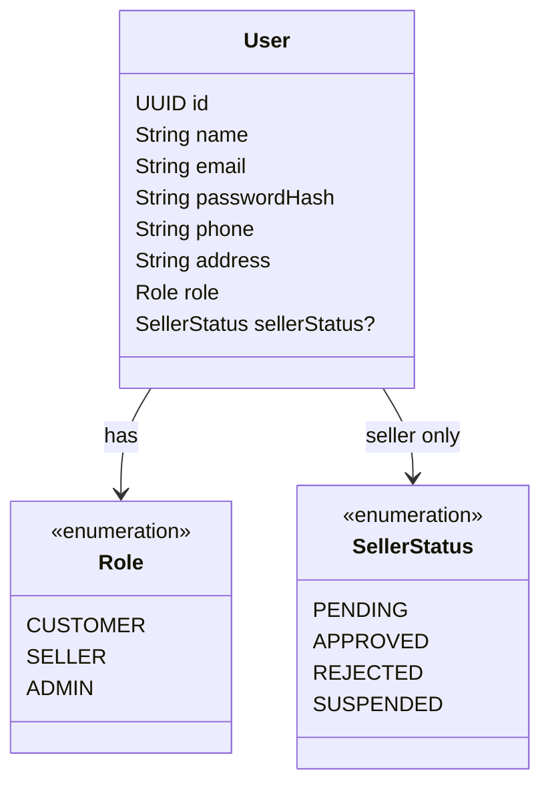

# Tính năng User

## Mục đích

Sở hữu dữ liệu người dùng marketplace, phân loại role và trạng thái phê duyệt seller.

## Trách nhiệm

- Lưu trữ dữ liệu định danh người dùng.
- Thể hiện các role `CUSTOMER`, `SELLER` và `ADMIN`.
- Thể hiện trạng thái phê duyệt seller khi phê duyệt seller được bật.
- Hỗ trợ quản lý người dùng của admin.
- Cung cấp thông tin sở hữu người dùng cho các service tính năng khác.

## Phân quyền

| Tác nhân | Thao tác cho phép | Ràng buộc |
|---|---|---|
| CUSTOMER | Dùng và xem ngữ cảnh tài khoản của chính mình | Không được truy cập dữ liệu được bảo vệ của người dùng khác. |
| SELLER | Dùng ngữ cảnh tài khoản seller của chính mình | Các thao tác bán hàng còn yêu cầu quyền sở hữu và phê duyệt seller. |
| ADMIN | Quản lý người dùng và trạng thái người dùng quản trị | Yêu cầu ủy quyền admin. |
| Các tính năng khác | Đọc định danh người dùng đã xác thực | Phải dùng principal đã xác thực, không dùng role/user ID do client gửi. |

## Sơ đồ lớp trọng tâm

## Quy tắc quan trọng

`SellerStatus` chỉ bắt buộc khi `User.role = SELLER`. Kiểm tra role và kiểm tra sở hữu là hai trách nhiệm riêng biệt.

## Mô hình dữ liệu

User là bảng định danh được gần như mọi tính năng nghiệp vụ tham chiếu. User là nguồn định danh tác nhân, không thay thế kiểm tra sở hữu riêng của từng tính năng.

### Quan hệ bảng

- `users.id -> products.sellerId`, `orders.userId`, `order_items.sellerId` và `shipments.sellerId` thiết lập quyền sở hữu.
- `users.id -> reviews.userId`, `messages.senderId` và các trường participant AI/chat thiết lập tác giả hoặc tham gia.
- `role` và `sellerStatus` là các trường scalar cho ủy quyền/onboarding; không trường nào là bảng riêng.

### Ý nghĩa trường

| Bảng | Trường | Ý nghĩa |
|---|---|---|
| `users` | `id` | Khóa chính dùng bởi mọi tham chiếu người dùng. |
| `users` | `name` | Tên hiển thị/tên đầy đủ logic; SQL V1 hiện tại dùng `full_name`. |
| `users` | `email` | Định danh tài khoản/đăng nhập duy nhất. |
| `users` | `passwordHash` | Hash thông tin xác thực một chiều. |
| `users` | `phone` | Giá trị liên hệ tùy chọn trong mô hình logic; chưa có trong SQL V1. |
| `users` | `address` | Địa chỉ profile tùy chọn trong mô hình logic; chưa có trong SQL V1. |
| `users` | `role` | `CUSTOMER`, `SELLER` hoặc `ADMIN`. |
| `users` | `sellerStatus` | `PENDING`, `APPROVED`, `REJECTED` hoặc `SUSPENDED`; nullable với non-seller. |
| `users` | `enabled` | Công tắc xác thực tài khoản; trường persistence V1 hiện tại. |
| `users` | `createdAt` / `updatedAt` | Timestamp vòng đời tài khoản; các trường persistence V1 hiện tại. |

Không ủy quyền từ `userId`, `role` hay `sellerStatus` do client gửi; cả ba phải lấy từ principal phía server/trạng thái database đã xác thực.
