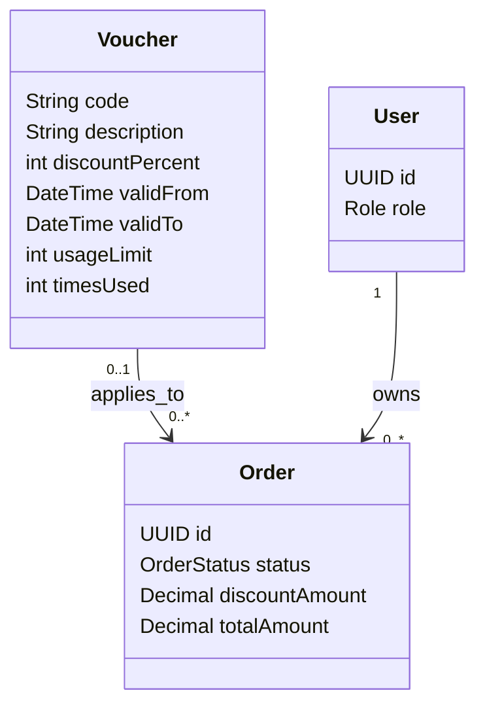

# Voucher Feature

## Purpose

Owns voucher administration, validation, usage limits, and order application rules.

## MVP boundary

Voucher administration and customer voucher application are deferred from the first mobile checkout
slice. Keep the validation and concurrency rules documented here for the later implementation.

## Responsibilities

- Provide Admin voucher CRUD.
- Validate voucher code, validity period, and usage limit.
- Reject expired or exhausted vouchers.
- Apply no more than one voucher to an order.
- Make concurrent final-voucher usage transaction-safe.

## Planned API

```text
POST /api/orders/{id}/voucher
GET  /api/vouchers/{code}/validate
```

## Permissions

| Actor | Allowed operation | Constraint |
|---|---|---|
| ADMIN | Create and manage vouchers | Admin authorization is required. |
| CUSTOMER | Validate/apply a voucher to their own order | Order ownership and voucher rules are checked. |
| SELLER | No direct voucher administration | Seller does not control platform voucher validity. |
| Order service | Consume voucher usage during checkout | Must be transactional and concurrency-safe. |

## Focused class diagram



## Important rules

- One order uses at most one voucher.
- Expired and exhausted vouchers are rejected.
- Concurrent use of the final voucher must not exceed the usage limit.
- Consumption must use an atomic conditional update (or equivalent optimistic locking), for example:
  `UPDATE vouchers SET times_used = times_used + 1 WHERE code = ? AND valid_from <= CURRENT_TIMESTAMP
  AND valid_to > CURRENT_TIMESTAMP AND times_used < usage_limit` inside the checkout transaction.
  The operation succeeds only when one row is updated; a zero-row update rejects the voucher.

## Data model

Voucher is a platform-owned table. Orders keep the applied code and a discount snapshot, while the
voucher row remains the source of validity and usage-limit checks.

### Table relationships

- `vouchers (1) -> orders (many)`: `orders.voucherCode` is optional, so an order may have no voucher.
- One order can reference at most one voucher; a voucher can be applied to many orders within its limits.
- Voucher consumption is coordinated by the order transaction; seller ownership is not involved.

### Field meanings

| Table | Field | Meaning |
|---|---|---|
| `vouchers` | `code` | Unique business identifier entered by the customer. |
| `vouchers` | `description` | Human-readable explanation of the promotion. |
| `vouchers` | `discountPercent` | Percentage discount applied by the checkout rule. |
| `vouchers` | `validFrom` / `validTo` | Inclusive/exclusive validity window used during validation. |
| `vouchers` | `usageLimit` | Maximum successful uses allowed. |
| `vouchers` | `timesUsed` | Atomic count of successful uses so far. |
| `orders` | `voucherCode` | Optional reference to the applied voucher. |
| `orders` | `discountAmount` | Immutable discount amount calculated for that order. |

The historical V5 migration is a placeholder. V13 creates the voucher schema and uniqueness
constraints; transaction-safe usage updates remain a service-layer responsibility.
