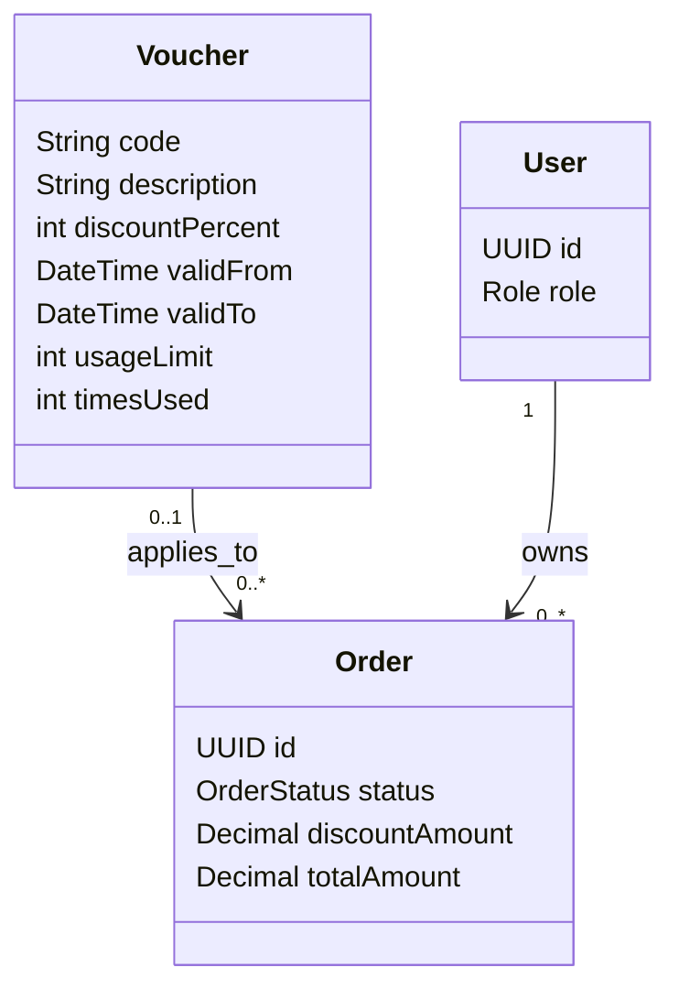

# Tính năng Voucher

## Mục đích

Sở hữu quản trị voucher, kiểm tra hiệu lực, giới hạn sử dụng và quy tắc áp dụng vào đơn hàng.

## Phạm vi MVP

Quản trị voucher và áp dụng voucher của customer được hoãn khỏi lát cắt checkout mobile đầu tiên. Giữ các quy tắc kiểm tra và đồng thời được ghi ở đây cho implementation sau này.

## Trách nhiệm

- Cung cấp CRUD voucher cho Admin.
- Kiểm tra mã voucher, thời hạn hiệu lực và giới hạn sử dụng.
- Từ chối voucher hết hạn hoặc đã dùng hết.
- Áp dụng tối đa một voucher cho một đơn hàng.
- Làm cho lần dùng voucher cuối cùng đồng thời an toàn transaction.

## API dự kiến

```text
GET   /api/v1/vouchers/{code}/validate
GET   /api/v1/admin/vouchers
POST  /api/v1/admin/vouchers
PATCH /api/v1/admin/vouchers/{code}
DELETE /api/v1/admin/vouchers/{code}
```

## Phân quyền

| Tác nhân | Thao tác cho phép | Ràng buộc |
|---|---|---|
| ADMIN | Tạo và quản lý voucher | Yêu cầu ủy quyền admin. |
| CUSTOMER | Kiểm tra/áp dụng voucher cho đơn hàng của mình | Quyền sở hữu đơn hàng và quy tắc voucher được kiểm tra. |
| SELLER | Không quản trị voucher trực tiếp | Seller không kiểm soát hiệu lực voucher nền tảng. |
| Order service | Tiêu thụ lượt dùng voucher trong lúc checkout | Phải theo transaction và an toàn đồng thời. |

## Sơ đồ lớp trọng tâm



## Quy tắc quan trọng

- Một đơn hàng dùng tối đa một voucher.
- Voucher hết hạn và đã dùng hết bị từ chối.
- Dùng đồng thời voucher cuối cùng không được vượt giới hạn sử dụng.
- Tiêu thụ phải dùng cập nhật điều kiện nguyên tử (hoặc optimistic locking tương đương), ví dụ: `UPDATE vouchers SET times_used = times_used + 1 WHERE code = ? AND valid_from <= CURRENT_TIMESTAMP AND valid_to > CURRENT_TIMESTAMP AND times_used < usage_limit` trong transaction checkout. Thao tác chỉ thành công khi một hàng được cập nhật; cập nhật 0 hàng thì từ chối voucher.

## Mô hình dữ liệu

Voucher là bảng thuộc sở hữu của nền tảng. Đơn hàng giữ mã đã áp dụng và snapshot giảm giá, trong khi hàng voucher vẫn là nguồn kiểm tra hiệu lực và giới hạn sử dụng.

### Quan hệ bảng

- `vouchers (1) -> orders (many)`: `orders.voucherCode` là tùy chọn, nên đơn hàng có thể không có voucher.
- Một đơn hàng có thể tham chiếu tối đa một voucher; một voucher có thể áp dụng cho nhiều đơn hàng trong giới hạn của nó.
- Tiêu thụ voucher do transaction order điều phối; quyền sở hữu của seller không liên quan.

### Ý nghĩa trường

| Bảng | Trường | Ý nghĩa |
|---|---|---|
| `vouchers` | `code` | Định danh nghiệp vụ duy nhất do customer nhập. |
| `vouchers` | `description` | Diễn giải khuyến mãi dễ đọc cho con người. |
| `vouchers` | `discountPercent` | Phần trăm giảm giá áp dụng theo quy tắc checkout. |
| `vouchers` | `validFrom` / `validTo` | Cửa sổ hiệu lực bao gồm/loại trừ dùng khi kiểm tra. |
| `vouchers` | `usageLimit` | Số lần dùng thành công tối đa cho phép. |
| `vouchers` | `timesUsed` | Đếm nguyên tử số lần dùng thành công cho đến nay. |
| `orders` | `voucherCode` | Tham chiếu tùy chọn tới voucher đã áp dụng. |
| `orders` | `discountAmount` | Số tiền giảm giá bất biến tính cho đơn hàng đó. |

Migration V5 lịch sử là placeholder. V13 tạo schema voucher và ràng buộc duy nhất; cập nhật lượt dùng an toàn transaction vẫn thuộc trách nhiệm service.
