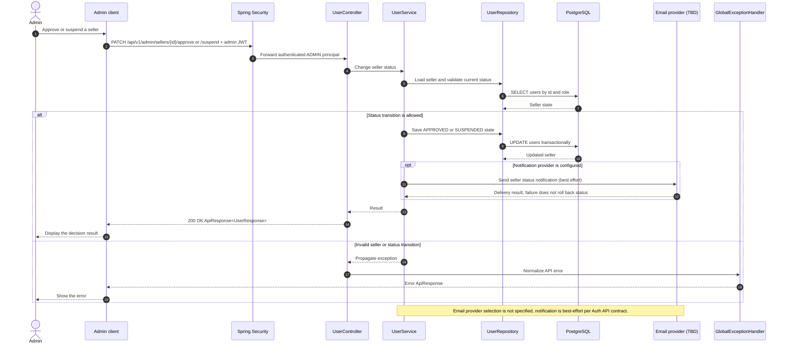

# User - Approve or Suspend Seller — Sequence Diagram

- **Use-case spec:** [approve-or-suspend-seller.vi.md](../../usecase-specification/admin/approve-or-suspend-seller.vi.md)
- **API route/status:** `PATCH /api/v1/admin/sellers/{id}/approve or /suspend` — Predicted
- **Feature API contract:** [features/user/API_CONTRACT.md](../../features/user/API_CONTRACT.md)

> **Target sequence:** endpoint status is not fully Confirmed (see API contract link). Layer names are planned placeholders; the backend scaffold does not yet implement them.

