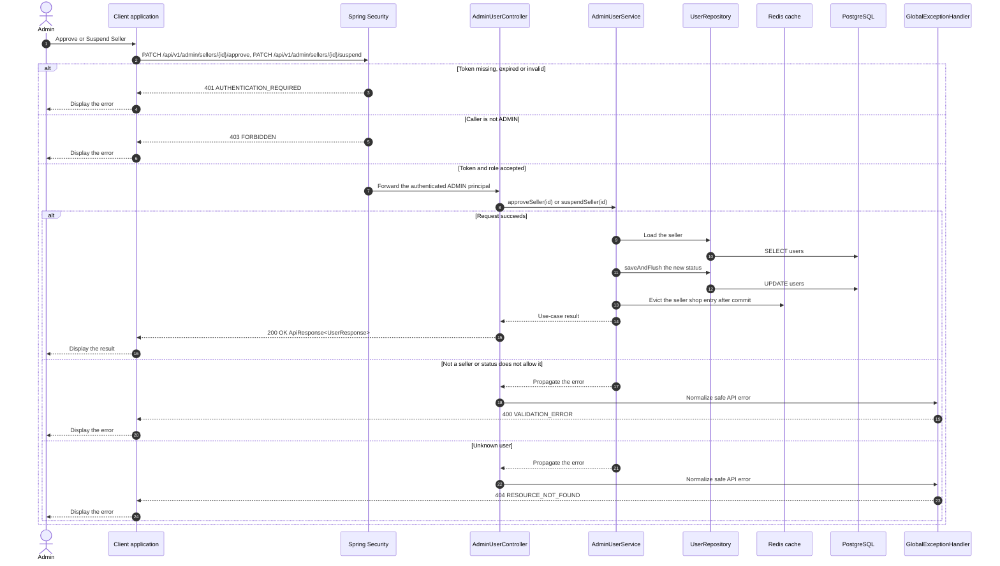

# Admin - Approve or Suspend Seller — Sequence Diagram

- **Use-case spec:** [approve-or-suspend-seller.vi.md](../../usecase-specification/admin/approve-or-suspend-seller.vi.md)
- **API route/status:** `PATCH /api/v1/admin/sellers/{id}/approve, PATCH /api/v1/admin/sellers/{id}/suspend` — Confirmed
- **Feature API contract:** [features/user/API_CONTRACT.md](../../features/user/API_CONTRACT.md)

