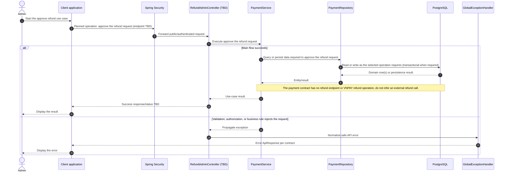

# Payment - Approve Refund — Sequence Diagram

- **Use-case spec:** [approve-refund.vi.md](../../usecase-specification/admin/approve-refund.vi.md)
- **API route/status:** `No refund endpoint is defined; route TBD` — TBD
- **Feature API contract:** [features/payment/API_CONTRACT.md](../../features/payment/API_CONTRACT.md)

> **Target sequence:** route and/or persistence contract is not defined yet. Layer names are planned placeholders; the backend scaffold does not yet implement them. Do not treat this as a frozen API.

