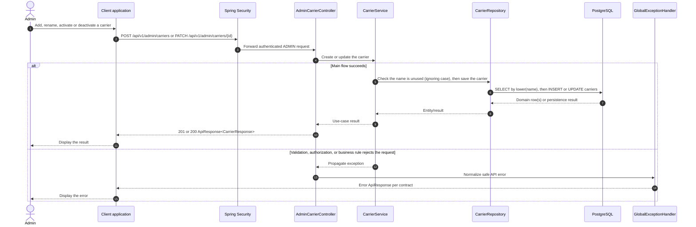

# Shipment - Manage Carriers — Sequence Diagram

- **Use-case spec:** [configure-platform-delivery.vi.md](../../usecase-specification/admin/configure-platform-delivery.vi.md)
- **API route/status:** `GET`/`POST /api/v1/admin/carriers`, `PATCH /api/v1/admin/carriers/{id}` — Confirmed
- **Feature API contract:** [features/shipment/API_CONTRACT.md](../../features/shipment/API_CONTRACT.md)

> Admin manages the carriers that sellers pick for `PLATFORM_DELIVERY`. A carrier is never deleted; deactivating it hides it from sellers.

