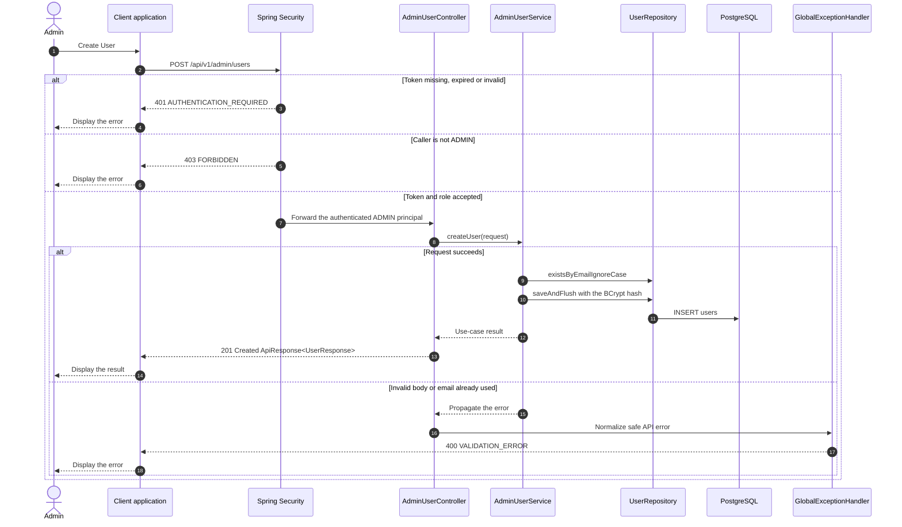

# Admin - Create User — Sequence Diagram

- **Use-case spec:** [create-user.vi.md](../../usecase-specification/admin/create-user.vi.md)
- **API route/status:** `POST /api/v1/admin/users` — Confirmed
- **Feature API contract:** [features/user/API_CONTRACT.md](../../features/user/API_CONTRACT.md)

