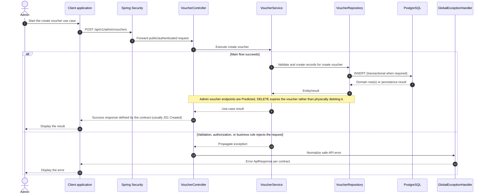

# Voucher - Create Voucher — Sequence Diagram

- **Use-case spec:** [create-voucher.vi.md](../../usecase-specification/admin/create-voucher.vi.md)
- **API route/status:** `POST /api/v1/admin/vouchers` — Predicted
- **Feature API contract:** [features/voucher/API_CONTRACT.md](../../features/voucher/API_CONTRACT.md)

> **Target sequence:** endpoint status is not fully Confirmed (see API contract link). Layer names are planned placeholders; the backend scaffold does not yet implement them.

