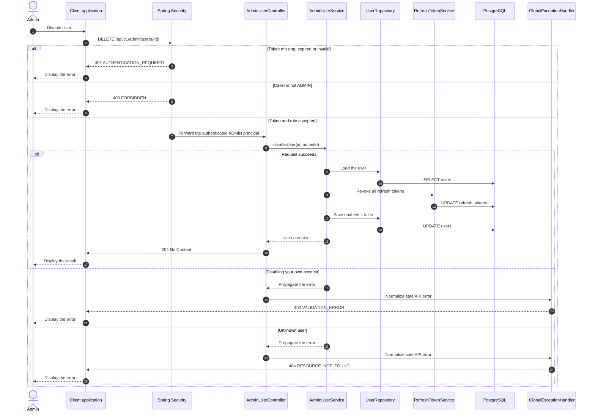

# Admin - Disable User — Sequence Diagram

- **Use-case spec:** [disable-user.vi.md](../../usecase-specification/admin/disable-user.vi.md)
- **API route/status:** `DELETE /api/v1/admin/users/{id}` — Confirmed
- **Feature API contract:** [features/user/API_CONTRACT.md](../../features/user/API_CONTRACT.md)

