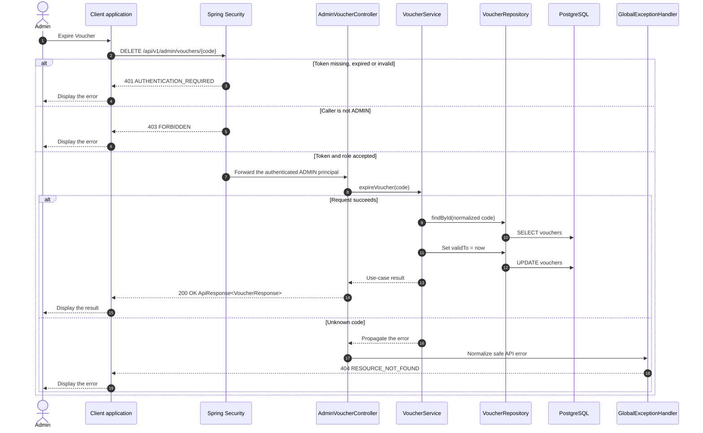

# Voucher - Expire Voucher — Sequence Diagram

- **Use-case spec:** [expire-voucher.vi.md](../../usecase-specification/admin/expire-voucher.vi.md)
- **API route/status:** `DELETE /api/v1/admin/vouchers/{code}` — Confirmed
- **Feature API contract:** [features/voucher/API_CONTRACT.md](../../features/voucher/API_CONTRACT.md)

