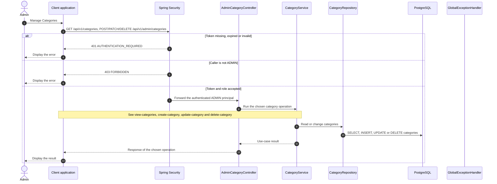

# Category - Manage Categories — Sequence Diagram

- **Use-case spec:** [manage-categories.vi.md](../../usecase-specification/admin/manage-categories.vi.md)
- **API route/status:** `GET /api/v1/categories, POST/PATCH/DELETE /api/v1/admin/categories` — Confirmed
- **Feature API contract:** [features/catalog/API_CONTRACT.md](../../features/catalog/API_CONTRACT.md)

