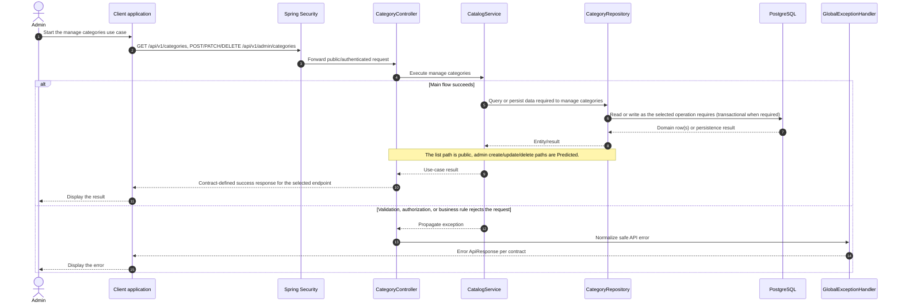

# Category - Manage Categories — Sequence Diagram

- **Use-case spec:** [manage-categories.vi.md](../../usecase-specification/admin/manage-categories.vi.md)
- **API route/status:** `GET /api/v1/categories; POST/PATCH/DELETE /api/v1/admin/categories` — Mixed: confirmed public read + predicted admin writes
- **Feature API contract:** [features/catalog/API_CONTRACT.md](../../features/catalog/API_CONTRACT.md)

> **Target sequence:** endpoint status is not fully Confirmed (see API contract link). Layer names are planned placeholders; the backend scaffold does not yet implement them.

