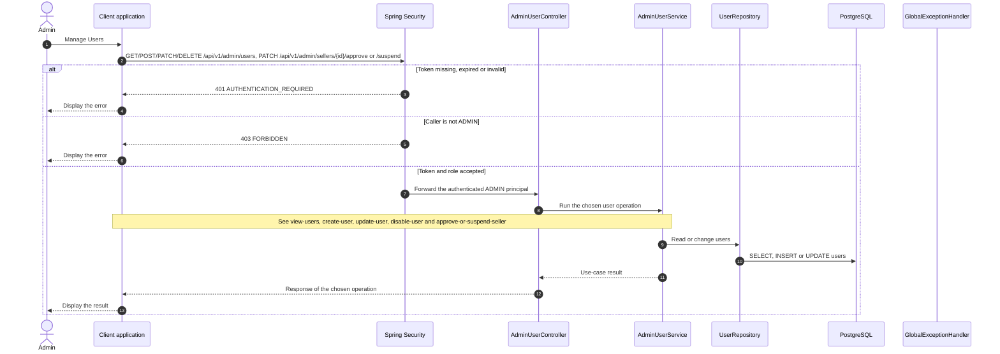

# Admin - Manage Users — Sequence Diagram

- **Use-case spec:** [manage-users.vi.md](../../usecase-specification/admin/manage-users.vi.md)
- **API route/status:** `GET/POST/PATCH/DELETE /api/v1/admin/users, PATCH /api/v1/admin/sellers/{id}/approve or /suspend` — Confirmed
- **Feature API contract:** [features/user/API_CONTRACT.md](../../features/user/API_CONTRACT.md)

