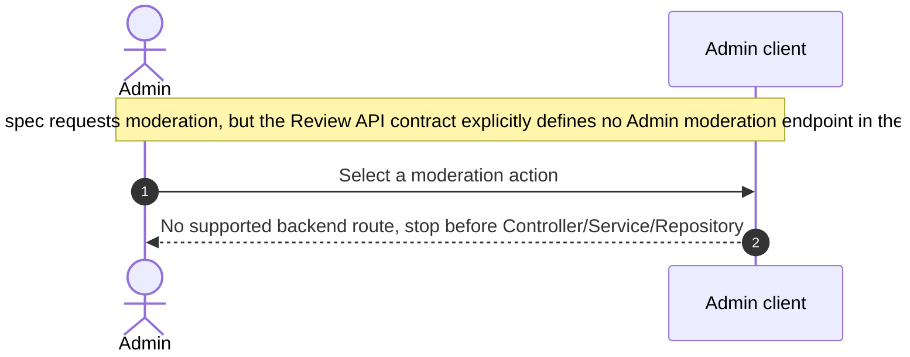

# Review - Moderate Reviews and Violations — Sequence Diagram

- **Use-case spec:** [moderate-reviews-and-violations.vi.md](../../usecase-specification/admin/moderate-reviews-and-violations.vi.md)
- **API route/status:** `No admin moderation endpoint exists in the current MVP contract` — Out of current API scope
- **Feature API contract:** [features/review/API_CONTRACT.md](../../features/review/API_CONTRACT.md)

> **Contract mismatch:** the use-case specification requests Admin review moderation, while the current Review API contract explicitly excludes Admin review actions from the MVP. This diagram therefore stops before inventing a backend endpoint.

