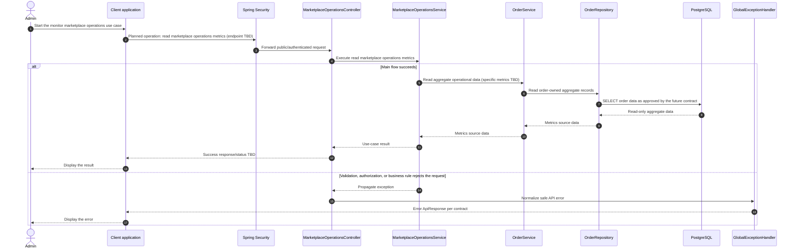

# Admin - Monitor Marketplace Operations — Sequence Diagram

- **Use-case spec:** [monitor-marketplace-operations.vi.md](../../usecase-specification/admin/monitor-marketplace-operations.vi.md)
- **API route/status:** `No monitoring endpoint is defined; route TBD` — TBD
- **API contract:** no feature API contract exists for this operation yet.

> **Target sequence:** route and/or persistence contract is not defined yet. Layer names are planned placeholders; the backend scaffold does not yet implement them. Do not treat this as a frozen API.

