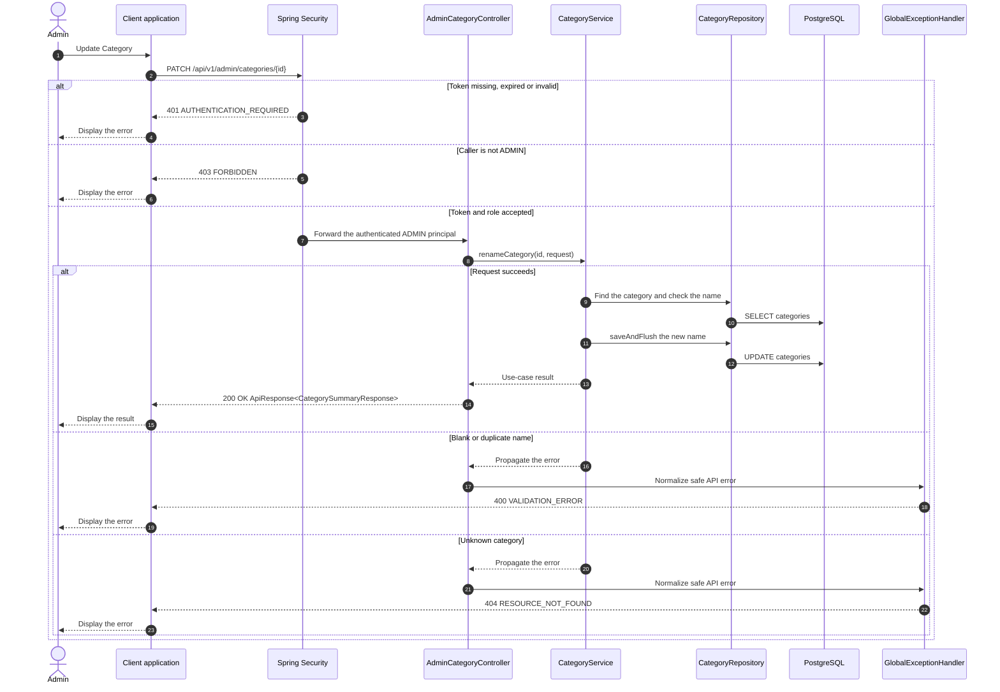

# Category - Update Category — Sequence Diagram

- **Use-case spec:** [update-category.vi.md](../../usecase-specification/admin/update-category.vi.md)
- **API route/status:** `PATCH /api/v1/admin/categories/{id}` — Confirmed
- **Feature API contract:** [features/catalog/API_CONTRACT.md](../../features/catalog/API_CONTRACT.md)

