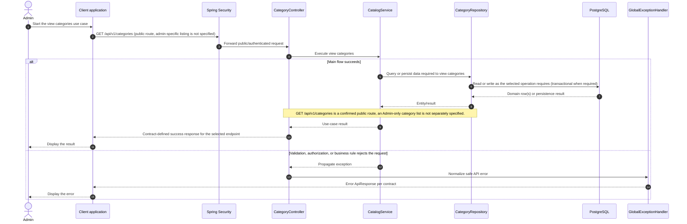

# Category - View Categories — Sequence Diagram

- **Use-case spec:** [view-categories.vi.md](../../usecase-specification/admin/view-categories.vi.md)
- **API route/status:** `GET /api/v1/categories (public route; admin-specific listing is not specified)` — Confirmed public read
- **Feature API contract:** [features/catalog/API_CONTRACT.md](../../features/catalog/API_CONTRACT.md)

> **Target sequence:** controller/service/repository names are planned placeholders; the current backend scaffold does not yet implement these layers.

