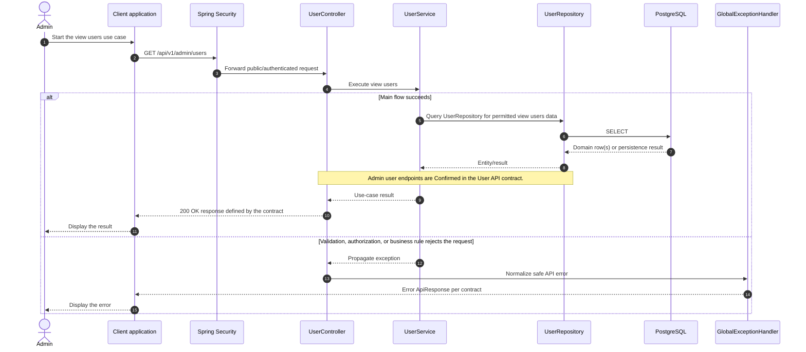

# User - View Users — Sequence Diagram

- **Use-case spec:** [view-users.vi.md](../../usecase-specification/admin/view-users.vi.md)
- **API route/status:** `GET /api/v1/admin/users` — Confirmed
- **Feature API contract:** [features/user/API_CONTRACT.md](../../features/user/API_CONTRACT.md)

> **Target sequence:** controller/service/repository names are planned placeholders; the current backend scaffold does not yet implement these layers.

