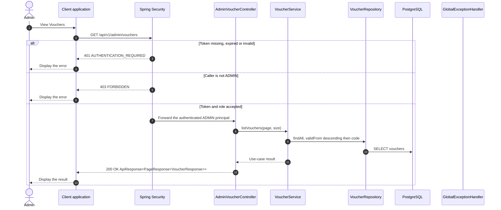

# Voucher - View Vouchers — Sequence Diagram

- **Use-case spec:** [view-vouchers.vi.md](../../usecase-specification/admin/view-vouchers.vi.md)
- **API route/status:** `GET /api/v1/admin/vouchers` — Confirmed
- **Feature API contract:** [features/voucher/API_CONTRACT.md](../../features/voucher/API_CONTRACT.md)

