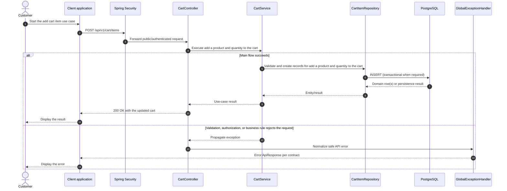

# Cart - Add Cart Item — Sequence Diagram

- **Use-case spec:** [add-cart-item.vi.md](../../usecase-specification/customer/add-cart-item.vi.md)
- **API route/status:** `POST /api/v1/cart/items` — Confirmed
- **Feature API contract:** [features/cart/API_CONTRACT.md](../../features/cart/API_CONTRACT.md)

> **Target sequence:** controller/service/repository names are planned placeholders; the current backend scaffold does not yet implement these layers.

